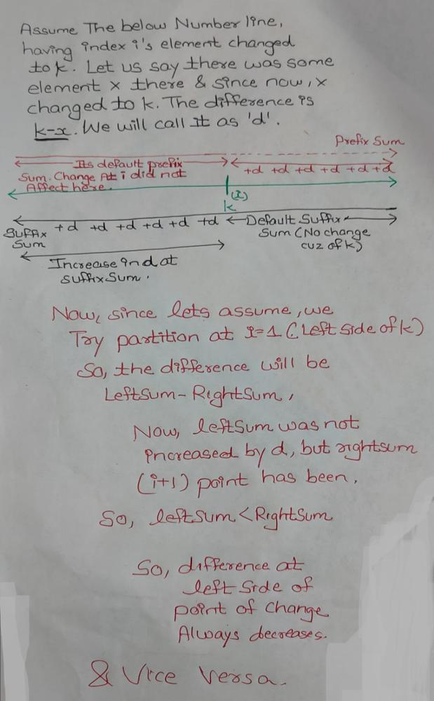

# [C++] Code for Beginners || Visualized Through Example AND Explaination || Easy understandable

**Author:** Decode_Apocalypse
**Votes:** 11
**Link:** [https://leetcode.com/problems/maximum-number-of-ways-to-partition-an-array/solutions/1935142/](https://leetcode.com/problems/maximum-number-of-ways-to-partition-an-array/solutions/1935142/)

---


TO UNDERSTAND PROPERLY, RUN BELOW CODE TO SEE

Lets try to see what happens when we change a certain index to k

```
#include <bits/stdc++.h>
using namespace std;

void resetAndRecalculate(vector<int> &prefix, vector<int> &suffix, vector<int> &arr){
    cout<<endl;
    prefix=arr;
    suffix=arr;
    for(int i=1;i<arr.size();i++){
        prefix[i]=prefix[i]+prefix[i-1];
    }
    for(int i=arr.size()-2;i>=0;i--){
        suffix[i]=suffix[i]+suffix[i+1];
    }
    cout<<"RECALCULATED PREFIX:- ";
    for(auto e: prefix){
        cout<<e<<" ";
    }
    cout<<endl<<"RECALCULATED SUFFIX:- ";
    for(auto e: suffix){
        cout<<e<<" ";
    }
    cout<<endl;
}
 
void Solve(vector<int> &arr, int k){
    int n=arr.size();
    vector<int> prefix=arr;
    vector<int> suffix=arr;
    for(int i=1;i<n;i++){
        prefix[i]=prefix[i]+prefix[i-1];
    }
    for(int i=n-2;i>=0;i--){
        suffix[i]=suffix[i]+suffix[i+1];
    }
    vector<int> origDifference(n);
    cout<<"DIFFERENCE WITHOUT REPLACEMENT "<<endl;
    for(int i=0;i<n-1;i++){
        origDifference[i]=prefix[i]-suffix[i+1];
        cout<<origDifference[i]<<" ";
    }
    cout<<endl;
    for(int i=0;i<n-1;i++){
        cout<<endl;
        vector<int> temp=arr;
        temp[i]=k;
        cout<<"i= "<<i<<endl;
        cout<<"Difference is d- "<<k-arr[i]<<endl;
        cout<<"ARRAY- ";
        for(auto e: temp){
            cout<<e<<" ";
        }
        resetAndRecalculate(prefix,suffix,temp);
        vector<int> tempDiff(n);
        cout<<"DIFFERENCE- ";
        for(int i=0;i<n-1;i++){
            tempDiff[i]=prefix[i]-suffix[i+1];
            cout<<tempDiff[i]<<" ";
        }
        cout<<endl<<"DIFFERENCE WRT TO origDifference "<<endl;
        for(int i=0;i<n-1;i++){
            cout<<origDifference[i]-tempDiff[i]<<" ";
        }
        cout<<endl;
    }
    
}

int main() {
    vector<int> arr={22,4,-25,-20,-15,15,-16,7,19,-10,0,-13,-14};
    int k=-33;
    cout<<"ORIGINAL ARRAY: -"<<endl;
    for(auto e: arr){
        cout<<e<<" ";
    }
    cout<<endl<<endl;
    Solve(arr,k);

    return 0;
}
```
# Just observe how left side of i is decreasing by d and right side increases by d

```
ORIGINAL ARRAY: -
22 4 -25 -20 -15 15 -16 7 19 -10 0 -13 -14 

DIFFERENCE WITHOUT REPLACEMENT 
90 98 48 8 -22 8 -24 -10 28 8 8 -18 

i= 0
Difference is d- -55
ARRAY- -33 4 -25 -20 -15 15 -16 7 19 -10 0 -13 -14 
RECALCULATED PREFIX:- -33 -29 -54 -74 -89 -74 -90 -83 -64 -74 -74 -87 -101 
RECALCULATED SUFFIX:- -101 -68 -72 -47 -27 -12 -27 -11 -18 -37 -27 -27 -14 
DIFFERENCE- 35 43 -7 -47 -77 -47 -79 -65 -27 -47 -47 -73 
DIFFERENCE WRT TO origDifference 
55 55 55 55 55 55 55 55 55 55 55 55 // since we changed i=0, there is no change seen, since left does not exist

i= 1
Difference is d- -37
ARRAY- 22 -33 -25 -20 -15 15 -16 7 19 -10 0 -13 -14 
RECALCULATED PREFIX:- 22 -11 -36 -56 -71 -56 -72 -65 -46 -56 -56 -69 -83 
RECALCULATED SUFFIX:- -83 -105 -72 -47 -27 -12 -27 -11 -18 -37 -27 -27 -14 
DIFFERENCE- 127 61 11 -29 -59 -29 -61 -47 -9 -29 -29 -55 
DIFFERENCE WRT TO origDifference 
-37 37 37 37 37 37 37 37 37 37 37 37  // when changed arr[i]=k, seen all j<i are getting decreased by d

i= 2
Difference is d- -8
ARRAY- 22 4 -33 -20 -15 15 -16 7 19 -10 0 -13 -14 
RECALCULATED PREFIX:- 22 26 -7 -27 -42 -27 -43 -36 -17 -27 -27 -40 -54 
RECALCULATED SUFFIX:- -54 -76 -80 -47 -27 -12 -27 -11 -18 -37 -27 -27 -14 
DIFFERENCE- 98 106 40 0 -30 0 -32 -18 20 0 0 -26   // These zeros are the points of partitions 
DIFFERENCE WRT TO origDifference 
-8 -8 8 8 8 8 8 8 8 8 8 8  // when changed arr[i]=k, seen all j<i are getting decreased by d

i= 3
Difference is d- -13
ARRAY- 22 4 -25 -33 -15 15 -16 7 19 -10 0 -13 -14 
RECALCULATED PREFIX:- 22 26 1 -32 -47 -32 -48 -41 -22 -32 -32 -45 -59 
RECALCULATED SUFFIX:- -59 -81 -85 -60 -27 -12 -27 -11 -18 -37 -27 -27 -14 
DIFFERENCE- 103 111 61 -5 -35 -5 -37 -23 15 -5 -5 -31 
DIFFERENCE WRT TO origDifference 
-13 -13 -13 13 13 13 13 13 13 13 13 13 

i= 4
Difference is d- -18
ARRAY- 22 4 -25 -20 -33 15 -16 7 19 -10 0 -13 -14 
RECALCULATED PREFIX:- 22 26 1 -19 -52 -37 -53 -46 -27 -37 -37 -50 -64 
RECALCULATED SUFFIX:- -64 -86 -90 -65 -45 -12 -27 -11 -18 -37 -27 -27 -14 
DIFFERENCE- 108 116 66 26 -40 -10 -42 -28 10 -10 -10 -36 
DIFFERENCE WRT TO origDifference 
-18 -18 -18 -18 18 18 18 18 18 18 18 18 

i= 5
Difference is d- -48
ARRAY- 22 4 -25 -20 -15 -33 -16 7 19 -10 0 -13 -14 
RECALCULATED PREFIX:- 22 26 1 -19 -34 -67 -83 -76 -57 -67 -67 -80 -94 
RECALCULATED SUFFIX:- -94 -116 -120 -95 -75 -60 -27 -11 -18 -37 -27 -27 -14 
DIFFERENCE- 138 146 96 56 26 -40 -72 -58 -20 -40 -40 -66 
DIFFERENCE WRT TO origDifference 
-48 -48 -48 -48 -48 48 48 48 48 48 48 48 

i= 6
Difference is d- -17
ARRAY- 22 4 -25 -20 -15 15 -33 7 19 -10 0 -13 -14 
RECALCULATED PREFIX:- 22 26 1 -19 -34 -19 -52 -45 -26 -36 -36 -49 -63 
RECALCULATED SUFFIX:- -63 -85 -89 -64 -44 -29 -44 -11 -18 -37 -27 -27 -14 
DIFFERENCE- 107 115 65 25 -5 25 -41 -27 11 -9 -9 -35 
DIFFERENCE WRT TO origDifference 
-17 -17 -17 -17 -17 -17 17 17 17 17 17 17 

i= 7
Difference is d- -40
ARRAY- 22 4 -25 -20 -15 15 -16 -33 19 -10 0 -13 -14 
RECALCULATED PREFIX:- 22 26 1 -19 -34 -19 -35 -68 -49 -59 -59 -72 -86 
RECALCULATED SUFFIX:- -86 -108 -112 -87 -67 -52 -67 -51 -18 -37 -27 -27 -14 
DIFFERENCE- 130 138 88 48 18 48 16 -50 -12 -32 -32 -58 
DIFFERENCE WRT TO origDifference 
-40 -40 -40 -40 -40 -40 -40 40 40 40 40 40 

i= 8
Difference is d- -52
ARRAY- 22 4 -25 -20 -15 15 -16 7 -33 -10 0 -13 -14 
RECALCULATED PREFIX:- 22 26 1 -19 -34 -19 -35 -28 -61 -71 -71 -84 -98 
RECALCULATED SUFFIX:- -98 -120 -124 -99 -79 -64 -79 -63 -70 -37 -27 -27 -14 
DIFFERENCE- 142 150 100 60 30 60 28 42 -24 -44 -44 -70 
DIFFERENCE WRT TO origDifference 
-52 -52 -52 -52 -52 -52 -52 -52 52 52 52 52 

i= 9
Difference is d- -23
ARRAY- 22 4 -25 -20 -15 15 -16 7 19 -33 0 -13 -14 
RECALCULATED PREFIX:- 22 26 1 -19 -34 -19 -35 -28 -9 -42 -42 -55 -69 
RECALCULATED SUFFIX:- -69 -91 -95 -70 -50 -35 -50 -34 -41 -60 -27 -27 -14 
DIFFERENCE- 113 121 71 31 1 31 -1 13 51 -15 -15 -41 
DIFFERENCE WRT TO origDifference 
-23 -23 -23 -23 -23 -23 -23 -23 -23 23 23 23 

i= 10
Difference is d- -33
ARRAY- 22 4 -25 -20 -15 15 -16 7 19 -10 -33 -13 -14 
RECALCULATED PREFIX:- 22 26 1 -19 -34 -19 -35 -28 -9 -19 -52 -65 -79 
RECALCULATED SUFFIX:- -79 -101 -105 -80 -60 -45 -60 -44 -51 -70 -60 -27 -14 
DIFFERENCE- 123 131 81 41 11 41 9 23 61 41 -25 -51 
DIFFERENCE WRT TO origDifference 
-33 -33 -33 -33 -33 -33 -33 -33 -33 -33 33 33 

i= 11
Difference is d- -20
ARRAY- 22 4 -25 -20 -15 15 -16 7 19 -10 0 -33 -14 
RECALCULATED PREFIX:- 22 26 1 -19 -34 -19 -35 -28 -9 -19 -19 -52 -66 
RECALCULATED SUFFIX:- -66 -88 -92 -67 -47 -32 -47 -31 -38 -57 -47 -47 -14 
DIFFERENCE- 110 118 68 28 -2 28 -4 10 48 28 28 -38 
DIFFERENCE WRT TO origDifference 
-20 -20 -20 -20 -20 -20 -20 -20 -20 -20 -20 20 
```

**THE MAIN REASON BEHIND THIS BEHAVIOUR
LEFT SIDE OF POINT OF CHANGE DECREASES 
AND 
RIGHT SIDE INCLUDING CHANGE POINT INCREASES BY K**




# CODE
```
class Solution {
public:
    
    int waysToPartition(vector<int>& nums, int k) {
        unordered_map<long long int,int> left;  
        unordered_map<long long int,int> right;   
        
        long long int sum=accumulate(nums.begin(),nums.end(),0L);
        long long int leftSum=0;
        int n=nums.size();
        
        for(int i=0;i<n-1;i++){
            leftSum+=nums[i];
            long long int rightSum=sum-leftSum;
            long long int difference=leftSum-rightSum;
            right[difference]++; //storing difference count in right, since no difference exist in left
        }
        
        int res=right[0];        // Point Zero difference are the partition points                       
        leftSum=0;
        for(int i=0;i<n;i++){
            long long int D=k-nums[i];  
            res=max(res,right[-D]+left[D]);  // We can run a few test cases and see that if we replace arr[i] by k, the difference D, the left side including i,each element decreases by D while the right Side each element increases by D, so we find -D on right Side... WHY?? if right side is increasing by D, we need to find -D since this will result in -D+D=0, which are our partition points, since point 0 signifies a partition where leftSum==rightSum, similarly, left side decreases by D, so we find +D on left since this will result in zero as well.

            leftSum+=nums[i];
            long long int rightSum=sum-leftSum;
            left[leftSum-rightSum]++;   //Now since we are moving our i forward, we are gonna change the next i point, so we are placing leftSum-RightSum on left side  
            right[leftSum-rightSum]--;  // From right we are gonna decrease it and transfer to left side
            if(right[leftSum-rightSum]==0){
                right.erase(leftSum-rightSum);
            }
        }
        return res;
    }
};
```

