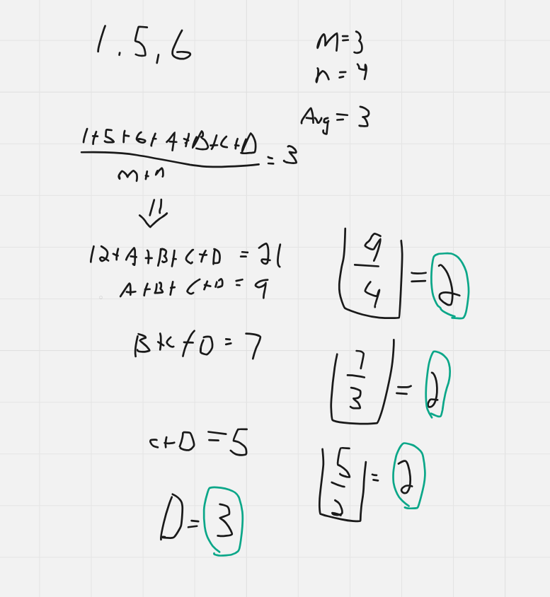

# Dart Solution

**Author:** Friendlygecko
**Votes:** 1
**Link:** [https://leetcode.com/problems/find-missing-observations/solutions/5108452/](https://leetcode.com/problems/find-missing-observations/solutions/5108452/)

---

# Intuition
<!-- Describe your first thoughts on how to solve this problem. -->

# Approach
<!-- Describe your approach to solving the problem. -->

# Complexity
- Time complexity:
<!-- Add your time complexity here, e.g. $$O(n)$$ -->

- Space complexity:
<!-- Add your space complexity here, e.g. $$O(n)$$ -->

# Code
```
class Solution {
    List<int> missingRolls(List<int> rolls, int mean, int n) {
        final sum = rolls.fold<int>(0, (a, b) => a + b);
        final m = rolls.length;
        final totalRolls = m + n;
        final total = mean * totalRolls;
        var target = total - sum;
        final List<int> ans = [];
        while (target > 0) {
            final ret = target ~/ n;
            if (ret > 6 || ret <= 0) {
                return [];
            }
            target -= ret;
            n -= 1;
            ans.add(ret);
        }

        return ans;
    }
}
```
image.png
