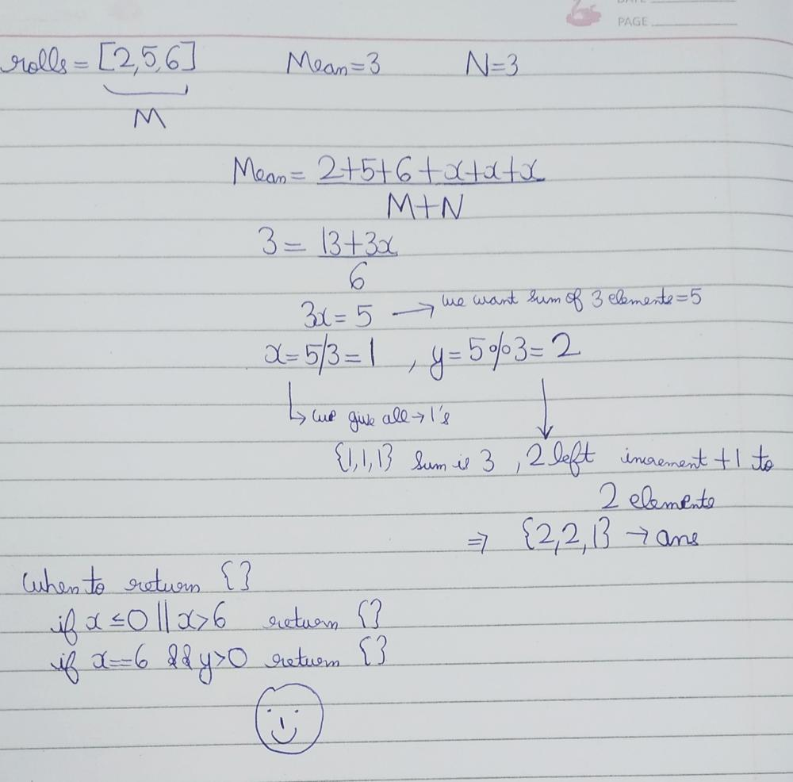

# 🧩 Solve the Dice Mean Problem: Code in C++,Java, JavaScript, Python & Ruby 🎲

**Author:** Garv_Virmani
**Votes:** 31
**Link:** [https://leetcode.com/problems/find-missing-observations/solutions/5741446/](https://leetcode.com/problems/find-missing-observations/solutions/5741446/)

---

# Intuition
<!-- Describe your first thoughts on how to solve this problem. -->
To solve the problem, we need to determine which values the missing dice rolls should have to achieve the desired mean when combined with the given dice rolls. We will calculate the total sum required to reach the desired mean, subtract the sum of the given rolls to find the total sum of the missing rolls, and then distribute this total sum into the missing rolls.
# Approach
<!-- Describe your approach to solving the problem. -->


1. Calculate Total Sum Required:

2. Determine the total sum of all rolls (both known and unknown) required to achieve the given mean. This is computed as (mean * total number of rolls) where total number of rolls = number of given rolls + number of missing rolls.

3. Determine Missing Sum:

Subtract the sum of the known rolls from the total sum required to get the sum of the missing rolls.


4. Validate Feasibility:

Check if it's possible to distribute this missing sum into the missing rolls such that each roll value is between 1 and 6.


5. Distribute Missing Sum:

Compute the base value for each missing roll and any extra value that needs to be distributed. Construct the result vector accordingly.

6. Return Result:

Return the vector containing the values for the missing rolls if feasible; otherwise, return an empty vector.


# Complexity
- Time complexity:
<!-- Add your time complexity here, e.g. $$O(n)$$ -->
O(N)
The solution involves iterating through the list of rolls and performing some constant-time operations, which results in linear time complexity with respect to the number of missing rolls.

- Space complexity:
<!-- Add your space complexity here, e.g. $$O(n)$$ -->
O(N)
The space complexity is primarily due to the storage required for the result vector of missing rolls.
# Code

```cpp []
class Solution {
public:
    vector<int> missingRolls(vector<int>& rolls, int mean, int n) {
        int m=rolls.size(),sumM=0;
        for(auto x:rolls) sumM+=x;
        int rhs=mean*(n+m);
        rhs-=sumM;
        int x=rhs/n,y=rhs%n;
        if(x<=0 || x>6) return {};
        if(x==6 && y>0) return {};
        vector<int>ans(n);
        for(int i=0;i<n;i++){
            ans[i]=x;
        }
        for(int i=0;i<y;i++){
            ans[i]++;
        }
        return ans;
    }
};
```

```javascript []
class Solution {
    missingRolls(rolls, mean, n) {
        let m = rolls.length;
        let sumM = rolls.reduce((a, b) => a + b, 0);
        let totalSum = mean * (n + m);
        let missingSum = totalSum - sumM;
        let baseValue = Math.floor(missingSum / n);
        let remainder = missingSum % n;

        if (baseValue <= 0 || baseValue > 6 || (baseValue === 6 && remainder > 0)) {
            return [];
        }

        let result = new Array(n).fill(baseValue);
        for (let i = 0; i < remainder; ++i) {
            result[i]++;
        }
        return result;
    }
}

```
``` java []
import java.util.*;

class Solution {
    public int[] missingRolls(int[] rolls, int mean, int n) {
        int m = rolls.length;
        int sumM = 0;
        for (int roll : rolls) {
            sumM += roll;
        }
        int totalSum = mean * (n + m);
        int missingSum = totalSum - sumM;
        int baseValue = missingSum / n;
        int remainder = missingSum % n;
        
        if (baseValue <= 0 || baseValue > 6 || (baseValue == 6 && remainder > 0)) {
            return new int[]{};
        }
        
        int[] result = new int[n];
        Arrays.fill(result, baseValue);
        for (int i = 0; i < remainder; ++i) {
            result[i]++;
        }
        return result;
    }
}
```
```python []
class Solution:
    def missingRolls(self, rolls, mean: int, n: int):
        m = len(rolls)
        sumM = sum(rolls)
        total_sum = mean * (n + m)
        missing_sum = total_sum - sumM
        base_value = missing_sum // n
        remainder = missing_sum % n

        if base_value <= 0 or base_value > 6 or (base_value == 6 and remainder > 0):
            return []

        result = [base_value] * n
        for i in range(remainder):
            result[i] += 1
        return result

```
```ruby []
class Solution
  def missing_rolls(rolls, mean, n)
    m = rolls.length
    sum_m = rolls.sum
    total_sum = mean * (n + m)
    missing_sum = total_sum - sum_m
    base_value = missing_sum / n
    remainder = missing_sum % n

    return [] if base_value <= 0 || base_value > 6 || (base_value == 6 && remainder > 0)

    result = Array.new(n, base_value)
    remainder.times { |i| result[i] += 1 }
    result
  end
end

```
-----


> Upvote If Helpful
If you found this explanation and the provided code translations helpful, please consider upvoting or providing feedback. Your support helps improve the quality and reach of the content!


