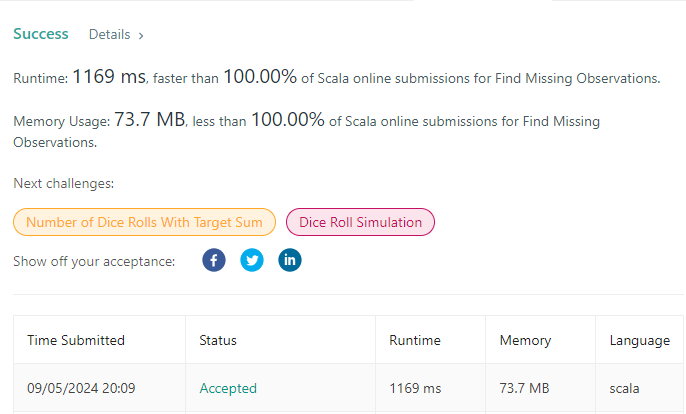

# Scala Solution. 100% time / memory

**Author:** densungkim
**Votes:** 0
**Link:** [https://leetcode.com/problems/find-missing-observations/solutions/5741986/](https://leetcode.com/problems/find-missing-observations/solutions/5741986/)

---

```
object Solution {
  def missingRolls(rolls: Array[Int], mean: Int, n: Int): Array[Int] = {
    val remaining = mean * (rolls.length + n) - rolls.sum
    if (remaining > n * 6 || remaining < n) Array.empty[Int]
    else {
      @annotation.tailrec
      def loop(index: Int, rest: Int, acc: Array[Int]): Array[Int] =
        if (index >= acc.length) acc
        else {
          val toAdd = math.min(6, rest - (n - index - 1)
          acc(index) = toAdd
          loop(index + 1, rest - toAdd, acc)
        }
      loop(0, remaining, Array.fill(n)(0))
    }
  }
}
```

