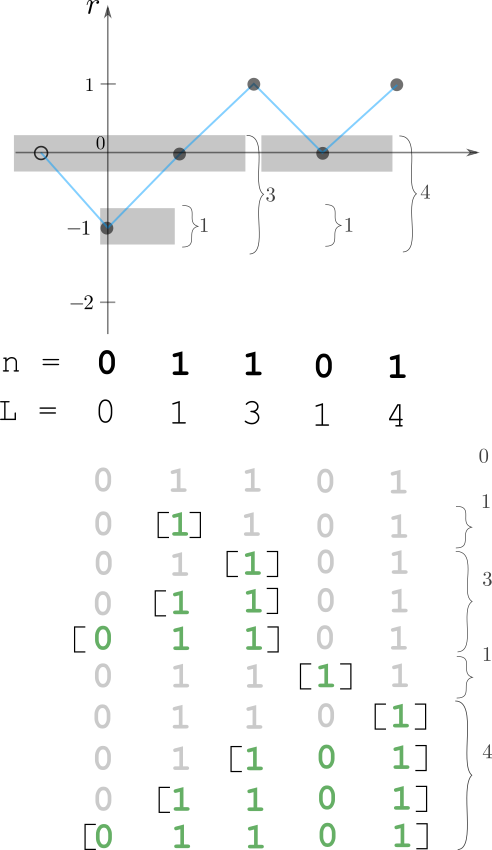

# linear/hashmap ^^

**Author:** andrii_khlevniuk
**Votes:** 2
**Link:** [https://leetcode.com/problems/count-subarrays-with-more-ones-than-zeros/solutions/2399971/](https://leetcode.com/problems/count-subarrays-with-more-ones-than-zeros/solutions/2399971/)

---

**1 pass/double counting**
**time: `O(N)`; space: `O(1)`**



```
int subarraysWithMoreZerosThanOnes(vector<int> & nn)
{
	int out{};
	unordered_map<int, int> m{{0,1}};
	for(int r{}, L{}; const auto & n : nn)
	{
		L += n ? m[r++] : -m[--r];
		out = (out+L)%1000000007; 
		++m[r];
	}
	return out;
}
```
**Notation:**
`r` - **r**unning sum counter: `1 -> r+=1; -1 -> r-=1`. This `r` is delta = the difference between number of `1s` and `0s`.
`L` - number of points the running sum of which is **l**ess then the current running sum `r`.


**Extra**
By the way the number of `1`-dominated subsequences in the following vectors:


form the [Centered square number](https://en.wikipedia.org/wiki/Centered_square_number) sequence while those


generate [Triangular number](https://en.wikipedia.org/wiki/Centered_square_number) sequence and those


generate natural numbers.


