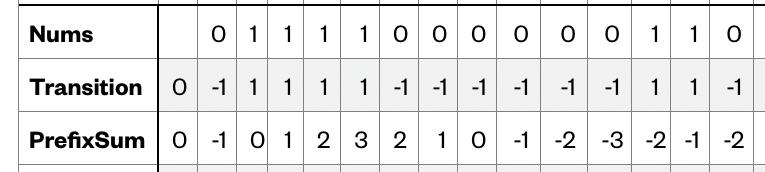
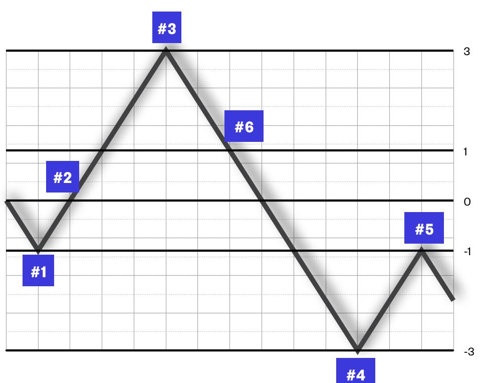

# Most understandable answer with diagram (Java)

**Author:** randytanpty
**Votes:** 12
**Link:** [https://leetcode.com/problems/count-subarrays-with-more-ones-than-zeros/solutions/1729813/](https://leetcode.com/problems/count-subarrays-with-more-ones-than-zeros/solutions/1729813/)

---




We can use a sample("01111000000110") to depict all the scenarios. 

Step1: we transit "0" to "-1".
Step2: we create a prefixSum array. Prefix[i] is the sum from nums[0] to nums[i](after transition).

Then, our new problem is: for any index i, how many points before the ith point is lower than it. 

Step3: 
In #2 and #3, these points are the new highest points. In #2, it is higher than all points before except zero. In #3, it is higher than all points before.
In #1 and  #4, they are lower than all points before, so they have no contribution.
In #5 and #6, they have previous points before. If values are lower than the first "1", they will be lower than the second "1". Therefore, the basic value of repeated value is the value of its precedent. For #6, it inheritances three from its precedent(0, -1, 0). For #5, it gets nothing. Then, we need to calculate the offset value from the precedent index to the ith point. For #5, they are three points (-2, -3, -2). For #6, this is nothing. 
Tip 1: We can approve that all points between #5  and its precedent are lower than it. Because #5 is higher than the point before it and #5 is a repeated point. For #6, vice versa, its contribution is always 0.
Tip 2: We can use a small trick to identify the situation is #5 or #6 when we meet repeated numbers. If nums[i] is 1, it is a #5 situation; otherwise, it is a #6 situation. It also can identify a new point in the hashmap as a new highest point(#2, #3) or a new lowest one(#1, #4).

```
class Solution {
    public int subarraysWithMoreZerosThanOnes(int[] nums) {      
        // <prefixSum, index>
        Map<Integer, Integer> hm = new HashMap<>();
        int mod = 1_000_000_007;
        int[] dp = new int[nums.length];
        int sum = 0, res = 0;
        for (int i = 0; i < nums.length; i++) {
            // transition
            sum += nums[i] == 1 ? 1 : -1;
            if (!hm.containsKey(sum)) {
                if ((nums[i] == 1)) {
                    // new highest
                    dp[i] = i + 1;
                    if (sum == 0) dp[i] -= 1;             
                } else {
                    // new lowest;
                }
            } else {
                // repeated
                dp[i] = dp[hm.get(sum)];
                if (nums[i] == 1) {
                    // bow
                    dp[i] += i - (hm.get(sum) + 1);
                } else {
                    // dome
                }
            }
            hm.put(sum, i);
            res = (res + dp[i]) % mod;
        }
        return res;
    }
}
```

