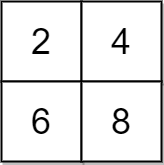

# [2033. Minimum Operations to Make a Uni-Value Grid](https://leetcode.com/problems/minimum-operations-to-make-a-uni-value-grid/)

| Category | Difficulty | Likes | Dislikes |
| :------: | :--------: | :---: | :------: |
| Algorithms | Medium | 1101 | 75 |

**Tags:** [`array`](https://leetcode.com/tag/array), [`math`](https://leetcode.com/tag/math), [`sorting`](https://leetcode.com/tag/sorting), [`matrix`](https://leetcode.com/tag/matrix)

**Companies:** `google`, `microsoft`, `epam-systems`

## Description

You are given a 2D integer `grid` of size `m x n` and an integer `x`. In one operation, you can **add** `x` to or **subtract** `x` from any element in the `grid`.

A **uni-value grid** is a grid where all the elements of it are equal.

Return *the **minimum** number of operations to make the grid **uni-value***. If it is not possible, return `-1`.

 

**Example 1:**


```

Input: grid = [[2,4],[6,8]], x = 2
Output: 4
Explanation: We can make every element equal to 4 by doing the following: 
- Add x to 2 once.
- Subtract x from 6 once.
- Subtract x from 8 twice.
A total of 4 operations were used.

```

**Example 2:**


```

Input: grid = [[1,5],[2,3]], x = 1
Output: 5
Explanation: We can make every element equal to 3.

```

**Example 3:**


```

Input: grid = [[1,2],[3,4]], x = 2
Output: -1
Explanation: It is impossible to make every element equal.

```

 

**Constraints:**

	- `m == grid.length`

	- `n == grid[i].length`

	- `1 <= m, n <= 10^5`

	- `1 <= m * n <= 10^5`

	- `1 <= x, grid[i][j] <= 10^4`

---

**Links:** [Submissions](https://leetcode.com/problems/minimum-operations-to-make-a-uni-value-grid/) | [Solutions](https://leetcode.com/problems/minimum-operations-to-make-a-uni-value-grid/)
