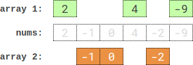

# [2035. Partition Array Into Two Arrays to Minimize Sum Difference](https://leetcode.com/problems/partition-array-into-two-arrays-to-minimize-sum-difference/)

| Category | Difficulty | Likes | Dislikes |
| :------: | :--------: | :---: | :------: |
| Algorithms | Hard | 3668 | 248 |

**Tags:** [`array`](https://leetcode.com/tag/array), [`two-pointers`](https://leetcode.com/tag/two-pointers), [`binary-search`](https://leetcode.com/tag/binary-search), [`dynamic-programming`](https://leetcode.com/tag/dynamic-programming), [`bit-manipulation`](https://leetcode.com/tag/bit-manipulation), [`ordered-set`](https://leetcode.com/tag/ordered-set), [`bitmask`](https://leetcode.com/tag/bitmask)

**Companies:** `google`, `bloomberg`, `amazon`, `arcesium`, `infosys`, `texas-instruments`, `samsung`

## Description

You are given an integer array `nums` of `2 * n` integers. You need to partition `nums` into **two** arrays of length `n` to **minimize the absolute difference** of the **sums** of the arrays. To partition `nums`, put each element of `nums` into **one** of the two arrays.

Return *the **minimum** possible absolute difference*.

 

**Example 1:**


```

Input: nums = [3,9,7,3]
Output: 2
Explanation: One optimal partition is: [3,9] and [7,3].
The absolute difference between the sums of the arrays is abs((3 + 9) - (7 + 3)) = 2.

```

**Example 2:**

```

Input: nums = [-36,36]
Output: 72
Explanation: One optimal partition is: [-36] and [36].
The absolute difference between the sums of the arrays is abs((-36) - (36)) = 72.

```

**Example 3:**


```

Input: nums = [2,-1,0,4,-2,-9]
Output: 0
Explanation: One optimal partition is: [2,4,-9] and [-1,0,-2].
The absolute difference between the sums of the arrays is abs((2 + 4 + -9) - (-1 + 0 + -2)) = 0.

```

 

**Constraints:**

	- `1 <= n <= 15`

	- `nums.length == 2 * n`

	- `-10^7 <= nums[i] <= 10^7`

---

**Links:** [Submissions](https://leetcode.com/problems/partition-array-into-two-arrays-to-minimize-sum-difference/) | [Solutions](https://leetcode.com/problems/partition-array-into-two-arrays-to-minimize-sum-difference/)
