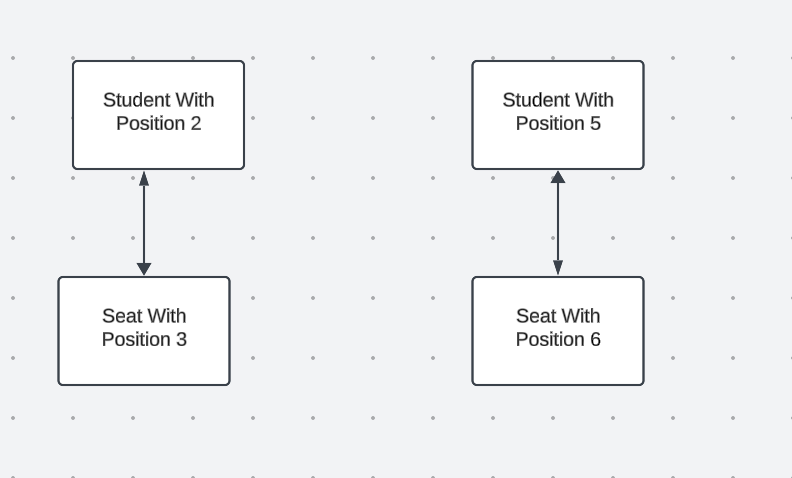
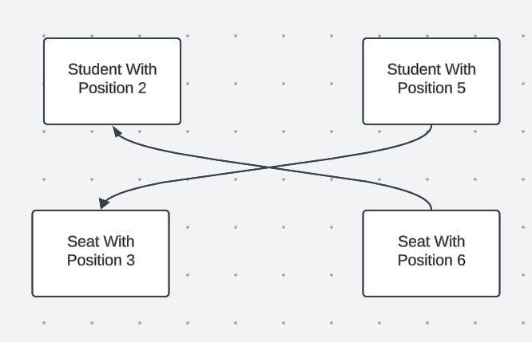

# [Greedy + Formal Proof + Tutorial] Minimum Number of Moves to Seat Everyone

**Author:** never_get_piped
**Votes:** 19
**Link:** [https://leetcode.com/problems/minimum-number-of-moves-to-seat-everyone/solutions/5304525/](https://leetcode.com/problems/minimum-number-of-moves-to-seat-everyone/solutions/5304525/)

---

**Topic** :  Greedy
Greedy algorithms are a class of algorithms that make locally optimal choices at each step with the hope of finding a global optimum solution. In these algorithms, decisions are made based on the information available at the current moment without considering the consequences of these decisions in the future. The key idea is to select the best possible choice at each step, leading to a solution that may not always be the most optimal but is often good enough for many problems. (GFG Reference)

**A thorough proof is essential to demonstrate the correctness of a perfect Greedy solution.**

___

## Greedy Solution
The objective is to minimize the total travel distance required for students to reach their assigned seats. 

The idea involves assigning students starting from the smallest position to seats in ascending order, ensuring that each student is placed in the closest available seat, beginning with the smallest seat position.

We can simplify the process by sorting both the seats and students arrays. Then the total distance is the sum of `abs(seats[i] - students[i])` for` 0 <= i < studeents.length`. <br/><br/>

## Proof 
To establish the validity of the proposed idea, we will employ a **proof by contradiction** method.

With the above approach, there are no instances of **cross assignment**. Let's use the following to illustrat the deination of **cross assignment**.
<br/>
No  **cross assignment**



In the above assignment, each student starts from the smallest position and is assigned to a seat in ascending order based on their position, which is the optimized assignment.
<br/><br/>

With  **cross assignment**


We first assume we have only two students **A** and **B**. 
```
* Student A's position : ai
* Student B's position : aj
* First seat position : bi
* Second seat position : bj

ai <= aj and bi <= bj

let d1 = |ai - bi| + |aj - bj| (original total travel distance)
let d2 = |ai - bj| + |aj - bi| (cross assignment total travel distance)

Case1 : bi <= bj <= ai <= aj
			d1 = ai - bi + aj - bj
			d2 = ai - bj + aj - bi = d1  
			Conclusion : d1 = d2

Case2 : bi <= ai <= bj <= aj
			d1 = ai - bi + aj - bj = (aj - bi) - (bj - ai)
			d2 = bj - ai + aj - bi  = (aj - bi) + (bj - ai)
			Conclusion :  (bj - ai) >= 0, d1 <= d2
			
Case3 : bi <= ai <= aj <= bj
			d1 = ai - bi + bj - aj = (bj - bi) - (aj - ai)
			d2 = bj - ai + aj - bi  = (bj - bi) + (aj - ai)
			Conclusion :  (aj - ai) >= 0, d1 <= d2
			
Case4 : ai <= bi <= bj <= aj
			d1 = bi - ai + aj - bj = (aj - ai) - (bj - bi)
			d2 = bj - ai + aj - bi  = (aj - ai) + (bj - bi)
			Conclusion :  (bj - bi) >= 0, d1 <= d2
			
Case5 : ai <= bi <= aj <= bj
			d1 = bi - ai + bj - aj = (bj - ai) - (aj - bi)
			d2 = bj - ai + aj - bi  = (bj - ai) + (aj - bi)
			Conclusion :  (aj - bi) >= 0, d1 <= d2
			
Case6 : ai <= aj <= bi <= bj
			d1 = bi - ai + bj - aj = (bj - aj) - (bi - ai)
			d2 = bj - ai + bi - aj  = (bj - aj) + (bi - ai)
			Conclusion :  d1 = d2
```

The proof has not finished yet ! With the above formula, we prove that any exchange of two students is unable to result in a smaller travel distance. But what happens with more than 2 students? Let's assume A takes B's seat, B takes C's seat, C takes D's seat, and so on. However, there must be a node that takes A's seat back finally.

Let's suppose **A** represents the initial student holding the` i-th` smallest position who opts not to occupy the seat corresponding to their` i-th` smallest position. We can then define a chain, denoted as `A -> B -> C -> D ... -> A`, as a connected component. 

We begin by sorting the students to their correct match positions. We then start by taking the student with the smallest position and exchange it with the student currently occupying that position. If we only consider these two students, they form a **cross assignment** relationship, and switching them back will result in a better solution.

**In conclusion** : If we sort these students back to match their original seats with no assignments, the result would only improve.

## Code
<iframe src="https://leetcode.com/playground/4Bov3vmm/shared" frameBorder="0" width="600" height="300"></iframe>

**Complexity**:
* Time Complexity : `O(n log n)`
* Space Complexity : `O(1)`

**Feel free to leave a comment if something is confusing, or if you have any suggestions on how I can improve the post.**