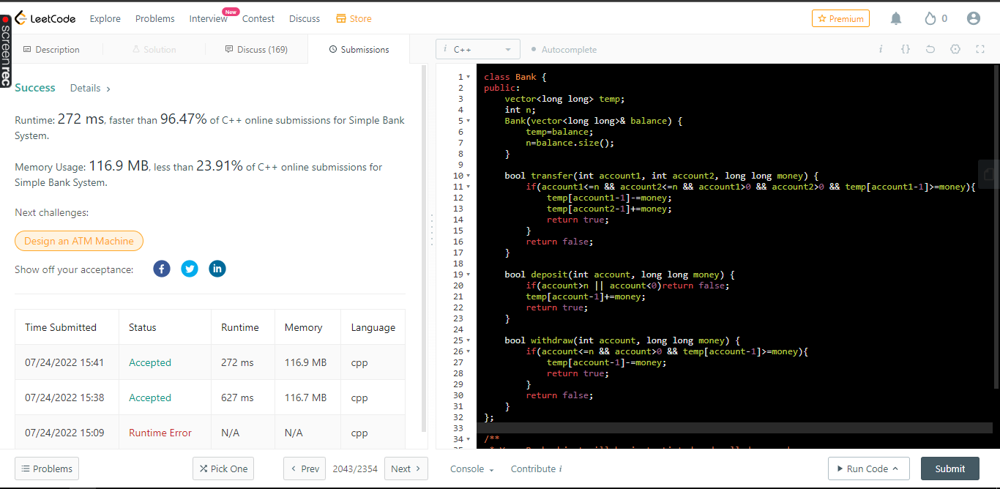

# ✅C++ || Shouldn't be a MEDIUM que! || Straightforward

**Author:** abhinav_0107
**Votes:** 5
**Link:** [https://leetcode.com/problems/simple-bank-system/solutions/2326602/](https://leetcode.com/problems/simple-bank-system/solutions/2326602/)

---

**All the opeartions are in O(1)**

	class Bank {
	public:
		vector<long long> temp;
		int n;
		Bank(vector<long long>& balance) {
			temp=balance;
			n=balance.size();
		}

		bool transfer(int account1, int account2, long long money) {
			if(account1<=n && account2<=n && account1>0 && account2>0 && temp[account1-1]>=money){
				temp[account1-1]-=money;
				temp[account2-1]+=money;
				return true;
			}
			return false;
		}

		bool deposit(int account, long long money) {
			if(account>n || account<0)return false;
			temp[account-1]+=money;
			return true;
		}

		bool withdraw(int account, long long money) {
			if(account<=n && account>0 && temp[account-1]>=money){
				temp[account-1]-=money;
				return true;
			}
			return false;
		}
	};