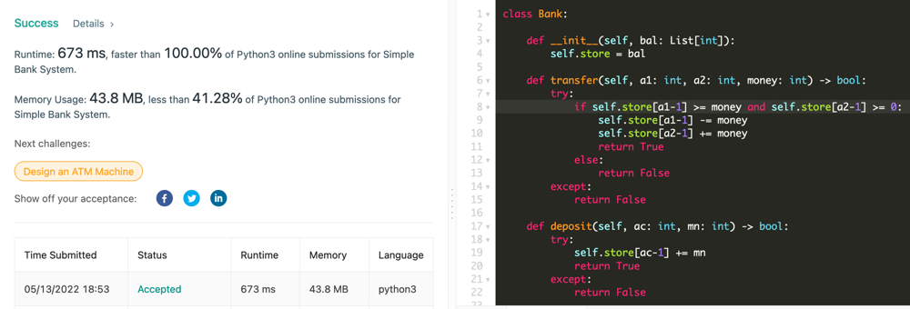

# Easy Python Solution | Faster than 100%  | With Comments

**Author:** the_sky_high
**Votes:** 4
**Link:** [https://leetcode.com/problems/simple-bank-system/solutions/2034981/](https://leetcode.com/problems/simple-bank-system/solutions/2034981/)

---

# Easy Python Solution | Faster than 100%  | With Comments

**Runtime: 673 ms, faster than 100.00% of Python3 online submissions for Simple Bank System.
Memory Usage: 43.8 MB.**

```
class Bank:

    def __init__(self, bal: List[int]):
        self.store = bal  # storage list


    def transfer(self, a1: int, a2: int, money: int) -> bool:
        try:
            # checking if both accounts exist. and if the transaction would be valid
            if self.store[a1 - 1] >= money and self.store[a2 - 1] >= 0:
                # performing the transaction
                self.store[a1 - 1] -= money
                self.store[a2 - 1] += money
                return True
            else:
                # retrning false on invalid transaction
                return False
        except:
            # returning false when accounts don't exist
            return False


    def deposit(self, ac: int, mn: int) -> bool:
        try:
            # if account exists performing transaction
            self.store[ac - 1] += mn
            return True
        except:
            # returning false when account doesn't exist
            return False


    def withdraw(self, ac: int, mn: int) -> bool:
        try:
            # checking if transaction is valid
            if self.store[ac - 1] >= mn:
                # performing the transaction
                self.store[ac - 1] -= mn
                return True
            else:
                # returning false in case on invalid transaction
                return False
        except:
            # returning false when account doesn't exist
            return False
```


