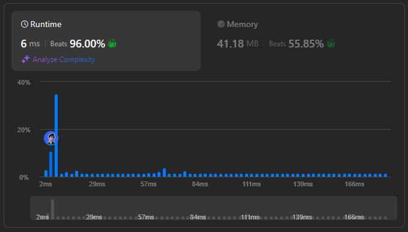

# 🌟 Beats 96.00% 👏  ||  Step-by-Step Breakdown 💯🔥

**Author:** withaarzoo
**Votes:** 80
**Link:** [https://leetcode.com/problems/count-number-of-maximum-bitwise-or-subsets/solutions/5928761/](https://leetcode.com/problems/count-number-of-maximum-bitwise-or-subsets/solutions/5928761/)

---


## **\uD83C\uDF1F Access Daily LeetCode Solutions Repo :** [click here](https://github.com/withaarzoo/LeetCode-Solutions)

---



---

# Intuition
When we are asked to compute the maximum bitwise OR of subsets and count how many subsets achieve this maximum, the problem essentially boils down to finding the largest possible OR value. Since OR operations are cumulative (meaning that once a bit is set, it stays set), the more elements we include in a subset, the closer we get to the maximum possible OR. Therefore, our goal is to:
1. Compute the maximum OR by combining all the elements in the array.
2. Use a method to explore every subset of the array and count how many subsets give this maximum OR value.

The key insight is that the more elements we OR together, the higher the result tends to be, making backtracking a natural choice to systematically explore each subset.

---

# Approach
1. **Compute Maximum OR**: First, find the maximum OR by combining all elements using the `|` (bitwise OR) operation. This is the maximum OR that any subset can achieve.
2. **Backtracking**: Next, use backtracking to explore all possible subsets. For each subset, compute its OR value. If the OR matches the maximum OR, increment the count.
3. **Base Case**: If a subset OR matches the maximum, count it. Recursively explore further subsets until all have been considered.

---

# Complexity
- **Time complexity**:  
  The total number of subsets is \\(2^n\\), where \\(n\\) is the length of the array. For each subset, we compute the OR, which takes \\(O(n)\\). Thus, the time complexity is approximately \\(O(n \	imes 2^n)\\).

- **Space complexity**:  
  The space complexity is \\(O(n)\\), which accounts for the recursion stack during backtracking.

---

# Code
```C++ []
class Solution
{
public:
    void backtrack(const vector<int> &nums, int index, int currentOR, int maxOR, int &count)
    {
        if (currentOR == maxOR)
        {
            count++;
        }

        for (int i = index; i < nums.size(); ++i)
        {
            backtrack(nums, i + 1, currentOR | nums[i], maxOR, count);
        }
    }

    int countMaxOrSubsets(vector<int> &nums)
    {
        int maxOR = 0;

        // Step 1: Compute the maximum OR
        for (int num : nums)
        {
            maxOR |= num;
        }

        int count = 0;
        // Step 2: Backtrack to count the subsets
        backtrack(nums, 0, 0, maxOR, count);

        return count;
    }
};

```
```Java []
class Solution {
    public void backtrack(int[] nums, int index, int currentOR, int maxOR, int[] count) {
        if (currentOR == maxOR) {
            count[0]++;
        }

        for (int i = index; i < nums.length; i++) {
            backtrack(nums, i + 1, currentOR | nums[i], maxOR, count);
        }
    }

    public int countMaxOrSubsets(int[] nums) {
        int maxOR = 0;

        // Step 1: Compute the maximum OR
        for (int num : nums) {
            maxOR |= num;
        }

        int[] count = new int[1];
        // Step 2: Backtrack to count the subsets
        backtrack(nums, 0, 0, maxOR, count);

        return count[0];
    }
}

```
```JavaScript []
/**
 * @param {number[]} nums
 * @return {number}
 */
var countMaxOrSubsets = function (nums) {
  let maxOR = 0;

  // Step 1: Compute the maximum OR
  for (let num of nums) {
    maxOR |= num;
  }

  let count = 0;

  const backtrack = (index, currentOR) => {
    if (currentOR === maxOR) {
      count++;
    }

    for (let i = index; i < nums.length; i++) {
      backtrack(i + 1, currentOR | nums[i]);
    }
  };

  // Step 2: Backtrack to count the subsets
  backtrack(0, 0);

  return count;
};

```
```Python []
class Solution:
    def backtrack(self, nums, index, currentOR, maxOR, count):
        if currentOR == maxOR:
            count[0] += 1
        
        for i in range(index, len(nums)):
            self.backtrack(nums, i + 1, currentOR | nums[i], maxOR, count)
    
    def countMaxOrSubsets(self, nums: List[int]) -> int:
        maxOR = 0
        
        # Step 1: Compute the maximum OR
        for num in nums:
            maxOR |= num
        
        count = [0]
        # Step 2: Backtrack to count the subsets
        self.backtrack(nums, 0, 0, maxOR, count)
        
        return count[0]

```
```Go []
func backtrack(nums []int, index int, currentOR int, maxOR int, count *int) {
    if currentOR == maxOR {
        *count++
    }
    
    for i := index; i < len(nums); i++ {
        backtrack(nums, i+1, currentOR|nums[i], maxOR, count)
    }
}

func countMaxOrSubsets(nums []int) int {
    maxOR := 0
    
    // Step 1: Compute the maximum OR
    for _, num := range nums {
        maxOR |= num
    }
    
    count := 0
    // Step 2: Backtrack to count the subsets
    backtrack(nums, 0, 0, maxOR, &count)
    
    return count
}

```

---

# Step-by-Step Detailed Explanation

1. **Initialization**:
   - We first initialize the `maxOR` variable to store the bitwise OR of all elements in the array. This represents the highest OR value a subset can achieve.
   
2. **Backtracking Setup**:
   - We define a helper function `backtrack` that takes the current subset's OR value, the index to consider next, and updates the count when a subset achieves the `maxOR`.

3. **Base Case**:
   - Every time the current subset's OR equals `maxOR`, we increment the count because this subset is one of the valid subsets.

4. **Recursive Step**:
   - For each element in the array, we explore two options: either include the current element (update the OR) or skip it. This generates all possible subsets.

5. **Count Result**:
   - Once all subsets have been explored through backtracking, the count gives the number of subsets whose OR matches the maximum OR.

---


