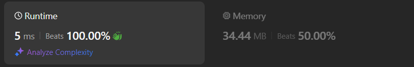

# Solution (5ms)

**Author:** Phantom2097
**Votes:** 1
**Link:** [https://leetcode.com/problems/count-number-of-maximum-bitwise-or-subsets/solutions/5936412/](https://leetcode.com/problems/count-number-of-maximum-bitwise-or-subsets/solutions/5936412/)

---




# Complexity
- Time complexity:
$$O(2^n)$$

- Space complexity:
$$O(n)$$

# Code
```kotlin []
class Solution {
    fun countMaxOrSubsets(nums: IntArray): Int {
        var max = 0
        nums.forEach { max = max or it }
        var result = 0

        fun helper(idx: Int, value: Int, count: Int): Int {
            var newCount = count
            if (value == max) {
                newCount++
            }
            if (idx == nums.size) {
                return newCount
            }
            for (j in idx + 1 ..< nums.size) {
                newCount += helper(j + 1, value or nums[j], 0)
            }
            return helper(idx + 1, value or nums[idx], newCount)
        }
        for (i in 0 ..< nums.size) {
            result += helper(i + 1, nums[i], 0)
        }
        return result
    }

    
}
```