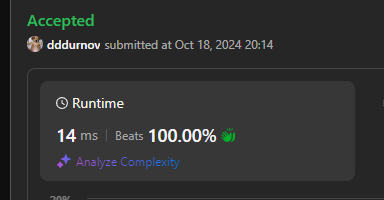

# 🚀Completed in 14ms: Beats 100%!🚀

**Author:** dddurnov
**Votes:** 2
**Link:** [https://leetcode.com/problems/count-number-of-maximum-bitwise-or-subsets/solutions/5932713/](https://leetcode.com/problems/count-number-of-maximum-bitwise-or-subsets/solutions/5932713/)

---




# Complexity
- Time complexity: $$O(2^n)$$
<!-- Add your time complexity here, e.g. $$O(n)$$ -->

- Space complexity: $$O(n)$$
<!-- Add your space complexity here, e.g. $$O(n)$$ -->

## Code 
```javascript []
function countMaxOrSubsets(nums) {
    const maxOr = nums.reduce((acc, cur) => acc | cur, 0);
    let count = 0;

    function backtrack(start, currentOr) {
        if (currentOr === maxOr) {
            count++;
        }

        for (let i = start; i < nums.length; i++) {
            backtrack(i + 1, currentOr | nums[i]);
        }
    }

    backtrack(0, 0);
    return count;
}
```
```typescript []
function countMaxOrSubsets(nums: number[]): number {
    const maxOr = nums.reduce((acc, cur) => acc | cur, 0);
    let count = 0;

    function backtrack(start: number, currentOr: number) {
        if (currentOr === maxOr) {
            count++;
        }

        for (let i = start; i < nums.length; i++) {
            backtrack(i + 1, currentOr | nums[i]);
        }
    }

    backtrack(0, 0);
    return count;
}
```
