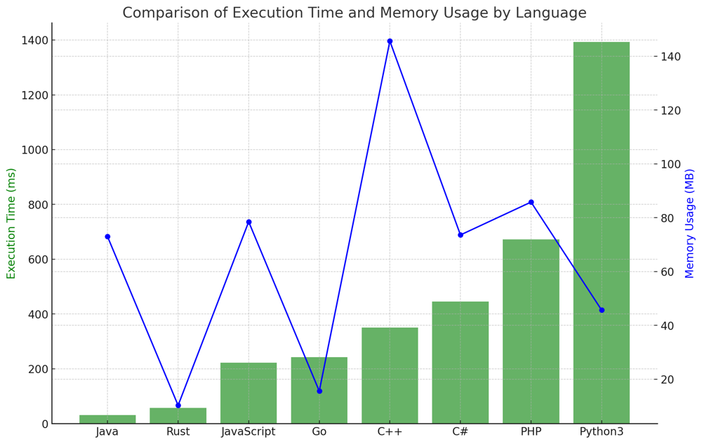

# ✅ 92.65%  BFS in Directed Acyclic Graph

**Author:** vanAmsen
**Votes:** 34
**Link:** [https://leetcode.com/problems/parallel-courses-iii/solutions/4180326/](https://leetcode.com/problems/parallel-courses-iii/solutions/4180326/)

---

# Intuition
When we first encounter this problem, it is evident that the courses have dependencies among themselves. The first intuition that should come to mind when seeing such dependencies is a directed graph, where an edge from one course to another signifies a prerequisite relationship. Since the problem guarantees no cycles (Directed Acyclic Graph or DAG), the thought should naturally progress towards topological ordering. This is because a topological order of a DAG ensures that every node (course, in this context) comes before its dependents.

## Live Coding + Explein
https://youtu.be/dtBSjB924kU?si=IDRT9XR09r9jdRyL

# Approach
1. **Graph Representation**: We start by representing the courses and their relationships as a graph where each node represents a course, and each edge represents a relationship between two courses.
   
2. **Calculate In-degrees**: For each course, we calculate its in-degree, which is the number of prerequisites it has.
   
3. **Topological Sort Using BFS**: We perform a BFS-based topological sort. We start with courses that have no prerequisites (in-degree of 0). For each course, we calculate the earliest time it can be completed. This is based on its prerequisites' completion times.
   
   - For each course, the start time is determined by its prerequisites. The start time is the maximum of the finish times of its prerequisites. The finish time of a course is its start time plus its duration (given in the `time` array).
   - We keep track of these times in the `dist` array.
   - As we determine the finish time for a course, we decrease the in-degree of its dependents (courses that have it as a prerequisite). If the in-degree of a course becomes 0, it means all its prerequisites are completed, and it's added to the queue.
   
4. **Result**: The answer to the problem is the maximum value in the `dist` array, which represents the earliest finish time for all courses.

# Complexity
- **Time complexity**: $O(N + M)$
  - $O(N)$ for initializing the in-degrees and dist arrays.
  - $O(M)$ for constructing the graph from the relations array, where $M$ is the length of the relations array.

- **Space complexity**: $O(N + M)$
  - $O(N)$ for the in-degrees and dist arrays.
  - $O(M)$ for the graph.

# Code
``` Python []
class Solution:
    def minimumTime(self, n: int, relations: List[List[int]], time: List[int]) -> int:
        # Build the graph and calculate in-degrees
        graph = defaultdict(list)
        in_degree = [0] * (n + 1)
        for u, v in relations:
            graph[u].append(v)
            in_degree[v] += 1
        
        # Initialize the dist array and queue
        dist = [0] + time
        queue = deque([i for i in range(1, n+1) if in_degree[i] == 0])
        
        # Perform Topological Sort
        while queue:
            course = queue.popleft()
            for next_course in graph[course]:
                dist[next_course] = max(dist[next_course], dist[course] + time[next_course-1])
                in_degree[next_course] -= 1
                if in_degree[next_course] == 0:
                    queue.append(next_course)
        
        return max(dist)
```
``` C++ []
class Solution {
public:
    int minimumTime(int n, std::vector<std::vector<int>>& relations, std::vector<int>& time) {
        std::unordered_map<int, std::vector<int>> graph;
        std::vector<int> in_degree(n + 1, 0);
        for (auto& relation : relations) {
            graph[relation[0]].push_back(relation[1]);
            in_degree[relation[1]]++;
        }

        std::vector<int> dist = time;
        dist.insert(dist.begin(), 0);
        std::queue<int> q;
        for (int i = 1; i <= n; i++) {
            if (in_degree[i] == 0) {
                q.push(i);
            }
        }

        while (!q.empty()) {
            int course = q.front(); q.pop();
            for (int next_course : graph[course]) {
                dist[next_course] = std::max(dist[next_course], dist[course] + time[next_course - 1]);
                in_degree[next_course]--;
                if (in_degree[next_course] == 0) {
                    q.push(next_course);
                }
            }
        }

        return *std::max_element(dist.begin(), dist.end());
    }
};
```
``` Java []
public class Solution {
    public int minimumTime(int n, int[][] relations, int[] time) {
        Map<Integer, List<Integer>> graph = new HashMap<>();
        int[] in_degree = new int[n + 1];
        for (int[] relation : relations) {
            graph.computeIfAbsent(relation[0], k -> new ArrayList<>()).add(relation[1]);
            in_degree[relation[1]]++;
        }

        int[] dist = new int[n + 1];
        System.arraycopy(time, 0, dist, 1, n);
        Queue<Integer> q = new LinkedList<>();
        for (int i = 1; i <= n; i++) {
            if (in_degree[i] == 0) {
                q.add(i);
            }
        }

        while (!q.isEmpty()) {
            int course = q.poll();
            if (graph.containsKey(course)) {
                for (int next_course : graph.get(course)) {
                    dist[next_course] = Math.max(dist[next_course], dist[course] + time[next_course - 1]);
                    in_degree[next_course]--;
                    if (in_degree[next_course] == 0) {
                        q.add(next_course);
                    }
                }
            }
        }

        int maxVal = 0;
        for (int val : dist) {
            maxVal = Math.max(maxVal, val);
        }
        return maxVal;
    }
}
```
``` Go []
func minimumTime(n int, relations [][]int, time []int) int {
    graph := make(map[int][]int)
    in_degree := make([]int, n+1)
    for _, relation := range relations {
        graph[relation[0]] = append(graph[relation[0]], relation[1])
        in_degree[relation[1]]++
    }

    dist := make([]int, n+1)
    copy(dist[1:], time)
    queue := []int{}
    for i := 1; i <= n; i++ {
        if in_degree[i] == 0 {
            queue = append(queue, i)
        }
    }

    for len(queue) > 0 {
        course := queue[0]
        queue = queue[1:]
        for _, next_course := range graph[course] {
            dist[next_course] = max(dist[next_course], dist[course] + time[next_course-1])
            in_degree[next_course]--
            if in_degree[next_course] == 0 {
                queue = append(queue, next_course)
            }
        }
    }

    maxVal := 0
    for _, val := range dist {
        maxVal = max(maxVal, val)
    }
    return maxVal
}

func max(a, b int) int {
    if a > b {
        return a
    }
    return b
}
```
``` Rust []
use std::collections::HashMap;
use std::collections::VecDeque;

impl Solution {
    pub fn minimum_time(n: i32, relations: Vec<Vec<i32>>, time: Vec<i32>) -> i32 {
        let mut graph: HashMap<i32, Vec<i32>> = HashMap::new();
        let mut in_degree = vec![0; (n + 1) as usize];
        for relation in &relations {
            graph.entry(relation[0]).or_insert(Vec::new()).push(relation[1]);
            in_degree[relation[1] as usize] += 1;
        }

        let mut dist: Vec<i32> = vec![0];
        dist.extend(&time);
        let mut queue: VecDeque<i32> = VecDeque::new();
        for i in 1..=n {
            if in_degree[i as usize] == 0 {
                queue.push_back(i);
            }
        }

        while let Some(course) = queue.pop_front() {
            if let Some(neighbors) = graph.get(&course) {
                for &next_course in neighbors {
                    dist[next_course as usize] = std::cmp::max(dist[next_course as usize], dist[course as usize] + time[(next_course - 1) as usize]);
                    in_degree[next_course as usize] -= 1;
                    if in_degree[next_course as usize] == 0 {
                        queue.push_back(next_course);
                    }
                }
            }
        }

        *dist.iter().max().unwrap()
    }
}
```
``` JavaScript []
var minimumTime = function(n, relations, time) {
    let graph = {};
    let in_degree = Array(n + 1).fill(0);
    for (let relation of relations) {
        if (!graph[relation[0]]) {
            graph[relation[0]] = [];
        }
        graph[relation[0]].push(relation[1]);
        in_degree[relation[1]]++;
    }

    let dist = [0].concat(time);
    let queue = [];
    for (let i = 1; i <= n; i++) {
        if (in_degree[i] === 0) {
            queue.push(i);
        }
    }

    while (queue.length) {
        let course = queue.shift();
        if (graph[course]) {
            for (let next_course of graph[course]) {
                dist[next_course] = Math.max(dist[next_course], dist[course] + time[next_course - 1]);
                in_degree[next_course]--;
                if (in_degree[next_course] === 0) {
                    queue.push(next_course);
                }
            }
        }
    }

    return Math.max(...dist);
};
```
``` PHP []
class Solution {
    function minimumTime($n, $relations, $time) {
        $graph = [];
        $in_degree = array_fill(0, $n + 1, 0);
        foreach ($relations as $relation) {
            if (!isset($graph[$relation[0]])) {
                $graph[$relation[0]] = [];
            }
            array_push($graph[$relation[0]], $relation[1]);
            $in_degree[$relation[1]]++;
        }

        $dist = array_merge([0], $time);
        $queue = [];
        for ($i = 1; $i <= $n; $i++) {
            if ($in_degree[$i] === 0) {
                array_push($queue, $i);
            }
        }

        while (count($queue) > 0) {
            $course = array_shift($queue);
            if (isset($graph[$course])) {
                foreach ($graph[$course] as $next_course) {
                    $dist[$next_course] = max($dist[$next_course], $dist[$course] + $time[$next_course - 1]);
                    $in_degree[$next_course]--;
                    if ($in_degree[$next_course] === 0) {
                        array_push($queue, $next_course);
                    }
                }
            }
        }

        return max($dist);
    }
}
```
``` C# []
using System;
using System.Collections.Generic;
using System.Linq;

public class Solution {
    public int MinimumTime(int n, int[][] relations, int[] time) {
        Dictionary<int, List<int>> graph = new Dictionary<int, List<int>>();
        int[] in_degree = new int[n + 1];
        foreach (var relation in relations) {
            if (!graph.ContainsKey(relation[0])) {
                graph[relation[0]] = new List<int>();
            }
            graph[relation[0]].Add(relation[1]);
            in_degree[relation[1]]++;
        }

        int[] dist = new int[n + 1];
        Array.Copy(time, 0, dist, 1, n);
        Queue<int> q = new Queue<int>();
        for (int i = 1; i <= n; i++) {
            if (in_degree[i] == 0) {
                q.Enqueue(i);
            }
        }

        while (q.Count > 0) {
            int course = q.Dequeue();
            if (graph.ContainsKey(course)) {
                foreach (int next_course in graph[course]) {
                    dist[next_course] = Math.Max(dist[next_course], dist[course] + time[next_course - 1]);
                    in_degree[next_course]--;
                    if (in_degree[next_course] == 0) {
                        q.Enqueue(next_course);
                    }
                }
            }
        }

        return dist.Max();
    }
}
```

## Performance
| Language  | Execution Time (ms) | Memory Usage |
|-----------|---------------------|--------------|
| Java      | 31                  | 73 MB       |
| Rust      | 57                  | 10.3 MB     |
| JavaScript| 222                 | 78.5 MB     |
| Go        | 243                 | 15.6 MB     |
| C++       | 350                 | 145.6 MB    |
| C#        | 446                 | 73.6 MB     |
| PHP       | 672                 | 85.8 MB     |
| Python3   | 1393                | 45.7 MB     |




# Why it works?
The approach relies on the properties of a Directed Acyclic Graph (DAG). In a DAG, there exists a topological order where every node comes before its dependents. By processing the courses in topological order, we ensure that we only start a course when all its prerequisites are completed. This guarantees that the resulting time for each course is the earliest possible completion time.