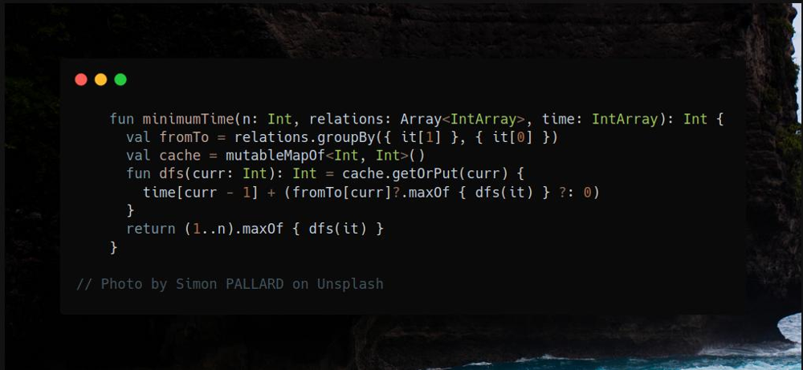

# Kotlin | dfs + memo from leafs

**Author:** SamoylenkoDmitry
**Votes:** 1
**Link:** [https://leetcode.com/problems/parallel-courses-iii/solutions/4180807/](https://leetcode.com/problems/parallel-courses-iii/solutions/4180807/)

---




#### Join me on Telegram

https://t.me/leetcode_daily_unstoppable/374

#### Problem TLDR

Shortest `time` to visite all nodes in `relations=[from, to]` graph 

#### Intuition

We can start from nodes without `out` siblings - leafs and do Depth-First Search from them calculating time for each sibling in parallel and choosing the maximum. That is an optimal way to visit all the nodes. For each node, solution can be cached.

#### Approach

Let's use some [Kotlin's API](https://kotlinlang.org/api/latest/jvm/stdlib/kotlin.collections/):
* calculate leafs by subtracting all `from` nodes from all the nodes `1..n`
* form a graph `Map<Int, List<Int>>` by using `groupBy`
* choose the maximum and return it with `maxOf`
* get and put to map with `getOrPut`

#### Complexity

- Time complexity:
$$O(nr)$$, will visit each node only once, r - average siblings count for each node

- Space complexity:
$$O(n)$$

#### Code

```kotlin

    fun minimumTime(n: Int, relations: Array<IntArray>, time: IntArray): Int {
      val lastNodes = (1..n) - relations.map { it[0] }
      val fromTo = relations.groupBy({ it[1] }, { it[0] })
      val cache = mutableMapOf<Int, Int>()
      fun dfs(curr: Int): Int = cache.getOrPut(curr) {
        time[curr - 1] + (fromTo[curr]?.maxOf { dfs(it) } ?: 0)
      }
      return lastNodes.maxOf { dfs(it) }
    }

```