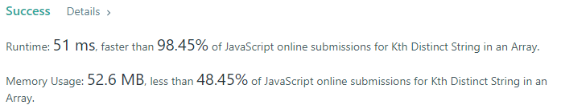
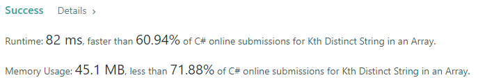
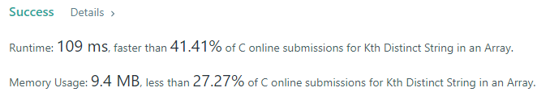
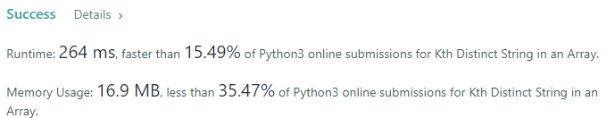
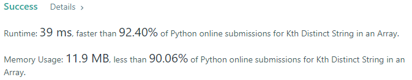
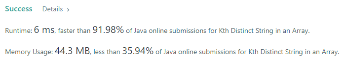
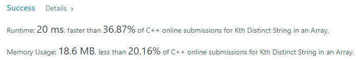

# 💢☠💫Easiest👾Faster✅💯 Lesser🧠 🎯 C++✅Python3🐍✅Java✅C✅Python🐍✅C#✅💥🔥💫Explained☠💥🔥 Beats 💯

**Author:** Edwards310
**Votes:** 4
**Link:** [https://leetcode.com/problems/kth-distinct-string-in-an-array/solutions/5589856/](https://leetcode.com/problems/kth-distinct-string-in-an-array/solutions/5589856/)

---

# Intuition








```javascript []
/**
 * @param {string[]} arr
 * @param {number} k
 * @return {string}
 */
//JavaScript
var kthDistinct = function(arr, k) {
    const help = new Map();
    for(let str of arr)
        help.set(str, (help.get(str) ?? 0 ) + 1)
    
    for(let str of arr){
        if(help.get(str) == 1){
            --k;
            if(k == 0)
                return str
        }
    }
    return ""
};
```
```C++ []
#include <bits/stdc++.h>
using namespace std;

#define FOR(a, b, c) for (int a = b; a < c; a++)
#define FOR1(a, b, c) for (int a = b; a <= c; ++a)
#define Rep(i, n) FOR(i, 0, n)
#define Rep1(i, n) FOR1(i, 1, n)
#define RepA(ele, nums) for (auto& ele : nums)

#define umsi unordered_map<string, int>
//C++
class Solution {
public:
    string kthDistinct(vector<string>& arr, int k) {
        umsi helper;
        RepA(str, arr) helper[str]++;
        Rep(i, arr.size()) {
            if (helper[arr[i]] == 1) {
                --k;
                if (k == 0)
                    return arr[i];
            }
        }
        return "";
    }
};
```
```Python3 []
#Python3
class Solution:
    def kthDistinct(self, arr: List[str], k: int) -> str:
        seen = set([s for s in arr if arr.count(s) > 1])
        count = 0
        for s in arr:
            if s in seen:
                continue
            count += 1
            if count == k:
                return s
        return ""
```
```Java []
//Java
class Solution {
    public String kthDistinct(String[] arr, int k) {
        HashMap<String, Integer> help = new HashMap<>();
        
        for(String str : arr)
            help.put(str, help.getOrDefault(str, 0) + 1);
        
        for(int i = 0; i < arr.length; ++i){
            if(help.get(arr[i]) == 1){
                --k;
                if(k == 0)
                    return arr[i];
            }
        }
        return "";
    }
}
```
```C []
//C
char* kthDistinct(char** arr, int n, int k) {
    for(int i = 0; i < n; i++){
        bool flag = 0;
        for(int j = 0; j < n; ++j){
            if(!strcmp(arr[i], arr[j]) && i != j){
                flag = true;
                break;
            }
        }
        if(!flag){
            --k;
            if(!k)
                return arr[i];
        }
    }
    return "";
}
```
```Python []
#Python
class Solution(object):
    def kthDistinct(self, arr, k):
        """
        :type arr: List[str]
        :type k: int
        :rtype: str
        """
        #this is a dictionary
        map = {}
        for s in arr:
            map[s] = map.get(s, 0) + 1
        for a in arr:
            if map[a] == 1:
                k -= 1
                if k == 0:
                    return a
        return ""
```
```C# []
//C#
public class Solution {
    public string KthDistinct(string[] arr, int k) {
        Dictionary<string, int> strMap = new Dictionary<string, int>();
        
        foreach(string str in arr)
            strMap[str] = strMap.ContainsKey(str) ? ++strMap[str] : 1;
        
        foreach(var st in arr){
            if(strMap[st] == 1){
                --k;
                if(k == 0)
                    return st;
            }
        }
        return "";
    }
}
```
<!-- Describe your first thoughts on how to solve this problem. -->

# Approach
<!-- Describe your approach to solving the problem. -->

# Complexity
- Time complexity:
<!-- Add your time complexity here, e.g. $$O(n)$$ -->
    O(N)
- Space complexity:
<!-- Add your space complexity here, e.g. $$O(n)$$ -->
    O(N)
# Code
```
/**
 * @param {string[]} arr
 * @param {number} k
 * @return {string}
 */
var kthDistinct = function(arr, k) {
    const help = new Map();
    for(let str of arr)
        help.set(str, (help.get(str) ?? 0 ) + 1)
    
    for(let str of arr){
        if(help.get(str) == 1){
            --k;
            if(k == 0)
                return str
        }
    }
    return ""
};
```

