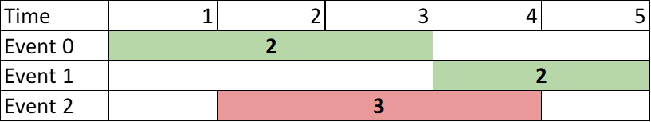
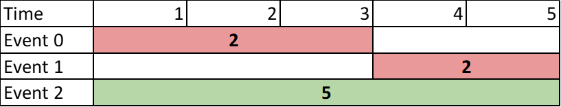
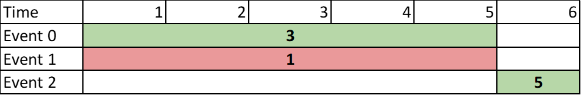

# [2054. Two Best Non-Overlapping Events](https://leetcode.com/problems/two-best-non-overlapping-events/)

| Category | Difficulty | Likes | Dislikes |
| :------: | :--------: | :---: | :------: |
| Algorithms | Medium | 1553 | 59 |

**Tags:** [`array`](https://leetcode.com/tag/array), [`binary-search`](https://leetcode.com/tag/binary-search), [`dynamic-programming`](https://leetcode.com/tag/dynamic-programming), [`sorting`](https://leetcode.com/tag/sorting), [`heap-priority-queue`](https://leetcode.com/tag/heap-priority-queue)

**Companies:** `jpmorgan`, `amazon`, `google`, `razorpay`

## Description

You are given a **0-indexed** 2D integer array of `events` where `events[i] = [startTime_i, endTime_i, value_i]`. The `i^th` event starts at `startTime_i` and ends at `endTime_i`, and if you attend this event, you will receive a value of `value_i`. You can choose **at most** **two** **non-overlapping** events to attend such that the sum of their values is **maximized**.

Return *this **maximum** sum.*

Note that the start time and end time is **inclusive**: that is, you cannot attend two events where one of them starts and the other ends at the same time. More specifically, if you attend an event with end time `t`, the next event must start at or after `t + 1`.

 

**Example 1:**


```

Input: events = [[1,3,2],[4,5,2],[2,4,3]]
Output: 4
Explanation: Choose the green events, 0 and 1 for a sum of 2 + 2 = 4.

```

**Example 2:**


```

Input: events = [[1,3,2],[4,5,2],[1,5,5]]
Output: 5
Explanation: Choose event 2 for a sum of 5.

```

**Example 3:**


```

Input: events = [[1,5,3],[1,5,1],[6,6,5]]
Output: 8
Explanation: Choose events 0 and 2 for a sum of 3 + 5 = 8.
```

 

**Constraints:**

	- `2 <= events.length <= 10^5`

	- `events[i].length == 3`

	- `1 <= startTime_i <= endTime_i <= 10^9`

	- `1 <= value_i <= 10^6`

---

**Links:** [Submissions](https://leetcode.com/problems/two-best-non-overlapping-events/) | [Solutions](https://leetcode.com/problems/two-best-non-overlapping-events/)
