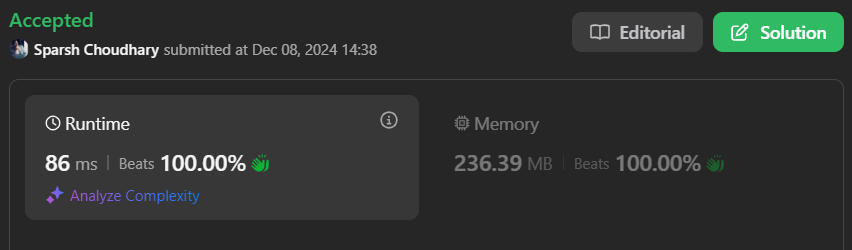
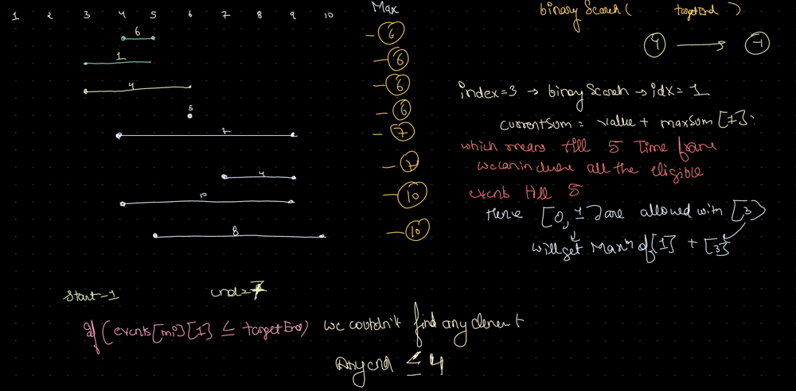

# 🔥BEATS 💯 % 🎯 |✨SUPER EASY BEGINNERS 👏

**Author:** CodeWithSparsh
**Votes:** 12
**Link:** [https://leetcode.com/problems/two-best-non-overlapping-events/solutions/6125383/](https://leetcode.com/problems/two-best-non-overlapping-events/solutions/6125383/)

---



## MOST IMP POINT
###  At most two non-overlapping 




---
Here\u2019s the detailed breakdown of the problem-solving process for maximizing the sum of values of at most two non-overlapping events:

---

# Intuition
The goal is to select up to two non-overlapping events such that their combined value is maximized.  
- To efficiently check overlapping conditions, **sorting the events by end time** is beneficial.  
- A **binary search** can be used to quickly find the latest event that does not overlap with the current one.  
- We use a **running maximum array** to keep track of the maximum value from earlier events, ensuring efficient calculation of the maximum sum.

---

# Approach
### Step 1: Sort Events by End Time
- Sorting events by their end times helps in managing overlapping efficiently. This way, for each event, we only need to look at earlier events for potential inclusion.

### Step 2: Create a Running Maximum Array
- A `maxValues` array is used to store the maximum value among all events up to the current event (non-overlapping logic considered via binary search).
- This allows efficient calculation of the sum for a given pair of events.

### Step 3: Iterate Through Events
- For each event:
  - Use binary search to find the latest event that ends before the current event starts.
  - Add its value (if it exists) to the current event's value.
  - Update the global maximum sum if the resulting sum is larger than the previous maximum.

### Step 4: Binary Search for Non-Overlapping Events
- The binary search is used to find the index of the latest event that ends before the current event starts. This ensures no overlap between the selected events.

---

# Complexity
- **Time Complexity:**  
  - Sorting: $$O(n \\log n)$$  
  - Binary Search for each event: $$O(n \\log n)$$  
  - Total: $$O(n \\log n)$$.

- **Space Complexity:**  
  - Running max array: $$O(n)$$  
  - Total: $$O(n)$$.

---


```dart []
import 'dart:math';

class Solution {
  int maxTwoEvents(List<List<int>> events) {
    // Step 1: Sort events by their end times
    events.sort((a, b) => a[1].compareTo(b[1]));

    // Step 2: Create a running max array
    int n = events.length;
    List<int> maxValues = List.filled(n, 0);
    maxValues[0] = events[0][2]; // Value of the first event

    // Fill the running max array
    for (int i = 1; i < n; i++) {
      maxValues[i] = max(maxValues[i - 1], events[i][2]);
    }

    int maxSum = 0;

    // Step 3: Iterate through the events and use binary search
    for (int i = 0; i < n; i++) {
      int start = events[i][0];
      int value = events[i][2];

      // Find the latest event that ends before the current event starts
      int idx = binarySearch(events, start - 1);

      // If a valid previous event is found, calculate the sum
      int currentSum = value;
      if (idx != -1) currentSum += maxValues[idx];

      // Update the global maximum sum
      maxSum = max(maxSum, currentSum);
    }

    return maxSum;
  }

  // Helper: Binary search to find the latest event that ends <= targetEnd
  int binarySearch(List<List<int>> events, int targetEnd) {
    int start = 0, end = events.length - 1, res = -1;

    while (start <= end) {
      int mid = start + (end - start) ~/ 2;
      if (events[mid][1] <= targetEnd) {
        res = mid; // Found a valid event
        start = mid + 1; // Try to find a later one
      } else {
        end = mid - 1;
      }
    }

    return res;
  }
}
```


```python []
class Solution:
    def maxTwoEvents(self, events: List[List[int]]) -> int:
        # Step 1: Sort events by their end times
        events.sort(key=lambda x: x[1])

        # Step 2: Create a running max array
        n = len(events)
        maxValues = [0] * n
        maxValues[0] = events[0][2]

        for i in range(1, n):
            maxValues[i] = max(maxValues[i - 1], events[i][2])

        maxSum = 0

        # Step 3: Iterate through the events and use binary search
        for i in range(n):
            start, value = events[i][0], events[i][2]
            idx = self.binarySearch(events, start - 1)

            currentSum = value
            if idx != -1:
                currentSum += maxValues[idx]

            maxSum = max(maxSum, currentSum)

        return maxSum

    def binarySearch(self, events, targetEnd):
        start, end = 0, len(events) - 1
        res = -1

        while start <= end:
            mid = start + (end - start) // 2
            if events[mid][1] <= targetEnd:
                res = mid
                start = mid + 1
            else:
                end = mid - 1

        return res
```


```cpp []
#include <vector>
#include <algorithm>
using namespace std;

class Solution {
public:
    int maxTwoEvents(vector<vector<int>>& events) {
        sort(events.begin(), events.end(), [](vector<int>& a, vector<int>& b) {
            return a[1] < b[1];
        });

        int n = events.size();
        vector<int> maxValues(n);
        maxValues[0] = events[0][2];

        for (int i = 1; i < n; ++i) {
            maxValues[i] = max(maxValues[i - 1], events[i][2]);
        }

        int maxSum = 0;

        for (int i = 0; i < n; ++i) {
            int start = events[i][0];
            int value = events[i][2];
            int idx = binarySearch(events, start - 1);

            int currentSum = value;
            if (idx != -1) {
                currentSum += maxValues[idx];
            }

            maxSum = max(maxSum, currentSum);
        }

        return maxSum;
    }

private:
    int binarySearch(vector<vector<int>>& events, int targetEnd) {
        int start = 0, end = events.size() - 1, res = -1;

        while (start <= end) {
            int mid = start + (end - start) / 2;
            if (events[mid][1] <= targetEnd) {
                res = mid;
                start = mid + 1;
            } else {
                end = mid - 1;
            }
        }

        return res;
    }
};
```


```javascript []
var maxTwoEvents = function(events) {
    // Step 1: Sort events by their end times
    events.sort((a, b) => a[1] - b[1]);

    let n = events.length;
    let maxValues = new Array(n).fill(0);
    maxValues[0] = events[0][2]; // Value of the first event

    // Fill the running max array
    for (let i = 1; i < n; i++) {
        maxValues[i] = Math.max(maxValues[i - 1], events[i][2]);
    }

    let maxSum = 0;

    // Step 3: Iterate through the events and use binary search
    for (let i = 0; i < n; i++) {
        let start = events[i][0];
        let value = events[i][2];

        // Find the latest event that ends before the current event starts
        let idx = binarySearch(events, start - 1);

        let currentSum = value;
        if (idx !== -1) currentSum += maxValues[idx];

        maxSum = Math.max(maxSum, currentSum);
    }

    return maxSum;
};

// Helper: Binary search to find the latest event that ends <= targetEnd
function binarySearch(events, targetEnd) {
    let start = 0, end = events.length - 1, res = -1;

    while (start <= end) {
        let mid = Math.floor(start + (end - start) / 2);
        if (events[mid][1] <= targetEnd) {
            res = mid;
            start = mid + 1;
        } else {
            end = mid - 1;
        }
    }

    return res;
}
```


```java []
import java.util.*;

class Solution {
    public int maxTwoEvents(int[][] events) {
        // Step 1: Sort events by their end times
        Arrays.sort(events, (a, b) -> Integer.compare(a[1], b[1]));

        int n = events.length;
        int[] maxValues = new int[n];
        maxValues[0] = events[0][2]; // Value of the first event

        // Fill the running max array
        for (int i = 1; i < n; i++) {
            maxValues[i] = Math.max(maxValues[i - 1], events[i][2]);
        }

        int maxSum = 0;

        // Step 3: Iterate through the events and use binary search
        for (int i = 0; i < n; i++) {
            int start = events[i][0];
            int value = events[i][2];

            // Find the latest event that ends before the current event starts
            int idx = binarySearch(events, start - 1);

            int currentSum = value;
            if (idx != -1) currentSum += maxValues[idx];

            maxSum = Math.max(maxSum, currentSum);
        }

        return maxSum;
    }

    // Helper: Binary search to find the latest event that ends <= targetEnd
    private int binarySearch(int[][] events, int targetEnd) {
        int start = 0, end = events.length - 1, res = -1;

        while (start <= end) {
            int mid = start + (end - start) / 2;
            if (events[mid][1] <= targetEnd) {
                res = mid;
                start = mid + 1;
            } else {
                end = mid - 1;
            }
        }

        return res;
    }
}
```


```go []
import (
	"sort"
)

func maxTwoEvents(events [][]int) int {
	// Step 1: Sort events by their end times
	sort.Slice(events, func(i, j int) bool {
		return events[i][1] < events[j][1]
	})

	n := len(events)
	maxValues := make([]int, n)
	maxValues[0] = events[0][2] // Value of the first event

	// Fill the running max array
	for i := 1; i < n; i++ {
		maxValues[i] = max(maxValues[i-1], events[i][2])
	}

	maxSum := 0

	// Step 3: Iterate through the events and use binary search
	for i := 0; i < n; i++ {
		start := events[i][0]
		value := events[i][2]

		// Find the latest event that ends before the current event starts
		idx := binarySearch(events, start-1)

		currentSum := value
		if idx != -1 {
			currentSum += maxValues[idx]
		}

		maxSum = max(maxSum, currentSum)
	}

	return maxSum
}

// Helper: Binary search to find the latest event that ends <= targetEnd
func binarySearch(events [][]int, targetEnd int) int {
	start, end, res := 0, len(events)-1, -1

	for start <= end {
		mid := start + (end-start)/2
		if events[mid][1] <= targetEnd {
			res = mid
			start = mid + 1
		} else {
			end = mid - 1
		}
	}

	return res
}

// Utility: Max function
func max(a, b int) int {
	if a > b {
		return a
	}
	return b
}
```


---

 {:style='width:250px'}