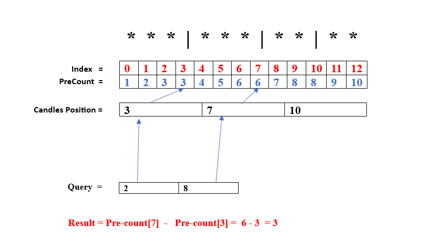
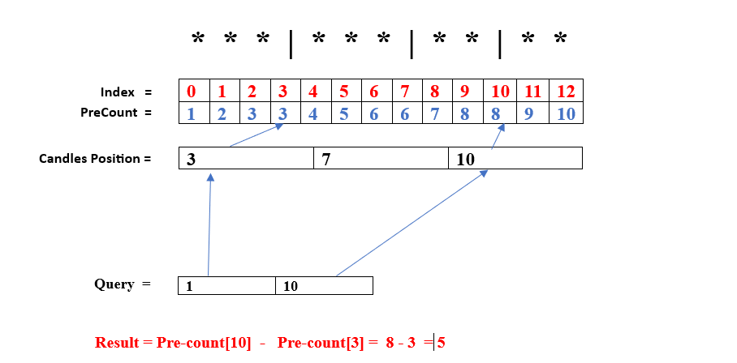
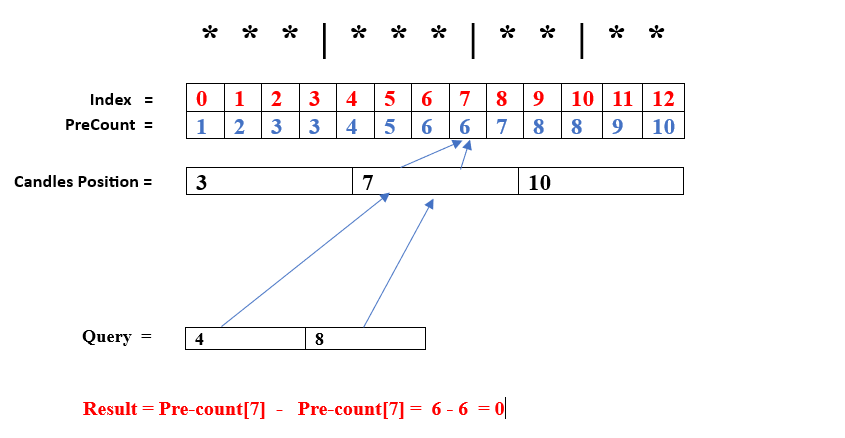

# Prefix Sum, Easy C++ with image Explanation ✅✅

**Author:** Deepak_5910
**Votes:** 12
**Link:** [https://leetcode.com/problems/plates-between-candles/solutions/3813432/](https://leetcode.com/problems/plates-between-candles/solutions/3813432/)

---

# Approach
**Precount :** Prefix-sum array that store the the number of plates(0 to i) at ith position.
**Candle Position:** Store the Candles position.

here for Each Query, we have to find out the candle's Positions **(just greater or equal to q[i][0] and just lesser or equal to q[i][1])**, using these candle's positions we can simply calculate the number of plates between them.


<!-- Describe your approach to solving the problem. -->





# Complexity
- Time complexity: O(N* Log(N))
<!-- Add your time complexity here, e.g. $$O(n)$$ -->

- Space complexity:O(N)
<!-- Add your space complexity here, e.g. $$O(n)$$ -->

# Code
```
class Solution {
public:
    vector<int> platesBetweenCandles(string s, vector<vector<int>>& q) {
      int n = s.size(),cnt = 0;
      vector<int> prec(n,0),cp,ans;
      for(int i = 0;i<n;i++)
      {
         if(s[i]=='*') cnt++;
         if(s[i]=='|') cp.push_back(i);
         prec[i] = cnt;
      }
      for(int i = 0;i<q.size();i++)
      {
          int l = lower_bound(cp.begin(),cp.end(),q[i][0])-cp.begin();
          int r = upper_bound(cp.begin(),cp.end(),q[i][1])-cp.begin();
          if(l<0 || l>=cp.size() || r<=0 || r>cp.size() || prec[cp[r-1]]-prec[cp[l]]<0) ans.push_back(0);
          else ans.push_back(prec[cp[r-1]]-prec[cp[l]]);
      }
      return ans;  
    }
};
```
