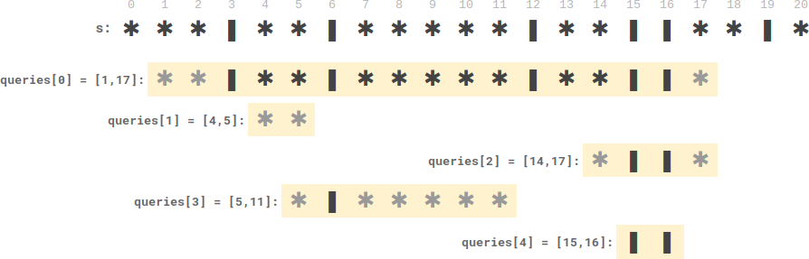

# Simple javascript solution, detailed explanation with comments

**Author:** bevins
**Votes:** 6
**Link:** [https://leetcode.com/problems/plates-between-candles/solutions/1550447/](https://leetcode.com/problems/plates-between-candles/solutions/1550447/)

---

##### **Steps**
1. Iterate string `s` while keeping track of total number of plates
2. Form an array `left` where `left[i]` is the total number of plates seen on the left of candle at `s[i]`

After step 1 and 2, you should see this 
(Referencing Example 2 from the question)


```
// e.g. There are 3 plates on the left of candle at index 3
// e.g. There are 10 plates on the left of candle at index 12
left = [
  0,  0,  0, 3, 0,  0, 5,
  0,  0,  0, 0, 0, 10, 0,
  0, 12, 12, 0, 0, 14, 0
]
candles is a Set containing { 3, 6, 12, 15, 16, 19 }
```

3. Process each query `[start, end]`
	* Check if `s[start]` is a candle. If not, find the nearest candle on the right
	* Check if `s[end]` is a candle. If not, find the nearest candle on the left

4. Calculate the number of candles between `start` and `end`, using `left[end] - left[start]`

##### **Example**
Query [1, 17] had `start = 1` and `end = 17`. 
Both are not candles, so we found the nearest candles to be `start = 3` and `end = 16`.
The difference (number of plates) between `start` and `end` is `left[16] - left[3] = 12 - 3 = 9`

Case where `diff` may be negative:
s = `*|*****`, query = `[1,3]`
`start = 1`, `end = 3`
We tried to find a candle on the left of `end`, but cannot find any. So `end` remains its value of `3`
Difference is now negative, `const diff = left[3] - left[1] = 0 - 1 = -1`
Push `0` to result instead since `diff` is negative

##### **Code**
```
/**
 * @param {string} s
 * @param {number[][]} queries
 * @return {number[]}
 */
var platesBetweenCandles = function (s, queries) {
  const result = []

  const left = Array(s.length).fill(0) // Initialize an array to store the number of plates seen on index i
  const candles = new Set() // Initialize a set to store the indexes of candles

  let leftPlateCount = 0; // Track the total number of plates seen so far
  for (const i in s) {
    if (s[i] === "|") { // If you see a candle,
      candles.add(+i) // add index i into candles Set ("+i" converts i of type string into a number)
      left[i] = leftPlateCount // also, store the number of plates you seen into 'left' array
    } else {
      leftPlateCount++ // If you see a plate, increment the total number of plates seen so far
    }
  }

  const candlesArr = [...candles] // Converts the Set into an array to iterate on later
  for (let [start, end] of queries) { // Destructure [start, end] from each query
    if (!candles.has(start)) { // If s[start] is not in candles Set
      for (const v of candlesArr) { // Iterate candlesArr from the front
        if (v >= start) { // Find the nearest candle index and assign to 'start'
          start = v
          break // Early termination
        }
      }
    }

    if (!candles.has(end)) { // If s[end] is not in candles Set
      for (let i = candlesArr.length - 1; i > 0; i--) { // Iterate candlesArr from the back
        if (candlesArr[i] <= end) { // Find the nearest candle index and assign to 'end'
          end = candlesArr[i]
          break // Early termination
        }
      }
    }

    if (start >= end) { // If start > end, it is an invalid query and we can push '0' to result
      result.push(0)
      continue
    }
	
	// Number of plates between candle at index start and candle at index end
	// Plates on the left of candle at index end minus plates on the left of candle at index start
    const diff = left[end] - left[start]
    result.push(diff < 0 ? 0 : diff) // If 'diff' is negative, push '0' to result, else push 'diff'
  }

  return result
}
```