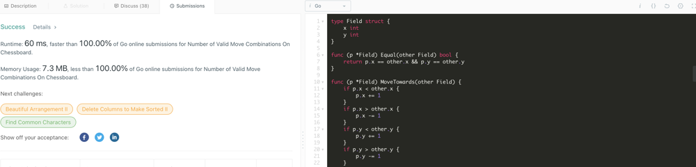

# Go | Explanation | Exhaustive search | Faster 100%

**Author:** sobik
**Votes:** 0
**Link:** [https://leetcode.com/problems/number-of-valid-move-combinations-on-chessboard/solutions/2501847/](https://leetcode.com/problems/number-of-valid-move-combinations-on-chessboard/solutions/2501847/)

---


### Explanation
1. For each piece generate list of all reachable fields.
2. Generate all possible final positions of pieces using lists from step #1
3. Define function that checks if trajectories of piece1 startField1 -> endField1 and piece2 startField2 -> endField2 clash
4. Apply function from step #3 to each pair from each final posiiton from step 2. If some trajectories will clash, then current final position is invalid. Else increase answer by 1. 
```
type Field struct {
	x int
	y int
}

func (p *Field) Equal(other Field) bool {
	return p.x == other.x && p.y == other.y
}

func (p *Field) MoveTowards(other Field) {
	if p.x < other.x {
		p.x += 1
	}
	if p.x > other.x {
		p.x -= 1
	}
	if p.y < other.y {
		p.y += 1
	}
	if p.y > other.y {
		p.y -= 1
	}
}

func (p *Field) Move(dir Field) Field {
	return Field{p.x + dir.x, p.y + dir.y}	
}

func (p *Field) IsValid() bool {
	return p.x >= 1 && p.x <= 8 && p.y >= 1 && p.y <= 8
}

func (p *Field) Copy() Field{
	return Field{p.x, p.y}
}

func willClash(start1, end1, start2, end2 Field) bool {
	for !start1.Equal(end1) || !start2.Equal(end2) {
		start1.MoveTowards(end1)
		start2.MoveTowards(end2)
		if start1.Equal(start2) {
			return true
		}
	}
	return false
}

func getPossibleMoves(piece string, startField Field) (result []Field) {
	horisontalMoves := []Field{{1, 0}, {0, 1}, {-1, 0}, {0, -1}}
	diagnoalMoves := []Field{{1, 1}, {-1, 1}, {1, -1}, {-1, -1}}

	findAllPossibleMoves := func(startField Field, directions[] Field) (possibleMoves []Field) {
		for _, dir := range directions {
			currentField := startField.Move(dir)
			for currentField.IsValid(){
				possibleMoves = append(possibleMoves, currentField)
				currentField = currentField.Move(dir)
			}
		}
		return
	}

	result = append(result, startField)
	switch piece {
		case "rook": {
			result = append(result, findAllPossibleMoves(startField, horisontalMoves)...)
		}
		case "bishop": {
			result = append(result, findAllPossibleMoves(startField, diagnoalMoves)...)
		}
		case "queen": {
			result = append(result, findAllPossibleMoves(startField, horisontalMoves)...)
			result = append(result, findAllPossibleMoves(startField, diagnoalMoves)...)
		}
		default : {
			panic("No such piece exists")
		}
	}
	return
}

func isValidEndFields(startFields, endFields []Field) bool {
	for i:=0; i<len(startFields); i++ {
		for j:=0; j<i; j++ {
			if willClash(startFields[i], endFields[i], startFields[j], endFields[j]) {
				return false
			}
		}
	}
	return true
}

func countCombinations(pieces []string, positions [][]int) int {
	piecesCount := len(pieces)
	startFields := []Field{}
	for _, pos := range positions {
		startFields = append(startFields, Field{pos[0], pos[1]})
	}

	var search func(pos int, endFields []Field) int 
	
	search = func(pos int, endFields []Field) int {
		if pos == piecesCount {
			if isValidEndFields(startFields, endFields) {
				return 1
			} else {
				return 0
			}
		}
		res := 0
		possibleMoves := getPossibleMoves(pieces[pos], startFields[pos])
		for _, move := range possibleMoves {
			endFields[pos] = move
			res += search(pos+1, endFields)	
		}
		return res
	}

	return search(0, make([]Field, len(pieces)))
}

```