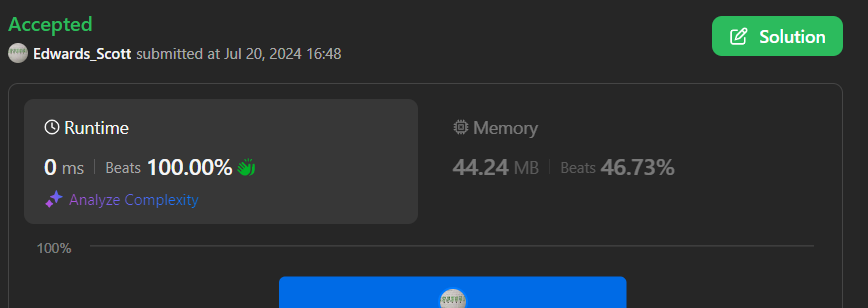

# 💢☠💫Easiest👾Faster✅💯 Lesser🧠 🎯 C++✅Python3🐍✅Java✅C✅Python🐍✅C#✅💥🔥💫Explained☠💥🔥 Beats 💯

**Author:** Edwards310
**Votes:** 3
**Link:** [https://leetcode.com/problems/smallest-index-with-equal-value/solutions/5507416/](https://leetcode.com/problems/smallest-index-with-equal-value/solutions/5507416/)

---

# Intuition


```C++ []
class Solution {
public:
    int smallestEqual(vector<int>& nums) {
        for(int i = 0; i < nums.size(); ++i){
            if(i % 10 == nums[i])
                return i;
        }
        return -1;
    }
};
```
```python3 []
class Solution:
    def smallestEqual(self, nums: List[int]) -> int:
        for i in range(len(nums)):
            if i % 10 == nums[i]:
                return i
        return  -1 
```
```C# []
public class Solution {
    public int SmallestEqual(int[] nums) {
        for(int i = 0; i < nums.Length; ++i){
            if(i % 10 == nums[i])
                return i;
        }
        return -1;
    }
}
```
```Java []
class Solution {
    public int smallestEqual(int[] nums) {
        int i = 0;
        int n = nums.length;
        while(i < n){
            if(i % 10 == nums[i])
                return i;
            i++;
        }
        return -1;
    }
}
```
```python []
class Solution(object):
    def smallestEqual(self, nums):
        """
        :type nums: List[int]
        :rtype: int
        """
        for u in range(len(nums)):
            if u % 10 == nums[u]:
                return u
        return -1
```
```C []
int smallestEqual(int* nums, int numsSize) {
    for(int i = 0; i < numsSize; ++i){
        if(i % 10 == nums[i])
            return i;
    }
    return -1;
}
```

<!-- Describe your first thoughts on how to solve this problem. -->

# Approach
<!-- Describe your approach to solving the problem. -->

# Complexity
- Time complexity:
<!-- Add your time complexity here, e.g. $$O(n)$$ -->
    O(n)
- Space complexity:
<!-- Add your space complexity here, e.g. $$O(n)$$ -->
    O(1)
# Code
```
class Solution {
    public int smallestEqual(int[] nums) {
        int i = 0;
        int n = nums.length;
        while(i < n){
            if(i % 10 == nums[i])
                return i;
            i++;
        }
        return -1;
    }
}
```

