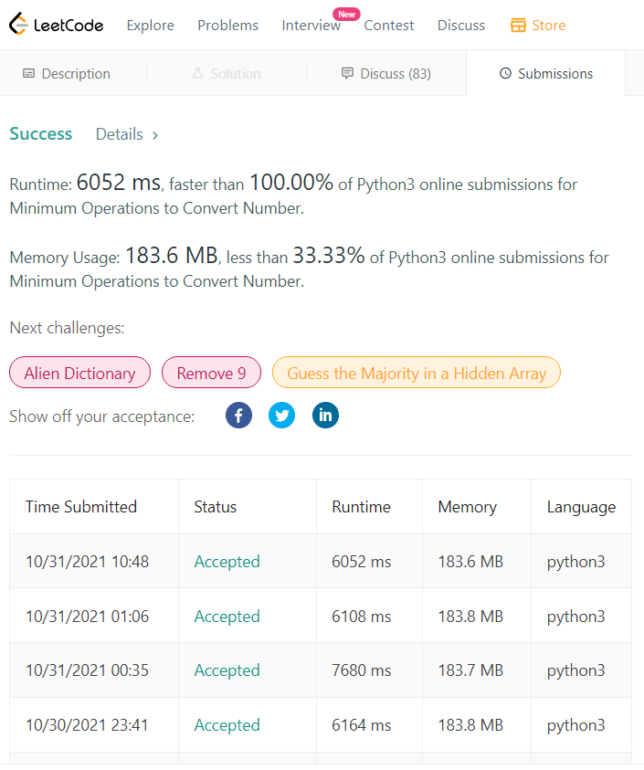

# [Python3] bfs

**Author:** ye15
**Votes:** 21
**Link:** [https://leetcode.com/problems/minimum-operations-to-convert-number/solutions/1550007/](https://leetcode.com/problems/minimum-operations-to-convert-number/solutions/1550007/)

---

Please check out this [commit](https://github.com/gaosanyong/leetcode/commit/4001168494179e85482f91afbf0cd66b908544f3) for my solutions of weekly 265. 
```
class Solution:
    def minimumOperations(self, nums: List[int], start: int, goal: int) -> int:
        ans = 0
        seen = {start}
        queue = deque([start])
        while queue: 
            for _ in range(len(queue)): 
                val = queue.popleft()
                if val == goal: return ans 
                if 0 <= val <= 1000: 
                    for x in nums: 
                        for op in (add, sub, xor): 
                            if op(val, x) not in seen: 
                                seen.add(op(val, x))
                                queue.append(op(val, x))
            ans += 1
        return -1 
```

I saw a few comments complaining TLE. But I've tried multiple submissions they are all consistently 6000-7000ms which is well within the range of AC (see the pic).




An alternative implementation using `list` runs 3500-4000ms
```
class Solution:
    def minimumOperations(self, nums: List[int], start: int, goal: int) -> int:
        ans = 0
        queue = deque([start])
        visited = [False]*1001
        while queue: 
            for _ in range(len(queue)): 
                val = queue.popleft()
                if val == goal: return ans 
                if 0 <= val <= 1000 and not visited[val]: 
                    visited[val] = True
                    for x in nums: 
                        for xx in (val+x, val-x, val^x):
                            queue.append(xx)
            ans += 1
        return -1 
```
