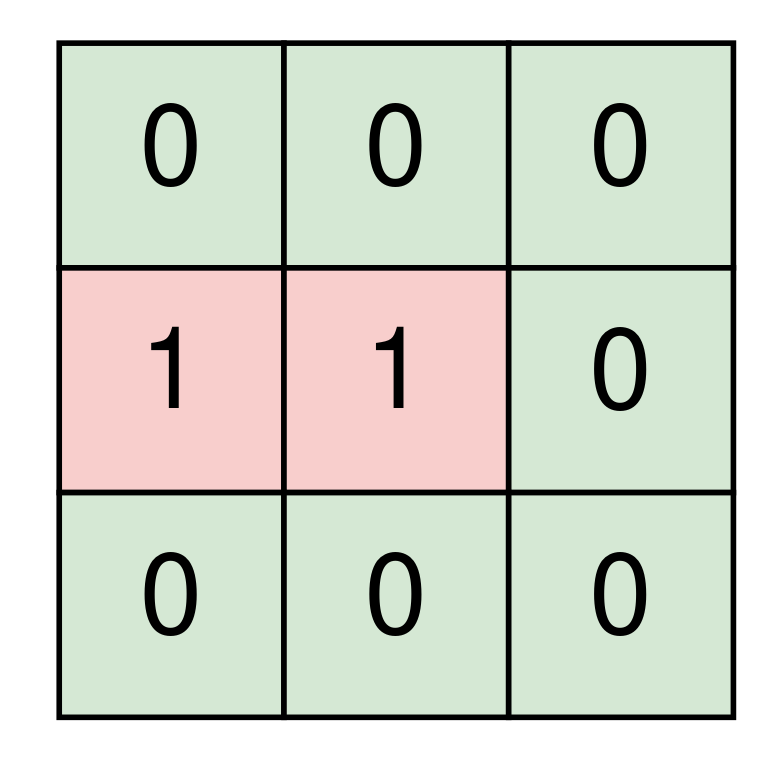
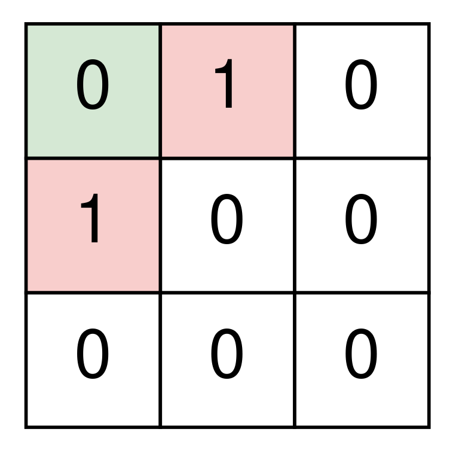

# [2061. Number of Spaces Cleaning Robot Cleaned](https://leetcode.com/problems/number-of-spaces-cleaning-robot-cleaned/)

| Category | Difficulty | Likes | Dislikes |
| :------: | :--------: | :---: | :------: |
| Algorithms | Medium | 128 | 29 |

**Tags:** [`array`](https://leetcode.com/tag/array), [`matrix`](https://leetcode.com/tag/matrix), [`simulation`](https://leetcode.com/tag/simulation)

**Companies:** `microsoft`

## Description

A room is represented by a **0-indexed** 2D binary matrix `room` where a `0` represents an **empty** space and a `1` represents a space with an **object**. The top left corner of the room will be empty in all test cases.

A cleaning robot starts at the top left corner of the room and is facing right. The robot will continue heading straight until it reaches the edge of the room or it hits an object, after which it will turn 90 degrees **clockwise** and repeat this process. The starting space and all spaces that the robot visits are **cleaned** by it.

Return *the number of **clean** spaces in the room if the robot runs indefinitely.*

 

**Example 1:**

 

**Input:** room = [[0,0,0],[1,1,0],[0,0,0]]

**Output:** 7

**Explanation:**

	- ​​​​​​​The robot cleans the spaces at (0, 0), (0, 1), and (0, 2).

	- The robot is at the edge of the room, so it turns 90 degrees clockwise and now faces down.

	- The robot cleans the spaces at (1, 2), and (2, 2).

	- The robot is at the edge of the room, so it turns 90 degrees clockwise and now faces left.

	- The robot cleans the spaces at (2, 1), and (2, 0).

	- The robot has cleaned all 7 empty spaces, so return 7.

**Example 2:**

 

**Input:** room = [[0,1,0],[1,0,0],[0,0,0]]

**Output:** 1

**Explanation:**

	- The robot cleans the space at (0, 0).

	- The robot hits an object, so it turns 90 degrees clockwise and now faces down.

	- The robot hits an object, so it turns 90 degrees clockwise and now faces left.

	- The robot is at the edge of the room, so it turns 90 degrees clockwise and now faces up.

	- The robot is at the edge of the room, so it turns 90 degrees clockwise and now faces right.

	- The robot is back at its starting position.

	- The robot has cleaned 1 space, so return 1.

**Example 3:**

**Input:** room = [[0,0,0],[0,0,0],[0,0,0]]

**Output:** 8​​​​​​​

 

 

**Constraints:**

	- `m == room.length`

	- `n == room[r].length`

	- `1 <= m, n <= 300`

	- `room[r][c]` is either `0` or `1`.

	- `room[0][0] == 0`

---

**Links:** [Submissions](https://leetcode.com/problems/number-of-spaces-cleaning-robot-cleaned/) | [Solutions](https://leetcode.com/problems/number-of-spaces-cleaning-robot-cleaned/)
