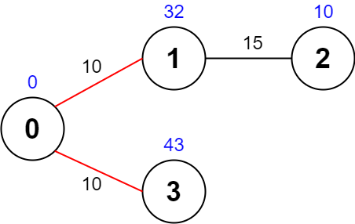
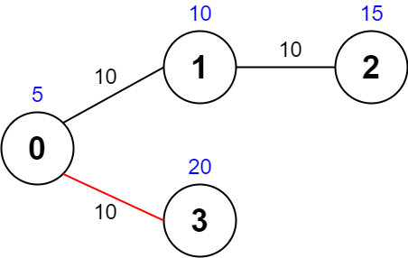
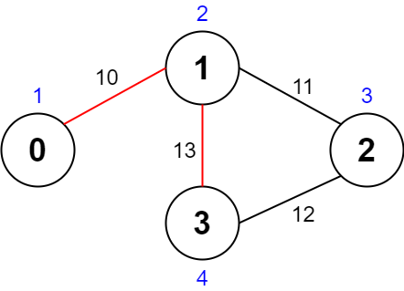

# [2065. Maximum Path Quality of a Graph](https://leetcode.com/problems/maximum-path-quality-of-a-graph/)

| Category | Difficulty | Likes | Dislikes |
| :------: | :--------: | :---: | :------: |
| Algorithms | Hard | 711 | 53 |

**Tags:** [`array`](https://leetcode.com/tag/array), [`backtracking`](https://leetcode.com/tag/backtracking), [`graph`](https://leetcode.com/tag/graph)

**Companies:** `doordash`, `apple`, `sap`

## Description

There is an **undirected** graph with `n` nodes numbered from `0` to `n - 1` (**inclusive**). You are given a **0-indexed** integer array `values` where `values[i]` is the **value **of the `i^th` node. You are also given a **0-indexed** 2D integer array `edges`, where each `edges[j] = [u_j, v_j, time_j]` indicates that there is an undirected edge between the nodes `u_j` and `v_j`, and it takes `time_j` seconds to travel between the two nodes. Finally, you are given an integer `maxTime`.

A **valid** **path** in the graph is any path that starts at node `0`, ends at node `0`, and takes **at most** `maxTime` seconds to complete. You may visit the same node multiple times. The **quality** of a valid path is the **sum** of the values of the **unique nodes** visited in the path (each node's value is added **at most once** to the sum).

Return *the **maximum** quality of a valid path*.

**Note:** There are **at most four** edges connected to each node.

 

**Example 1:**


```

Input: values = [0,32,10,43], edges = [[0,1,10],[1,2,15],[0,3,10]], maxTime = 49
Output: 75
Explanation:
One possible path is 0 -&gt; 1 -&gt; 0 -&gt; 3 -&gt; 0. The total time taken is 10 + 10 + 10 + 10 = 40 &lt;= 49.
The nodes visited are 0, 1, and 3, giving a maximal path quality of 0 + 32 + 43 = 75.

```

**Example 2:**


```

Input: values = [5,10,15,20], edges = [[0,1,10],[1,2,10],[0,3,10]], maxTime = 30
Output: 25
Explanation:
One possible path is 0 -&gt; 3 -&gt; 0. The total time taken is 10 + 10 = 20 &lt;= 30.
The nodes visited are 0 and 3, giving a maximal path quality of 5 + 20 = 25.

```

**Example 3:**


```

Input: values = [1,2,3,4], edges = [[0,1,10],[1,2,11],[2,3,12],[1,3,13]], maxTime = 50
Output: 7
Explanation:
One possible path is 0 -&gt; 1 -&gt; 3 -&gt; 1 -&gt; 0. The total time taken is 10 + 13 + 13 + 10 = 46 &lt;= 50.
The nodes visited are 0, 1, and 3, giving a maximal path quality of 1 + 2 + 4 = 7.

```

 

**Constraints:**

	- `n == values.length`

	- `1 <= n <= 1000`

	- `0 <= values[i] <= 10^8`

	- `0 <= edges.length <= 2000`

	- `edges[j].length == 3 `

	- `0 <= u_j < v_j <= n - 1`

	- `10 <= time_j, maxTime <= 100`

	- All the pairs `[u_j, v_j]` are **unique**.

	- There are **at most four** edges connected to each node.

	- The graph may not be connected.

---

**Links:** [Submissions](https://leetcode.com/problems/maximum-path-quality-of-a-graph/) | [Solutions](https://leetcode.com/problems/maximum-path-quality-of-a-graph/)
