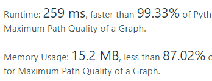

# python | BFS | 99.33% | commented

**Author:** hanjo108
**Votes:** 15
**Link:** [https://leetcode.com/problems/maximum-path-quality-of-a-graph/solutions/1965727/](https://leetcode.com/problems/maximum-path-quality-of-a-graph/solutions/1965727/)

---

Hello, just wrote this and wanted to checkout other's solution, and I couldn't find fast BFS solutions, so I am just sharing my code.

I wonder how can I not keeping copy of set every append to queue. Please **any suggest** will be appreciated

**Thought process:**
1. build undirected graph
2. start BFS from 0 with (current vertex / time taken so far / quality collected so far / used vertext so far for this path)
3. **Memoization** here which let you stop if current vertext can't give you better result extremely accelerate the whole algorithm
4. Also if the time taken so far is more than the limit, no need to proceed
5. If we are at node '0' then let's keep the maximum quality points collected so far
6. quality will only be updated if has not been collected for the path. I am copying the set to use for new path. (like I said, any suggestion to use instead of this is big thanks)

```
class Solution:
    def maximalPathQuality(self, values: List[int], edges: List[List[int]], maxTime: int) -> int:
        graph = defaultdict(list)
		# build graph
        for edge in edges:
            graph[edge[0]].append((edge[1], edge[2]))
            graph[edge[1]].append((edge[0], edge[2]))
        
        q = deque()
        q.append((0, 0, values[0], set([0])))
        cache = {}
        maxPoint = 0
		
        while q:
            currV, currTime, currPoints, currSet = q.popleft()
            if currV in cache:
				# if vertex has been visited, and if the previousTime is 
				# less or equal to current time but current points is lower?
				# then this path can't give us better quality so stop proceeding.
                prevTime, prevPoints = cache[currV]
                if prevTime <= currTime and prevPoints > currPoints:
                    continue
            cache[currV] = (currTime, currPoints)
			# can't go over the maxTime limit
            if currTime > maxTime:
                continue
			# collect maxPoint only if current vertex is 0
            if currV == 0:
                maxPoint = max(maxPoint, currPoints)
            for neigh, neighTime in graph[currV]:
                newSet = currSet.copy()
				# collects quality only if not collected before
                if neigh not in currSet:
                    newSet.add(neigh)
                    newPoint = currPoints + values[neigh]
                else:
                    newPoint = currPoints
                q.append((neigh, currTime + neighTime, newPoint, newSet))
        return maxPoint
```



**Please correct me if I am wrong !
Please UPVOTE if you find this solution helpful !
Happy algo!**
