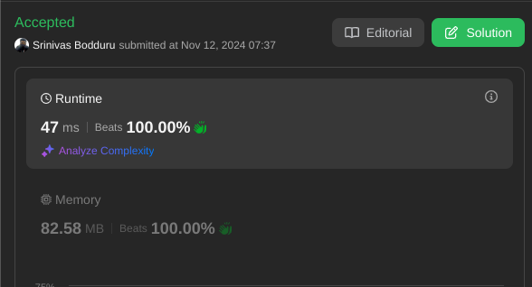

# 🌟 Beats 100.00% 👏 || For loop || Explained with example

**Author:** phoenix_sr
**Votes:** 55
**Link:** [https://leetcode.com/problems/most-beautiful-item-for-each-query/solutions/6035442/](https://leetcode.com/problems/most-beautiful-item-for-each-query/solutions/6035442/)

---



# Intuition
<!-- Describe your first thoughts on how to solve this problem. -->
The goal of this algorithm is to find the maximum "beauty" of items a person can afford, given an array of items, where each item is represented as [price, beauty], and an array of queries, where each query represents an available budget.

To do this efficiently:

We preprocess the items to build a "price-beauty bracket" where each entry stores the highest possible beauty value achievable up to a certain price.
For each query, we quickly look up the maximum beauty achievable within that budget by consulting our preprocessed data.
This allows us to answer each query in constant time after the preprocessing step.


# Approach
<!-- Describe your approach to solving the problem. -->
The algorithm is divided into two main parts: preprocessing the items and processing the queries.

Part 1: Preprocessing
Sort the Items by Price: We first sort the items array by price in ascending order. Sorting helps ensure that each processed item has a price greater than or equal to previous items, allowing us to build a cumulative "price-beauty bracket."

Construct Price-Beauty Brackets:

We create a list res to store "price-beauty brackets." Each bracket is represented as [min_price, max_beauty, max_price].
Starting with a bracket [0, 0, \u221E], which represents zero budget, we iterate over each item in sorted order:
If the current item's beauty is higher than the last recorded beauty in res, we add a new bracket with the current item's price and beauty, updating the last bracket\u2019s max_price to the current price.
Result of Preprocessing: At the end of preprocessing, res will contain cumulative price-beauty brackets, allowing us to check the maximum beauty for any budget by examining the highest bracket we can afford.

Part 2: Processing the Queries
For each budget in queries, we iterate backward through res (from the most expensive bracket to the least) and find the first bracket with a minimum price that fits within the query budget.
We record the corresponding beauty value in the result array.

# Example
Suppose we have:

items = [[1, 2], [3, 4], [5, 6], [6, 8]] (price-beauty pairs)
queries = [2, 3, 5, 7] (budgets)
Step-by-Step Execution
Sorting Items by Price

After sorting (already sorted here), we have items = [[1, 2], [3, 4], [5, 6], [6, 8]].
Building the Price-Beauty Brackets (res)

Initialize res with [0, 0, \u221E].
Process each item:
Item [1, 2]: Since 2 > 0 (last bracket's beauty), add a new bracket [1, 2, \u221E] and set the last bracket\u2019s max_price to 1.
Item [3, 4]: Since 4 > 2, add [3, 4, \u221E] and update the previous bracket\u2019s max_price to 3.
Item [5, 6]: Since 6 > 4, add [5, 6, \u221E] and update the previous bracket\u2019s max_price to 5.
Item [6, 8]: Since 8 > 6, add [6, 8, \u221E] and update the previous bracket\u2019s max_price to 6.
Final res: [[0, 0, 1], [1, 2, 3], [3, 4, 5], [5, 6, 6], [6, 8, \u221E]].
Answering Queries

For each query in queries, find the maximum beauty that can be afforded.
Query 2: Find the last bracket with min_price <= 2. Result: bracket [1, 2, 3], so beauty is 2.
Query 3: Last bracket with min_price <= 3. Result: bracket [3, 4, 5], so beauty is 4.
Query 5: Last bracket with min_price <= 5. Result: bracket [5, 6, 6], so beauty is 6.
Query 7: Last bracket with min_price <= 7. Result: bracket [6, 8, \u221E], so beauty is 8.
Output
The final output for the queries [2, 3, 5, 7] would be [2, 4, 6, 8].

# Complexity
- Time complexity:O(N log N)
<!-- Add your time complexity here, e.g. $$O(n)$$ -->

- Space complexity:O(M)
<!-- Add your space complexity here, e.g. $$O(n)$$ -->

# Code
```javascript []
var maximumBeauty = function (items, queries) {
    const maxI = Number.MAX_SAFE_INTEGER;
    let res = [[0, 0, maxI]]

    items.sort((a, b) => a[0] - b[0])

    for (let item of items) {
        let price = item[0]
        let beauty = item[1]
        let lastBracket = res.at(-1)

        if (beauty > lastBracket[1]) {
            res[res.length - 1][2] = price
            res.push([price, beauty, maxI])
        }
    }

    let ans = []

    for (let x of queries) {
        for (let i = res.length - 1; i > -1; i--) {
            if (res[i][0] <= x) {
                ans.push(res[i][1])
                break
            }
        }
    }

    return ans

};
```
```python []
class Solution(object):
    def maximumBeauty(self, items, queries):
        
        maxI = float('inf')
        res = [[0, 0, maxI]]
    
        items.sort(key=lambda x: x[0])

        for price, beauty in items:
            lastBracket = res[-1]
            if beauty > lastBracket[1]:
                res[-1][2] = price
                res.append([price, beauty, maxI])

        ans = []

        for x in queries:
            for i in range(len(res) - 1, -1, -1):
                if res[i][0] <= x:
                    ans.append(res[i][1])
                    break

        return ans

```
```java []
import java.util.*;

public class Solution {
    public int[] maximumBeauty(int[][] items, int[] queries) {
        int maxI = Integer.MAX_VALUE;
        List<int[]> res = new ArrayList<>();
        res.add(new int[] {0, 0, maxI});

        Arrays.sort(items, Comparator.comparingInt(a -> a[0]));

        for (int[] item : items) {
            int price = item[0];
            int beauty = item[1];
            int[] lastBracket = res.get(res.size() - 1);

            if (beauty > lastBracket[1]) {
                lastBracket[2] = price;
                res.add(new int[] {price, beauty, maxI});
            }
        }

        int[] ans = new int[queries.length];

        for (int j = 0; j < queries.length; j++) {
            int x = queries[j];
            for (int i = res.size() - 1; i >= 0; i--) {
                if (res.get(i)[0] <= x) {
                    ans[j] = res.get(i)[1];
                    break;
                }
            }
        }

        return ans;
    }
}

```
```c++ []
#include <vector>
#include <algorithm>
#include <climits>

using namespace std;

class Solution {
public:
    vector<int> maximumBeauty(vector<vector<int>>& items, vector<int>& queries) {
        int maxI = INT_MAX;
        vector<vector<int>> res = {{0, 0, maxI}};

        sort(items.begin(), items.end());

        for (const auto& item : items) {
            int price = item[0];
            int beauty = item[1];
            if (beauty > res.back()[1]) {
                res.back()[2] = price;
                res.push_back({price, beauty, maxI});
            }
        }

        vector<int> ans;

        for (int x : queries) {
            for (int i = res.size() - 1; i >= 0; i--) {
                if (res[i][0] <= x) {
                    ans.push_back(res[i][1]);
                    break;
                }
            }
        }

        return ans;
    }
};
```
