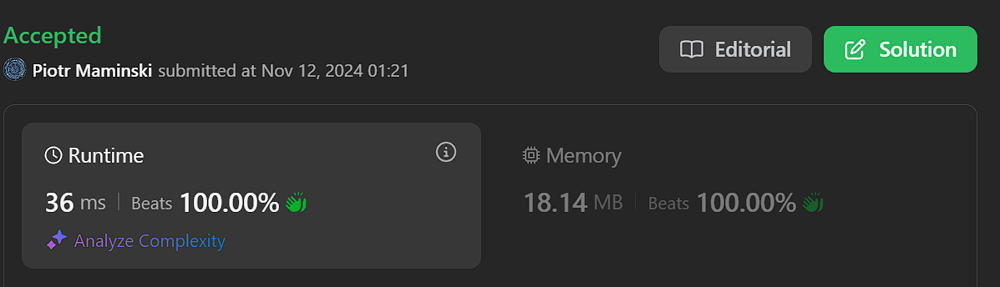

# ✅ Tutorial Video | Simple and Short | Working 12.11.2024

**Author:** Piotr_Maminski
**Votes:** 13
**Link:** [https://leetcode.com/problems/most-beautiful-item-for-each-query/solutions/6035220/](https://leetcode.com/problems/most-beautiful-item-for-each-query/solutions/6035220/)

---


https://youtu.be/kybir7n8JJg?si=9bsPxiEvtf3d-YqM
# #1 Sorting + Two Pointers - Most simple solution


```python3 []
class Solution:
    def maximumBeauty(self, items: List[List[int]], queries: List[int]) -> List[int]:
        items.sort()  
        queries = sorted([(q, i) for i, q in enumerate(queries)])  

        res = [0] * len(queries)
        max_bea = 0
        j = 0
        for q, i in queries:
            while j < len(items) and items[j][0] <= q:
                max_bea = max(max_bea, items[j][1])
                j += 1

            res[i] = max_bea

        return res


```
```cpp []
class Solution {
public:
    vector<int> maximumBeauty(vector<vector<int>>& items, vector<int>& queries) {
        sort(items.begin(), items.end());
        vector<pair<int, int>> queriesWithIndex;
        for (int i = 0; i < queries.size(); i++) {
            queriesWithIndex.push_back({queries[i], i});
        }
        sort(queriesWithIndex.begin(), queriesWithIndex.end());
        
        vector<int> res(queries.size());
        int maxBea = 0;
        int j = 0;
        for (auto [q, i] : queriesWithIndex) {
            while (j < items.size() && items[j][0] <= q) {
                maxBea = max(maxBea, items[j][1]);
                j++;
            }
            res[i] = maxBea;
        }
        return res;
    }
};
```
```java []
class Solution {
    public int[] maximumBeauty(int[][] items, int[] queries) {
        Arrays.sort(items, (a, b) -> a[0] - b[0]);
        int[][] queriesWithIndex = new int[queries.length][2];
        for (int i = 0; i < queries.length; i++) {
            queriesWithIndex[i] = new int[]{queries[i], i};
        }
        Arrays.sort(queriesWithIndex, (a, b) -> a[0] - b[0]);
        
        int[] res = new int[queries.length];
        int maxBea = 0;
        int j = 0;
        for (int[] query : queriesWithIndex) {
            while (j < items.length && items[j][0] <= query[0]) {
                maxBea = Math.max(maxBea, items[j][1]);
                j++;
            }
            res[query[1]] = maxBea;
        }
        return res;
    }
}
```
```csharp []
public class Solution {
    public int[] MaximumBeauty(int[][] items, int[] queries) {
        Array.Sort(items, (a, b) => a[0].CompareTo(b[0]));
        var queriesWithIndex = queries.Select((q, i) => new { Query = q, Index = i })
                                    .OrderBy(x => x.Query)
                                    .ToArray();
        
        int[] res = new int[queries.Length];
        int maxBea = 0;
        int j = 0;
        foreach (var query in queriesWithIndex) {
            while (j < items.Length && items[j][0] <= query.Query) {
                maxBea = Math.Max(maxBea, items[j][1]);
                j++;
            }
            res[query.Index] = maxBea;
        }
        return res;
    }
}
```
```golang []
func maximumBeauty(items [][]int, queries []int) []int {
    sort.Slice(items, func(i, j int) bool {
        return items[i][0] < items[j][0]
    })
    
    type Query struct {
        val, idx int
    }
    queriesWithIndex := make([]Query, len(queries))
    for i, q := range queries {
        queriesWithIndex[i] = Query{q, i}
    }
    sort.Slice(queriesWithIndex, func(i, j int) bool {
        return queriesWithIndex[i].val < queriesWithIndex[j].val
    })
    
    res := make([]int, len(queries))
    maxBea := 0
    j := 0
    for _, q := range queriesWithIndex {
        for j < len(items) && items[j][0] <= q.val {
            if items[j][1] > maxBea {
                maxBea = items[j][1]
            }
            j++
        }
        res[q.idx] = maxBea
    }
    return res
}
```
```swift []
class Solution {
    func maximumBeauty(_ items: [[Int]], _ queries: [Int]) -> [Int] {
        let sortedItems = items.sorted { $0[0] < $1[0] }
        let queriesWithIndex = queries.enumerated().map { ($1, $0) }.sorted { $0.0 < $1.0 }
        
        var res = Array(repeating: 0, count: queries.count)
        var maxBea = 0
        var j = 0
        
        for (query, index) in queriesWithIndex {
            while j < sortedItems.count && sortedItems[j][0] <= query {
                maxBea = max(maxBea, sortedItems[j][1])
                j += 1
            }
            res[index] = maxBea
        }
        return res
    }
}
```
```javascript [JS]
// JavaScript

var maximumBeauty = function(items, queries) {
    items.sort((a, b) => a[0] - b[0]);
    const queriesWithIndex = queries.map((q, i) => [q, i])
                                  .sort((a, b) => a[0] - b[0]);
    
    const res = new Array(queries.length).fill(0);
    let maxBea = 0;
    let j = 0;
    
    for (const [query, index] of queriesWithIndex) {
        while (j < items.length && items[j][0] <= query) {
            maxBea = Math.max(maxBea, items[j][1]);
            j++;
        }
        res[index] = maxBea;
    }
    return res;
};
```
```typescript [TS]
// TypeScript

function maximumBeauty(items: number[][], queries: number[]): number[] {
    items.sort((a, b) => a[0] - b[0]);
    const queriesWithIndex = queries.map((q, i) => [q, i])
                                  .sort((a, b) => a[0] - b[0]);
    
    const res = new Array(queries.length).fill(0);
    let maxBea = 0;
    let j = 0;
    
    for (const [query, index] of queriesWithIndex) {
        while (j < items.length && items[j][0] <= query) {
            maxBea = Math.max(maxBea, items[j][1]);
            j++;
        }
        res[index] = maxBea;
    }
    return res;
}
```
```rust []
impl Solution {
    pub fn maximum_beauty(items: Vec<Vec<i32>>, queries: Vec<i32>) -> Vec<i32> {
        let mut items = items;
        items.sort_by_key(|x| x[0]);
        
        let mut queries_with_index: Vec<(i32, usize)> = queries.iter()
            .enumerate()
            .map(|(i, &q)| (q, i))
            .collect();
        queries_with_index.sort_by_key(|&(q, _)| q);
        
        let mut res = vec![0; queries.len()];
        let mut max_bea = 0;
        let mut j = 0;
        
        for (query, index) in queries_with_index {
            while j < items.len() && items[j][0] <= query {
                max_bea = max_bea.max(items[j][1]);
                j += 1;
            }
            res[index] = max_bea;
        }
        res
    }
}


```
```ruby []
def maximum_beauty(items, queries)
    items.sort!
    queries_with_index = queries.each_with_index.map { |q, i| [q, i] }.sort
    
    res = Array.new(queries.size, 0)
    max_bea = 0
    j = 0
    
    queries_with_index.each do |query, index|
        while j < items.size && items[j][0] <= query
            max_bea = [max_bea, items[j][1]].max
            j += 1
        end
        res[index] = max_bea
    end
    
    res
end
```

- Complexy: Time O(n log n) and Space O(n)


# #2 Sorting + Binary Search (almost all beats 100%)

```python3 []
class Solution:
    def maximumBeauty(self, items: List[List[int]], queries: List[int]) -> List[int]:
        sorted_items = sorted(items, key=lambda item: item[0])  # Step 1: Sort items by price

        prices = [item[0] for item in sorted_items] # Step 2: Extract prices and beauties
        beauties = [item[1] for item in sorted_items]
        
        max_beauties = list(accumulate(beauties, max, initial=0)) # Step 3: Create running maximum beauty array
        
        result = []     # Step 4: Find maximum beauty for each query price
        for query_price in queries:
            index = bisect_right(prices, query_price)
            result.append(max_beauties[index])  
        return result
```
```cpp []
class Solution {
public:
    vector<int> maximumBeauty(vector<vector<int>>& items, vector<int>& queries) {
        // Step 1: Sort items by price in ascending order
        sort(items.begin(), items.end());
        
        // Step 2: Extract prices and beauties into separate vectors
        vector<int> prices, beauties;
        for (const auto& item : items) {
            prices.push_back(item[0]);
            beauties.push_back(item[1]);
        }
        
        // Step 3: Create running maximum beauty array
        vector<int> max_beauties(1, 0);
        int curr_max = 0;
        for (int beauty : beauties) {
            curr_max = max(curr_max, beauty);
            max_beauties.push_back(curr_max);
        }
        
        // Step 4: Process each query using binary search
        vector<int> result;
        for (int query_price : queries) {
            auto index = upper_bound(prices.begin(), prices.end(), query_price) - prices.begin();
            result.push_back(max_beauties[index]);
        }
        
        return result;
    }
};

```
```java []
class Solution {
    public int[] maximumBeauty(int[][] items, int[] queries) {
        // Step 1: Sort items by price in ascending order
        Arrays.sort(items, (a, b) -> Integer.compare(a[0], b[0]));
        
        int n = items.length;
        // Step 2: Extract prices and beauties into separate arrays
        int[] prices = new int[n];
        int[] beauties = new int[n];
        for (int i = 0; i < n; i++) {
            prices[i] = items[i][0];
            beauties[i] = items[i][1];
        }
        
        // Step 3: Create running maximum beauty array
        int[] maxBeauties = new int[n + 1];
        for (int i = 0; i < n; i++) {
            maxBeauties[i + 1] = Math.max(maxBeauties[i], beauties[i]);
        }
        
        // Step 4: Process each query using binary search
        int[] result = new int[queries.length];
        for (int i = 0; i < queries.length; i++) {
            int index = upperBound(prices, queries[i]);
            result[i] = maxBeauties[index];
        }
        
        return result;
    }
    
    // Helper method for binary search
    private int upperBound(int[] arr, int target) {
        int left = 0, right = arr.length;
        while (left < right) {
            int mid = left + (right - left) / 2;
            if (arr[mid] <= target) left = mid + 1;
            else right = mid;
        }
        return left;
    }
}
```
```csharp []
public class Solution {
    public int[] MaximumBeauty(int[][] items, int[] queries) {
        // Step 1: Sort items by price in ascending order
        Array.Sort(items, (a, b) => a[0].CompareTo(b[0]));
        
        int n = items.Length;
        // Step 2: Extract prices and beauties into separate arrays
        int[] prices = new int[n];
        int[] beauties = new int[n];
        for (int i = 0; i < n; i++) {
            prices[i] = items[i][0];
            beauties[i] = items[i][1];
        }
        
        // Step 3: Create running maximum beauty array
        int[] maxBeauties = new int[n + 1];
        for (int i = 0; i < n; i++) {
            maxBeauties[i + 1] = Math.Max(maxBeauties[i], beauties[i]);
        }
        
        // Step 4: Process each query using binary search
        int[] result = new int[queries.Length];
        for (int i = 0; i < queries.Length; i++) {
            int index = Array.BinarySearch(prices, queries[i]);
            if (index < 0) index = ~index;
            result[i] = maxBeauties[index];
        }
        
        return result;
    }
}
```
```golang []
func maximumBeauty(items [][]int, queries []int) []int {
    // Step 1: Sort items by price in ascending order
    sort.Slice(items, func(i, j int) bool {
        return items[i][0] < items[j][0]
    })
    
    n := len(items)
    // Step 2: Extract prices and beauties into separate slices
    prices := make([]int, n)
    beauties := make([]int, n)
    for i, item := range items {
        prices[i] = item[0]
        beauties[i] = item[1]
    }
    
    // Step 3: Create running maximum beauty array
    maxBeauties := make([]int, n+1)
    for i := 0; i < n; i++ {
        maxBeauties[i+1] = max(maxBeauties[i], beauties[i])
    }
    
    // Step 4: Process each query using binary search
    result := make([]int, len(queries))
    for i, query := range queries {
        index := sort.SearchInts(prices, query+1)
        result[i] = maxBeauties[index]
    }
    
    return result
}

func max(a, b int) int {
    if a > b {
        return a
    }
    return b
}
```
```swift []
class Solution {
    func maximumBeauty(_ items: [[Int]], _ queries: [Int]) -> [Int] {
        // Step 1: Sort items by price in ascending order
        let sortedItems = items.sorted { $0[0] < $1[0] }
        
        // Step 2: Extract prices and beauties into separate arrays
        let prices = sortedItems.map { $0[0] }
        let beauties = sortedItems.map { $0[1] }
        
        // Step 3: Create running maximum beauty array
        var maxBeauties = [0]
        var currentMax = 0
        for beauty in beauties {
            currentMax = max(currentMax, beauty)
            maxBeauties.append(currentMax)
        }
        
        // Step 4: Process each query using binary search
        return queries.map { query in
            let index = prices.firstIndex(where: { $0 > query }) ?? prices.count
            return maxBeauties[index]
        }
    }
}
```
```javascript [JS]
// JavaScript

var maximumBeauty = function(items, queries) {
    // Step 1: Sort items by price
    items.sort((a, b) => a[0] - b[0]);
    
    // Step 2: Extract prices and beauties
    const prices = items.map(item => item[0]);
    const beauties = items.map(item => item[1]);
    
    // Step 3: Create running maximum beauty array
    const maxBeauties = [0];
    let currentMax = 0;
    for (const beauty of beauties) {
        currentMax = Math.max(currentMax, beauty);
        maxBeauties.push(currentMax);
    }
    
    // Step 4: Find maximum beauty for each query price using binary search
    return queries.map(query => {
        let left = 0, right = prices.length;
        while (left < right) {
            const mid = Math.floor((left + right) / 2);
            if (prices[mid] <= query) {
                left = mid + 1;
            } else {
                right = mid;
            }
        }
        return maxBeauties[left];
    });
};
```
```typescript [TS]
// TypeScript

function maximumBeauty(items: number[][], queries: number[]): number[] {
    // Step 1: Sort items by price in ascending order
    items.sort((a, b) => a[0] - b[0]);
    
    // Step 2: Extract prices and beauties into separate arrays
    const prices: number[] = items.map(item => item[0]);
    const beauties: number[] = items.map(item => item[1]);
    
    // Step 3: Create running maximum beauty array
    const maxBeauties: number[] = [0];
    let currentMax = 0;
    for (const beauty of beauties) {
        currentMax = Math.max(currentMax, beauty);
        maxBeauties.push(currentMax);
    }
    
    // Step 4: Process each query using binary search
    return queries.map(query => {
        const index = upperBound(prices, query);
        return maxBeauties[index];
    });
}

// Helper function for binary search
function upperBound(arr: number[], target: number): number {
    let left = 0, right = arr.length;
    while (left < right) {
        const mid = Math.floor((left + right) / 2);
        if (arr[mid] <= target) left = mid + 1;
        else right = mid;
    }
    return left;
}
```
```rust []
impl Solution {
    pub fn maximum_beauty(mut items: Vec<Vec<i32>>, queries: Vec<i32>) -> Vec<i32> {
        // Step 1: Sort items by price in ascending order
        items.sort_by_key(|item| item[0]);
        
        // Step 2: Extract prices and beauties into separate vectors
        let prices: Vec<i32> = items.iter().map(|item| item[0]).collect();
        let beauties: Vec<i32> = items.iter().map(|item| item[1]).collect();
        
        // Step 3: Create running maximum beauty array
        let mut max_beauties = vec![0];
        let mut current_max = 0;
        for &beauty in beauties.iter() {
            current_max = current_max.max(beauty);
            max_beauties.push(current_max);
        }
        
        // Step 4: Process each query using binary search
        queries.iter().map(|&query| {
            let index = prices.partition_point(|&x| x <= query);
            max_beauties[index]
        }).collect()
    }
}
```
```ruby []
def maximum_beauty(items, queries)
    # Step 1: Sort items by price
    items.sort_by! { |item| item[0] }
    
    # Step 2: Extract prices and beauties
    prices = items.map { |item| item[0] }
    beauties = items.map { |item| item[1] }
    
    # Step 3: Create running maximum beauty array
    max_beauties = [0]
    current_max = 0
    beauties.each do |beauty|
        current_max = [current_max, beauty].max
        max_beauties << current_max
    end
    
    # Step 4: Find maximum beauty for each query price using binary search
    queries.map do |query|
        left = 0
        right = prices.length
        while left < right
            mid = (left + right) / 2
            if prices[mid] <= query
                left = mid + 1
            else
                right = mid
            end
        end
        max_beauties[left]
    end
end
```
- Complexy: Time O(n log n) and Space O(n)


# Step by Step

---

1. Sort all items by price in ascending order making it easier to find items within price ranges

```
sorted_items = sorted(items, key=lambda item: item[0])
```
2. Create two sorted lists
- `prices`
- `beauties`

```
prices = [item[0] for item in sorted_items]
beauties = [item[1] for item in sorted_items]
```
3. Track Maximum Beauty
- Create a running maximum beauty array where each position i contains the maximum beauty value seen up to index i.  `initial=0` In case when no items are affordable.
```
max_beauties = list(accumulate(beauties, max, initial=0))
```
4. Query Processing
- Use binary search (bisect_right) to find where the query price woud fit in the sorted prices
- Looks up the maximum beauty achievable at that price point using the [pre-computed](https://en.wikipedia.org/wiki/Precomputation) `max_beauties` array

```
for query_price in queries:
    index = bisect_right(prices, query_price)
    result.append(max_beauties[index])
```

---

# Still dont understand binary search
- IMO Best explained Binary Search: google "topcoder Binary Search" first 
- Video:
 https://www.youtube.com/watch?v=GU7DpgHINWQ


---


# Most common Array Interview Problems
List based on my research (interviews, reddit, github) Probably not 100% accurate but very close to my recruitments. Leetcode Premium is probably more accurate [I don't have]


**Easy:** [[1. Two Sum]](https://leetcode.com/problems/two-sum/solutions/5999466/beats-100-explained-step-by-step-list-most-common-array-inverview) **(common warm-up)** [[121. Best Time to Buy and Sell Stock]](https://leetcode.com/discuss/topic/6027720/solution/) [[88. Merge Sorted Array]](https://leetcode.com/problems/merge-sorted-array/solutions/6031394/beats-100-explained-step-by-step-list-most-common-string-interview-problems) [[27. Remove Element]](https://leetcode.com/problems/remove-element/solutions/6031528/beats-100-explained-step-by-step-list-most-common-array-interview-problems) [[929. Unique Email Addresses]](https://leetcode.com/problems/unique-email-addresses/solutions/6031687/explained-step-by-step-video-list-most-common-array-interview-problems) 


**Medium/Hard:** [[15. 3Sum]](https://leetcode.com/problems/3sum/description/) [[42. Trapping Rain Water]](https://leetcode.com/problems/trapping-rain-water/?envType=problem-list-v2&envId=atbyk0mj) [[56. Merge Intervals]](https://leetcode.com/problems/merge-intervals/description/) [[57. Insert Interval]](https://leetcode.com/problems/insert-interval/description/) [[46. Permutations]](https://leetcode.com/problems/permutations/description/) [[53. Maximum Subarray]](https://leetcode.com/problems/maximum-subarray/description/) [[73. Set Matrix Zeroes]](https://leetcode.com/problems/set-matrix-zeroes/description/) [[284. Peeking Iterator]](https://leetcode.com/problems/peeking-iterator/description/)


####  [Interview Questions and Answers Repository](https://github.com/RooTinfinite/Interview-questions-and-answers)




