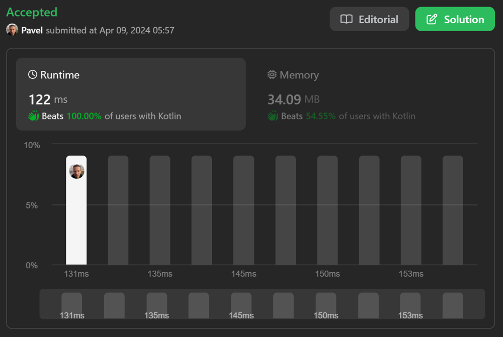

# The Fastest One Pass Code | 122 ms 🚀

**Author:** naXa777
**Votes:** 2
**Link:** [https://leetcode.com/problems/time-needed-to-buy-tickets/solutions/4995980/](https://leetcode.com/problems/time-needed-to-buy-tickets/solutions/4995980/)

---

# Approach

Use a counter variable `time` to accumulate time required to buy tickets.
Use `threshold` to make sure that nobody buys more tickets than the K-th person.

Use two consecutive loops to iterate over the input array `tickets`.

Pure Function: no modifications to the input array or dependency on external state.

# Complexity

- Time complexity: $$O(n)$$ - single pass.
- Space complexity: $$O(1)$$ - constant extra space.

# Code

```kt
class Solution {
    fun timeRequiredToBuy(tickets: IntArray, k: Int): Int {
        var threshold = tickets[k]
        var time = threshold  // start by selling tickets to the K-th person
        var i = 0

        // sell tickets to persons before K
        while (i < k) {
            time += tickets[i++].coerceAtMost(threshold)
        }

        if (threshold > 1) {
            --threshold
            ++i
            // sell tickets to persons after K
            while (i < tickets.size) {
                time += tickets[i++].coerceAtMost(threshold)
            }
        }

        return time
    }
}
```

# Screenshot

best time


