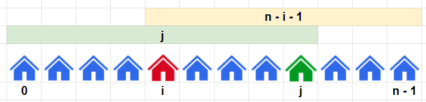

# Constant Space

**Author:** votrubac
**Votes:** 90
**Link:** [https://leetcode.com/problems/two-furthest-houses-with-different-colors/solutions/1589029/](https://leetcode.com/problems/two-furthest-houses-with-different-colors/solutions/1589029/)

---

The maximum distance will always include either first or the last house. This can be proven by a contradiction.

Therefore, we need to return the maximum of two cases: `max(j, n - i - 1)`, where
- `i` is the leftmost position of the color different from the last color.
- `j` is the rightmost position of the color different from the first one.



**C++**
```cpp
int maxDistance(vector<int>& cs) {
    int n = cs.size(), i = 0, j = n - 1;
    while (cs[0] == cs[j])
        --j;
    while (cs[n - 1] == cs[i])
        ++i;
    return max(j, n - i - 1);
}
```
**Java**
```java
public int maxDistance(int[] cs) {
    int n = cs.length, i = 0, j = n - 1;
    while (cs[0] == cs[j])
        --j;
    while (cs[n - 1] == cs[i])
        ++i;
    return Math.max(j, n - i - 1);     
}
```

#### Alternative Solution
We only care about two positions: `0` for the first color, and the first position for some other color (`p`).

It works since we are looking for a maximum distance:
- If color `i` is different than the first one, the maximum distance is `i`.
- If color `i` is the same as the first one, the maximum distance is `i - p`.

**Python 3**
```python
class Solution:
    def maxDistance(self, colors: List[int]) -> int:
        p, res = inf, 0
        for i, c in enumerate(colors):
            if (c != colors[0]):
                res = i
                p = min(p, i)
            else:
                res = max(res, i - p)
        return res
```
**C++**
```cpp
int maxDistance(vector<int>& cs) {
    int p = INT_MAX, res = 1;
    for (int i = 1; i < cs.size(); ++i) {
        if (cs[i] != cs[0])
            p = min(i, p);
        res = max({res, cs[i] == cs[0] ? 0 : i, i - p });
    }
    return res;
}
```
**Java**
```java
public int maxDistance(int[] cs) {
    int p_col2 = Integer.MAX_VALUE, res = 1;
    for (int i = 1; i < cs.length; ++i) {
        if (cs[i] != cs[0]) {
            p_col2 = Math.min(i, p_col2);
            res = i;
        }
        else
            res = Math.max(res, i - p_col2);
    }
    return res;        
}
```