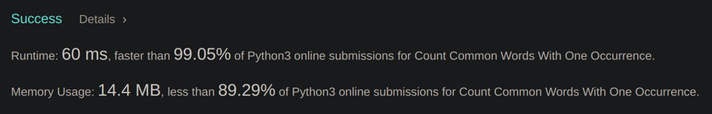

# Python Solution | Faster than 99% | O(n) time complexity

**Author:** xavier-kong
**Votes:** 9
**Link:** [https://leetcode.com/problems/count-common-words-with-one-occurrence/solutions/1856316/](https://leetcode.com/problems/count-common-words-with-one-occurrence/solutions/1856316/)

---



Explanation can be found after full solution code block.
Full Solution:
```
count1 = {}
for i in words1:
	if i in count1:
			count1[i] += 1
	else:
		count1[i] = 1
 ans = 0
 count2 = {}
 for i in words2:
	if i in count2:
		if count2[i] == 'added':
			ans -= 1
			count2[i] = 'processed'
	else:
		if i in count1 and count1[i] == 1:
			count2[i] = 'added'
			ans += 1                  
return ans
```

First we use a dictionary `count1` to get the frequencies of each word in the first word array `words1`.  
```
count1 = {}
for i in words1: # for loop to iterate through each element directly, does not use the value of index 
	if i in count1: # if the word is found in the count i.e already seen earlier
		count1[i] += 1 # increment the count by 1
	else: # if the word is not in count i.e. not seen before
		count1[i] = 1 # set the count of the word to 1
```
Then we initialize our answer variable `ans` and another dictionary `count2` to process the second word array `words2`
```
ans = 0
count2 = {}
```
So under what conditions do we increment our answer?
1. Must occur only once in both `words1` and `words2`
2. Must occur in both `words1` and `words2`

Initially, I considered counting the frequencies of both arrays then seeing if a word with a count of 1 found in `count1` existed in `count2` with a count of 1. While this is also a O(n) solution, we are increasing the run time by having to, in the worst case, iterate through every word again. So I came up with a solution that increments the answer while processing `count2`.

Iterating through `words2`, if we come across a word which we have never seen before, we can initally assume its frequency is 1 and increment our answer by 1. To signify that we have already incremented our answer because of this word, we will set the value of the word in `count2` as "added". 
If you are wondering why we are doing that:

Then if we come across a word that we have seen before, it can either be of two situations:
1. We have seen it before and we have incremented our answer because if it
2. We have seen it before and we have done nothing because of it.

In this case we don't really care about the second case because nothing has happened to our precious answer so we can just ignore any instance of our second case.
What we really care about is the first case, because this ensures that we are only adding words that are of frequency 1 and more importantly we are getting the correct answer. So how do we handle the first case? Remember that we used "added"? If we see that the value of a word in count2 is "added", it means that we have already seen it and have incremented our answer which is our first case. So if we encounter "added" we have to decrement our answer then add another flag to show that we have taken care of it.
```
for i in words2: # for each word in words2 
	if i in count2: # if the word is in count2 i.e we have already seen it before
		if count2[i] == 'added': # if we have already seen the word and added to answer
			ans -= 1 # decrement our lovely answer
			count2[i] = 'processed' # set value of word in dictionary to something other than "added"
	else: # if the word is not in count2 i.e we have not seen it before.
		if i in count1 and count1[i] == 1: # if the word is also found in count1 and if of frequency 1
			count2[i] = 'added' # set value of word in dictionary to "added"
			ans += 1 # increment our lovely answer
```

and of course, remember to return your answer.
```
return ans
```
Time complexity:
We go through `words1` exactly once while building our `count1`. We also go through `words2` exactly once while building our `count2`. 
Let n = length of words1 + length of words2
Therefore time complexity is O(n)

If you found my answer helpful, please upvote and leave a like!


