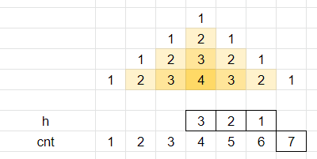

# Stack Pyramids

**Author:** votrubac
**Votes:** 18
**Link:** [https://leetcode.com/problems/count-fertile-pyramids-in-a-land/solutions/1599491/](https://leetcode.com/problems/count-fertile-pyramids-in-a-land/solutions/1599491/)

---

The center of a pyramid with height `h` must be right below the center of a pyramid with height `h - 1` (or greater).



We count consecutive land in a row. For a given count `cnt`, we can potentially have pyramids with `h` from `1` up to `(cnt - 1) / 2`. So, we check the height of pyramids above each potential pyramid (`g[i - 1][j - h]`). If a new pyramid can be formed, we mark its center with `h + 1` - so that we can use it to quickly check pyramids below.

**C++**
```cpp
int count(vector<vector<int>>& g) {
    int m = g.size(), n = g[0].size(), res = 0;
    for (int i = 1; i < m; ++i) {
        for (int j = 0, cnt = 0; j < n; ++j) {
            cnt = g[i][j] + (g[i][j] ? cnt : 0);
            for (int h = 1; cnt > h * 2 && g[i - 1][j - h] >= h; ++h, ++res)
                g[i][j - h] = h + 1;
        }
    }
    return res;
}
int countPyramids(vector<vector<int>>& grid) {
    vector<vector<int>> flip_grid(rbegin(grid), rend(grid));
    return count(grid) + count(flip_grid);
}
```