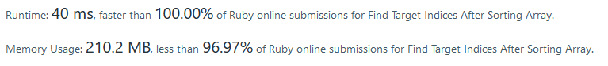

# Ruby Solution

**Author:** jaoeding
**Votes:** 2
**Link:** [https://leetcode.com/problems/find-target-indices-after-sorting-array/solutions/1643646/](https://leetcode.com/problems/find-target-indices-after-sorting-array/solutions/1643646/)

---



```
def target_indices(nums, target)
    less_than_count = 0
    target_count = 0
    nums.each do |n|
        less_than_count += n < target ? 1 : 0
        target_count += n == target ? 1 : 0
    end
    (less_than_count...less_than_count + target_count).to_a
end
```

We don't have to sort the array. We can just do a single pass over the elements keeping track of how many are less than the target and how many times we encounter the target. Then, we can just create a range with `target_count` elements that starts at `less_than_count`.