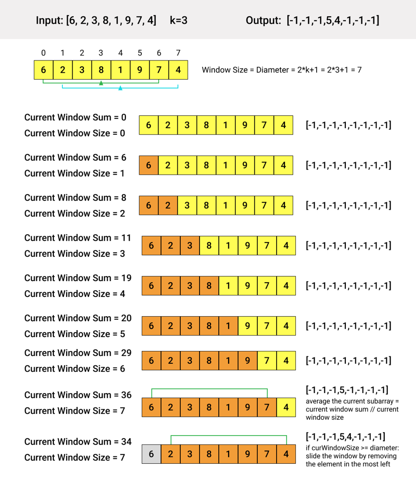

# Python 3 | Sliding Window | Illustration

**Author:** ndus
**Votes:** 76
**Link:** [https://leetcode.com/problems/k-radius-subarray-averages/solutions/1599973/](https://leetcode.com/problems/k-radius-subarray-averages/solutions/1599973/)

---




```python
class Solution:
  def getAverages(self, nums: List[int], k: int) -> List[int]:
    res = [-1]*len(nums)

    left, curWindowSum, diameter = 0, 0, 2*k+1
    for right in range(len(nums)):
      curWindowSum += nums[right]
      if (right-left+1 >= diameter):
        res[left+k] = curWindowSum//diameter
        curWindowSum -= nums[left]
        left += 1
    return res
```

Time complexity: O(n), where `n` is the length of the input array.
Space complexity: O(1)