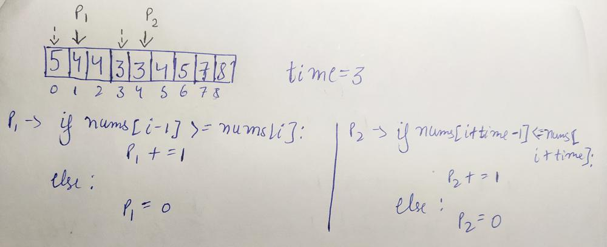

# O(1) - Space Complexity,Two Pointers

**Author:** maninderbachhal25
**Votes:** 18
**Link:** [https://leetcode.com/problems/find-good-days-to-rob-the-bank/solutions/1900530/](https://leetcode.com/problems/find-good-days-to-rob-the-bank/solutions/1900530/)

---

Algorithm:-
1.Place two pointers p1 and p2 at 1 and time steps ahead of p1.
2.check non-increasing and non-decreasing condition for p1 and p2 respectively. If condition is satisfied increment by 1 else reduce to 0.
3.check if p1 and p2 both are greater than equal to time. If True then append the index to result.
nums=[5,4,4,3,3,4,5,7,8]  , time=3

```
class Solution:
    def goodDaysToRobBank(self, nums: List[int], time: int) -> List[int]:  
        n=len(nums)
        if time==0:return range(n)
        res=[]
        p1,p2=0,0
        for i in range(1,n-time):
            p1+=1 if nums[i-1]>=nums[i] else -p1
            p2+=1 if nums[i+time-1]<=nums[i+time] else -p2
            
            if p1>=time and p2>=time:res.append(i)
        return res
```
Time Complexity- O(N)
Space Complexity-O(1)   (Ignoring the space required for result.
