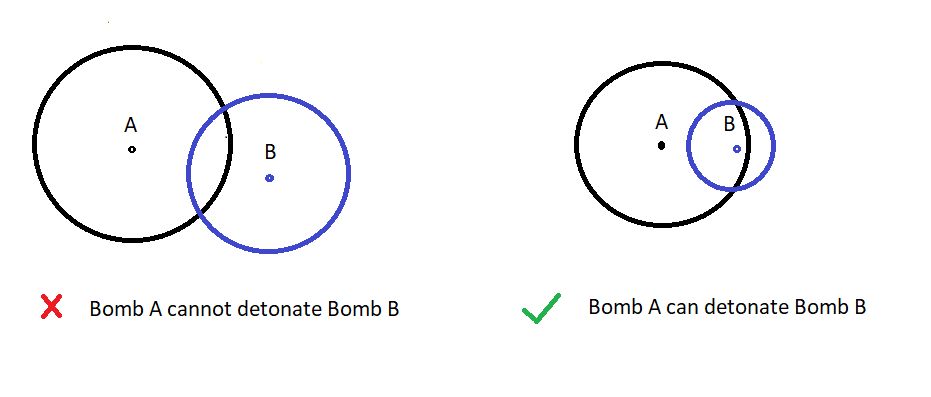
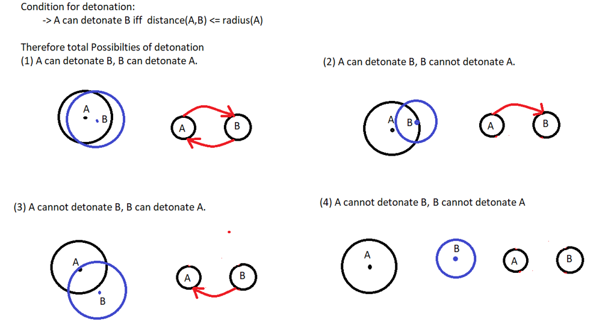
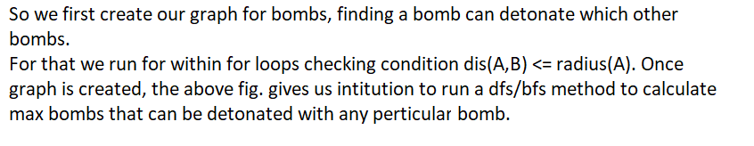
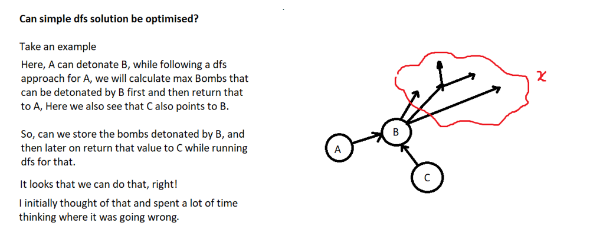
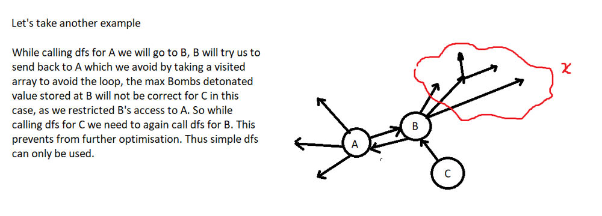

# Intuition Explained | Can simple DFS be further optimized?

**Author:** 27aryanraj
**Votes:** 27
**Link:** [https://leetcode.com/problems/detonate-the-maximum-bombs/solutions/1627189/](https://leetcode.com/problems/detonate-the-maximum-bombs/solutions/1627189/)

---

**NOTE: One Bomb can detonate other if and only if the other bomb lies within the area covered by the Bomb.**







```
class Solution {
public:
    double calcDis(int& x1, int& y1, int& x2, int& y2){
        
        long double dis = sqrtl(1LL * (x1-x2)*(x1-x2) + 1LL * (y1-y2)*(y1-y2));
        
        return dis;
    }
    
    void dfs(int node, vector<int>& visited,int& thisPathBombs, vector<int> canDetonate[]){
        
        visited[node] = 1;
        thisPathBombs++;
        
        for(int i=0;i<canDetonate[node].size();i++){
            
            int cnode = canDetonate[node][i];
            
            if(visited[cnode] == -1){
                dfs(cnode,visited,thisPathBombs,canDetonate);
            }
        }
    }
    
    int maximumDetonation(vector<vector<int>>& bombs) {
        
        int n = bombs.size();
        
        vector<int> canDetonate[n];
        
        int mxBombs = 0;
        
        for(int i=0;i<n;i++){
            for(int j=i+1;j<n;j++){
                double dis = calcDis(bombs[i][0],bombs[i][1],bombs[j][0],bombs[j][1]);
                double d1 = bombs[i][2] * 1.0;
                double d2 = bombs[j][2] * 1.0;
                
                if(dis <= d1){
                    canDetonate[i].push_back(j);
                }
                
                if(dis <= d2){
                    canDetonate[j].push_back(i);
                }
            }
        }
        
        for(int i=0;i<n;i++) {
            int thisPathBombs = 0;
            vector<int> visited(n,-1);
            dfs(i,visited,thisPathBombs,canDetonate);
            mxBombs = max(mxBombs, thisPathBombs);
        }
        
        return mxBombs;
    }
};
```

**Here we are running dfs for every node for multiple times.**






