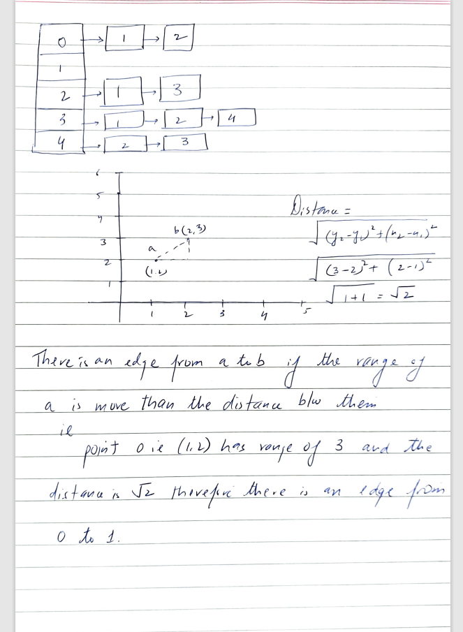
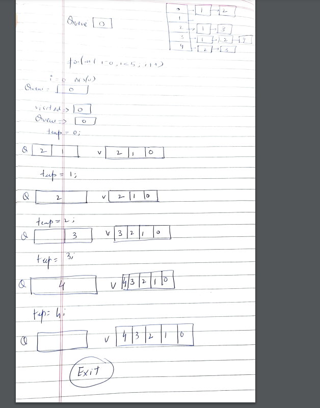

# C# | BFS | Detailed Explanation + Dry Run | Runtime Beats 87.47%

**Author:** anaken
**Votes:** 4
**Link:** [https://leetcode.com/problems/detonate-the-maximum-bombs/solutions/3767553/](https://leetcode.com/problems/detonate-the-maximum-bombs/solutions/3767553/)

---

# Intuition
While reading the problem we get to understand that this is a sort of problem where a relationship needs to be established between bombs so that when one explodes the other one does too. This becomes more clearer by the fact that the range is involved while deciding that. So with this information it becomes clear that it is a graph problem. Most of the graph problems revolve around 4 algorithms, DFS, BFS, Union Find and Topological Sort. Also one problem can be solved by more than one of these algorithms. Since we need to detonate maximum number of bombs by detonating a single bomb so at any given time all the children of a node are coming into the picture and hence BFS is the algorithm we will go with.

# Approach

**Example used - bombs = [[1,2,3],[2,3,1],[3,4,2],[4,5,3],[5,6,4]]**

**Adjacency List Creation**

Our solution starts by building the Adjacency List of the form in the image. This kind of structure can be used to represent both a directed and an undirected graph, the difference being that in undirected we will be adding two edges for each relationship, one for each node involved whereas in directed just one edge is added. In our case we will be using a directed graph since bomb 1 being in the range of bomb 2 does not mean it is true the other way around as the ranges differ for both of them even though the distance remains same.
We will be using the mathematical formula to calculate distance between any two bombs. If the range of the first bomb is greater than the calculated distance, we can assume that bomb 2 will detonate on the detonation of bomb 1 and hence there a directed edge from bomb 1 to bomb 2.
Once our Adjacency list is ready we need a way to find a way to detonate maximum bombs. For this we will be using the breadth first search algorithm to iterate over all nodes in the graph, then run the BFS for each of them since we don't know which bomb will detonate all the bombs. We also maintain the 'maxBombsDetonated' state so that at any point if we detonate all bombs we don't need to iterate further and can exit then and there.




**How BFS works**

Breadth First Search is an algorithm to traverse the nodes of a graph in a breadth wise manner, what it means is instead of going in one direction straight like in DFS, we want to iterate over the current node as well as over all its children before moving onto a new node and its children thereafter, so in this manner we go level by level instead of in one direction depth wise. For BFS algorithm we use Queue data structure since it helps to preserve the order of insertion.
The exist condition for this is generally the queue count becoming zero as no more nodes are left to process. Also another important point is that we need to maintain a 'visited' set inorder to not detonate a bomb again which has already been detonated since there could be a case in which we come back to the node from which we started via some other intermediate node.
In the below image I have shown a dry run for the example.
Here since the first iteration with i = 0 itself detonates all 5 bombs we don't to traverse further and the code exists.



# **If you found my solution and explanation helpful, please consider upvoting it. Your upvote will help rank it higher among other solutions, making it easier for people seeking assistance to find. Feel free to ask any follow-up questions in the comment section. Thank you for reading!**

# Complexity
- Time complexity: O(n^2)
<!-- Add your time complexity here, e.g. $$O(n)$$ -->

- Space complexity: O(n^2)
<!-- Add your space complexity here, e.g. $$O(n)$$ -->

Initializing the adjacency list: O(n)

The code initializes the adjacency list by creating a new list for each vertex. This takes O(n) time, where n is the number of bombs.
Constructing the adjacency list: O(n^2)

The code constructs the adjacency list by checking the distance between each pair of bombs and adding an edge if they are adjacent. This involves nested loops, where the outer loop runs n times and the inner loop also runs n times. Therefore, this step takes O(n^2) time.
BFS traversal: O(n + m)

The code performs a BFS traversal on the adjacency list. The time complexity of BFS is O(V + E), where V is the number of vertices and E is the number of edges. In this case, the number of vertices is n, and the number of edges is the sum of the sizes of all lists in the adjacency list, which can be denoted as m. Therefore, the BFS traversal takes O(n + m) time.
Main loop: O(n * (n + m))

The code iterates over each vertex and performs a BFS traversal on it. Since the BFS traversal takes O(n + m) time, and this is done for each of the n vertices, the overall time complexity of the main loop is O(n * (n + m)).
Overall, the time complexity of the given code is O(n^2 + n + m), which can be simplified to O(n^2 + m) in the worst case.
# Code
```
public class Solution {
    List<int>[] adjacencyList;
    public int MaximumDetonation(int[][] bombs) 
    {
        int n = bombs.Length;
        adjacencyList = new List<int>[n];
        int maxBombsDetonated = 0;

        for(int i = 0 ; i < n ; i++)
        {
            adjacencyList[i] = new List<int>();
        }

        for(int i = 0 ; i < n ; i++)
        {
            for(int j = 0 ; j < n ; j++)
            {
                if(i != j)
                {
                    double dist = Math.Sqrt(Math.Pow((bombs[i][0]-bombs[j][0]),2) + Math.Pow((bombs[i][1] - bombs[j][1]),2));
                    if(bombs[i][2] >= dist)
                    {
                        // bombs are adjacent if the second bomb lies in the range of first, drawing an edge from first to second
                        adjacencyList[i].Add(j);
                    }
                }
            }
        }

        for(int i = 0 ; i < n ; i++)
        {
            maxBombsDetonated = Math.Max(BFS(i),maxBombsDetonated);
            if(maxBombsDetonated == n)
            {
                return n;
            }
        }
        return maxBombsDetonated;          
    }
    public int BFS(int i)
    {
       // Travsering the adjacencyList in BFS manner 
       Queue<int> queue = new Queue<int>();
       HashSet<int> visited = new HashSet<int>();

       queue.Enqueue(i);
       visited.Add(i);

       while(queue.Count != 0)
       {
           int temp = queue.Dequeue();
           foreach(int curr in adjacencyList[temp])
           {
               if(!visited.Contains(curr))
               {
                   queue.Enqueue(curr);
                   visited.Add(curr);
               }
           }
       }
       return visited.Count;
    }
}


```