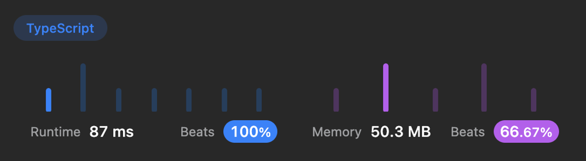
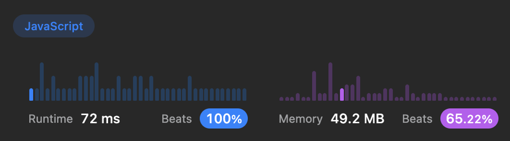
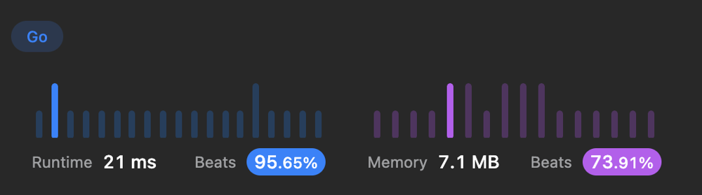

# 🚀 87ms, 100% Beats Runtime. TypeScript, JavaScript, Go

**Author:** ArtMe
**Votes:** 1
**Link:** [https://leetcode.com/problems/detonate-the-maximum-bombs/solutions/3589348/](https://leetcode.com/problems/detonate-the-maximum-bombs/solutions/3589348/)

---

# Code
``` typescript []
function maximumDetonation(bombs: number[][]): number {
    const neighbours: Map<number, number[]> = new Map();
    for (let i = 0; i < bombs.length; i++) {
        const x1 = bombs[i][0];
        const y1 = bombs[i][1];
        const r = bombs[i][2];
        for (let j = 0; j < bombs.length; j++) {
            if (i !== j) {
                const x2 = bombs[j][0];
                const y2 = bombs[j][1];
                if ((x1 - x2) ** 2 + (y1 - y2) ** 2 <= r ** 2) {
                    if (neighbours.has(i)) {
                        neighbours.get(i).push(j);
                        neighbours.set(i, neighbours.get(i))
                    } else {
                        neighbours.set(i, [j]);
                    }
                }
            }
        }
    }
	let max = 0;
	for(let i = 0; i < bombs.length; i++) {
		const visited: Set<number> = new Set();
		const q: number[] = [];
		q.push(i);
		visited.add(i);
		while (q.length) {
            const first = q.shift();
            if (neighbours.has(first)) {
                for (let b of neighbours.get(first)) {
                    if (!visited.has(b)) {
                        visited.add(b);
                        q.push(b);
                    }
                }    
            }
		}
    	if (visited.size === bombs.length) {
            return visited.size;
        }
		max = Math.max(max, visited.size);
	}
	return max;
};
```
``` javascript []
var maximumDetonation = function(bombs) {
    const neighbours = new Map();
    for (let i = 0; i < bombs.length; i++) {
        const x1 = bombs[i][0];
        const y1 = bombs[i][1];
        const r = bombs[i][2];
        for (let j = 0; j < bombs.length; j++) {
            if (i !== j) {
                const x2 = bombs[j][0];
                const y2 = bombs[j][1];
                if ((x1 - x2) ** 2 + (y1 - y2) ** 2 <= r ** 2) {
                    if (neighbours.has(i)) {
                        neighbours.get(i).push(j);
                        neighbours.set(i, neighbours.get(i))
                    } else {
                        neighbours.set(i, [j]);
                    }
                }
            }
        }
    }
	let max = 0;
	for(let i = 0; i < bombs.length; i++) {
		const visited = new Set();
		const q = [];
		q.push(i);
		visited.add(i);
		while (q.length) {
            const first = q.shift();
            if (neighbours.has(first)) {
                for (let b of neighbours.get(first)) {
                    if (!visited.has(b)) {
                        visited.add(b);
                        q.push(b);
                    }
                }    
            }
		}
    	if (visited.size === bombs.length) {
            return visited.size;
        }
		max = Math.max(max, visited.size);
	}
	return max;
};
```
``` golang []
func maximumDetonation(bombs [][]int) int {
    neighbours := make(map[int][]int)
    for i := 0; i < len(bombs); i++ {
        x1 := bombs[i][0]
        y1 := bombs[i][1]
        r := bombs[i][2]
        for j := 0; j < len(bombs); j++ {
            if i != j {
                x2 := bombs[j][0]
                y2 := bombs[j][1]
                if (x1-x2)*(x1-x2)+(y1-y2)*(y1-y2) <= r*r {
                    neighbours[i] = append(neighbours[i], j)
                }
            }
        }
    }
    max := 0
    for i := 0; i < len(bombs); i++ {
        visited := make(map[int]bool)
        q := []int{i}
        visited[i] = true
        for len(q) > 0 {
            first := q[0]
            q = q[1:]
            if val, ok := neighbours[first]; ok {
                for _, b := range val {
                    if !visited[b] {
                        visited[b] = true
                        q = append(q, b)
                    }
                }
            }
        }
        if len(visited) == len(bombs) {
            return len(visited)
        }
        l := len(visited)
        if l > max {
            max = l
        }
    }
    return max
}
```




