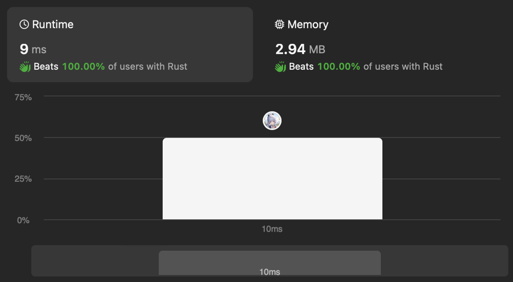

# [Rust] First thought

**Author:** discreaminant2809
**Votes:** 0
**Link:** [https://leetcode.com/problems/number-of-smooth-descent-periods-of-a-stock/solutions/4723263/](https://leetcode.com/problems/number-of-smooth-descent-periods-of-a-stock/solutions/4723263/)

---



# Complexity
- Time complexity:
$$O(n)$$

- Space complexity:
$$O(1)$$

# Code
```rust
impl Solution {
    pub fn get_descent_periods(prices: Vec<i32>) -> i64 {
        let mut prices = prices.into_iter();
        let first_price = prices.next().unwrap();
        prices
            .scan((first_price, 1), |(prev_price, streak), price| {
                if *prev_price - price == 1 {
                    *streak += 1
                } else {
                    *streak = 1;
                }

                *prev_price = price;

                Some(*streak as i64)
            })
            .sum::<i64>()
            + 1
    }
}
```