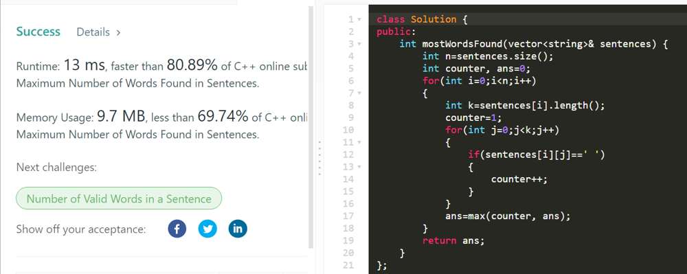

# C++ Very Easy To Understand [Faster Than 80%]

**Author:** gyt4x8ue7w6tf4y
**Votes:** 38
**Link:** [https://leetcode.com/problems/maximum-number-of-words-found-in-sentences/solutions/1656664/](https://leetcode.com/problems/maximum-number-of-words-found-in-sentences/solutions/1656664/)

---

```
class Solution {
public:
    int mostWordsFound(vector<string>& sentences) {
        int n=sentences.size();
        int counter, ans=0;
        for(int i=0;i<n;i++)
        {
            int k=sentences[i].length();
            counter=1;
            for(int j=0;j<k;j++)
            {
                if(sentences[i][j]==' ')
                {
                    counter++;
                }
            }
            ans=max(counter, ans);
        }
        return ans;
    }
};
```
**PLEASE UPVOTE IF YOU LIKE IT!**


