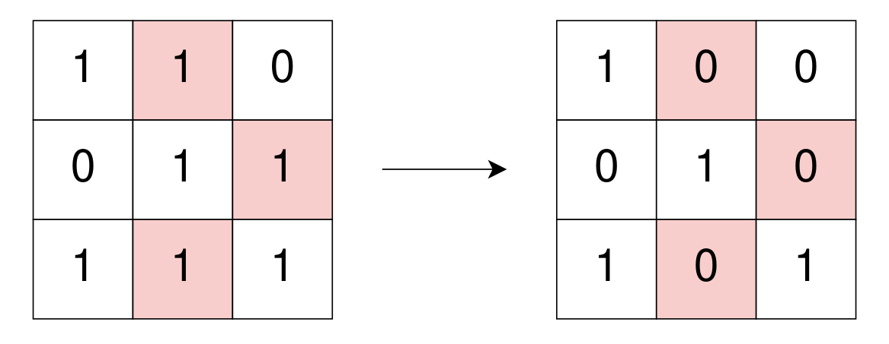
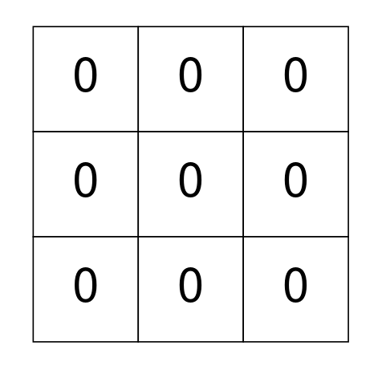
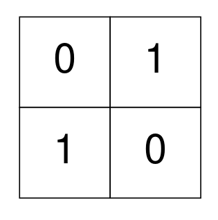

# [2123. Minimum Operations to Remove Adjacent Ones in Matrix](https://leetcode.com/problems/minimum-operations-to-remove-adjacent-ones-in-matrix/)

| Category | Difficulty | Likes | Dislikes |
| :------: | :--------: | :---: | :------: |
| Algorithms | Hard | 54 | 13 |

**Tags:** [`array`](https://leetcode.com/tag/array), [`graph`](https://leetcode.com/tag/graph), [`matrix`](https://leetcode.com/tag/matrix)

**Companies:** `amazon`

## Description

You are given a **0-indexed** binary matrix `grid`. In one operation, you can flip any `1` in `grid` to be `0`.

A binary matrix is **well-isolated** if there is no `1` in the matrix that is **4-directionally connected** (i.e., horizontal and vertical) to another `1`.

Return *the minimum number of operations to make *`grid`* **well-isolated***.

 

**Example 1:**


```

Input: grid = [[1,1,0],[0,1,1],[1,1,1]]
Output: 3
Explanation: Use 3 operations to change grid[0][1], grid[1][2], and grid[2][1] to 0.
After, no more 1&#39;s are 4-directionally connected and grid is well-isolated.

```

**Example 2:**


```

Input: grid = [[0,0,0],[0,0,0],[0,0,0]]
Output: 0
Explanation: There are no 1&#39;s in grid and it is well-isolated.
No operations were done so return 0.

```

**Example 3:**


```

Input: grid = [[0,1],[1,0]]
Output: 0
Explanation: None of the 1&#39;s are 4-directionally connected and grid is well-isolated.
No operations were done so return 0.

```

 

**Constraints:**

	- `m == grid.length`

	- `n == grid[i].length`

	- `1 <= m, n <= 300`

	- `grid[i][j]` is either `0` or `1`.

---

**Links:** [Submissions](https://leetcode.com/problems/minimum-operations-to-remove-adjacent-ones-in-matrix/) | [Solutions](https://leetcode.com/problems/minimum-operations-to-remove-adjacent-ones-in-matrix/)
