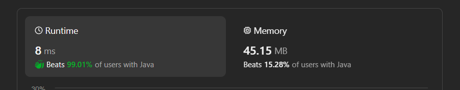

# ✅Beats 99.01% - Explained with [ Video ] - C++/Java/Python/JS - Iterate and Count

**Author:** lancertech6
**Votes:** 107
**Link:** [https://leetcode.com/problems/number-of-laser-beams-in-a-bank/solutions/4495099/](https://leetcode.com/problems/number-of-laser-beams-in-a-bank/solutions/4495099/)

---



# YouTube Video Explanation:

<!-- **If you want a video for this question please write in the comments** -->

<!-- https://www.youtube.com/watch?v=ujU-jeO1v-k -->
https://youtu.be/WIAeWzSG1ts

**\uD83D\uDD25 Please like, share, and subscribe to support our channel's mission of making complex concepts easy to understand.**

Subscribe Link: https://www.youtube.com/@leetlogics/?sub_confirmation=1

*Subscribe Goal: 1200 Subscribers*
*Current Subscribers: 1105*

---


# Intuition
The problem involves counting the number of laser beams that can be formed between pairs of security devices in the bank. A laser beam is possible between two devices if there are no security devices in the rows between them.
<!-- Describe your first thoughts on how to solve this problem. -->

# Approach
<!-- Describe your approach to solving the problem. -->
1. Iterate through each row of the bank and calculate the number of security devices in that row (`curRowCount`).
2. For each non-empty row, calculate the number of laser beams that can be formed between devices in the current row and devices in the previous row (`prevRowCount`).
3. Update the total count of laser beams.
4. Return the total count.

# Complexity
- Time complexity: O(m * n), where m is the number of rows and n is the number of columns in the bank. The solution iterates through each row and calculates the count of security devices in that row.
<!-- Add your time complexity here, e.g. $$O(n)$$ -->

- Space complexity: O(1), as the space used is constant, and no additional data structures are used.
<!-- Add your space complexity here, e.g. $$O(n)$$ -->

# Code
```java []
class Solution {
    public int numberOfBeams(String[] bank) {
        int prevRowCount = 0;
        int total=0;

        for(String row : bank) {
            int curRowCount = calc(row);
            if(curRowCount==0) 
                continue;

            total += curRowCount * prevRowCount;
            prevRowCount = curRowCount;
        }
        return total;
    }

    private int calc(String s) {
        int count = 0;
        for(char c : s.toCharArray()) 
            count += c - '0';

        return count;
    }    
}
```
```C++ []
class Solution {
public:
    int numberOfBeams(std::vector<std::string>& bank) {
        int prevRowCount = 0;
        int total = 0;

        for (const std::string& row : bank) {
            int curRowCount = calc(row);
            if (curRowCount == 0)
                continue;

            total += curRowCount * prevRowCount;
            prevRowCount = curRowCount;
        }
        return total;
    }

private:
    int calc(const std::string& s) {
        int count = 0;
        for (char c : s)
            count += c - '0';

        return count;
    }
};
```
```Python []
class Solution(object):
    def numberOfBeams(self, bank):
        prev_row_count = 0
        total = 0

        for row in bank:
            cur_row_count = self.calc(row)
            if cur_row_count == 0:
                continue

            total += cur_row_count * prev_row_count
            prev_row_count = cur_row_count

        return total

    def calc(self, s):
        return sum(int(c) for c in s)
        
```
```JavaScript []
/**
 * @param {string[]} bank
 * @return {number}
 */
var numberOfBeams = function(bank) {
    let prevRowCount = 0;
    let total = 0;

    const calc = (s) => {
        return s.split('').reduce((count, c) => count + parseInt(c), 0);
    };

    for (const row of bank) {
        const curRowCount = calc(row);
        if (curRowCount === 0)
            continue;

        total += curRowCount * prevRowCount;
        prevRowCount = curRowCount;
    }
    return total;
};
```

