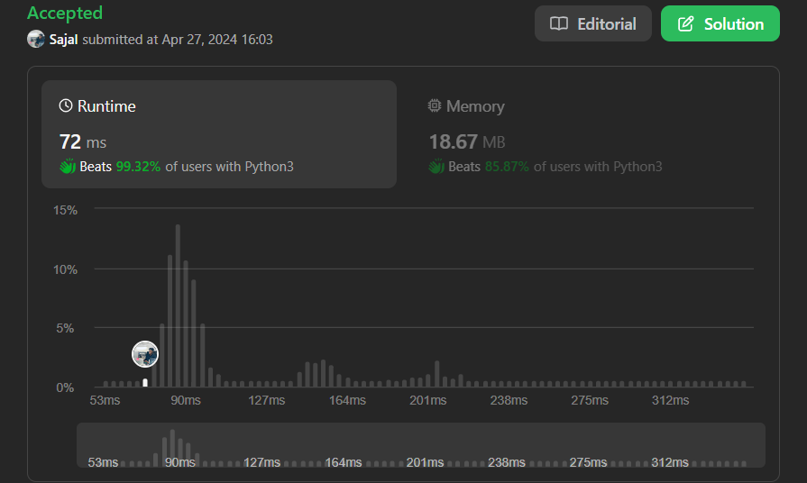

# with one loop (beats 99%) readable answer

**Author:** Sajal_
**Votes:** 0
**Link:** [https://leetcode.com/problems/number-of-laser-beams-in-a-bank/solutions/5079087/](https://leetcode.com/problems/number-of-laser-beams-in-a-bank/solutions/5079087/)

---



# Code
```
class Solution:
    def numberOfBeams(self, bank: List[str]) -> int:
        res = 0
        prev = 0
        cur = 0
        for row in bank:
            cur = row.count('1')
            if prev :
                res = res + cur * prev
            if cur:
                prev = cur

        return res
```