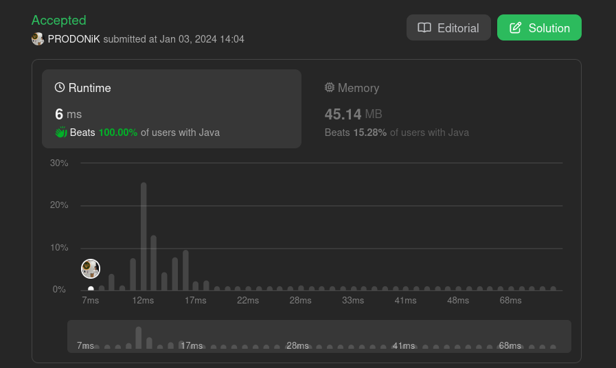

# 🚀🚀🚀 BEATS 100% CODERS 🚀🚀🚀 by PRODONiK (Java, C++, Python, C#, Ruby, GO)

**Author:** prodonik
**Votes:** 3
**Link:** [https://leetcode.com/problems/number-of-laser-beams-in-a-bank/solutions/4497454/](https://leetcode.com/problems/number-of-laser-beams-in-a-bank/solutions/4497454/)

---



# Intuition
The problem involves counting the number of beams in a bank represented as a 2D array of strings. A beam is defined as a continuous sequence of '1's in a row. The intuition is to iterate through each row, count the number of '1's in each row, and accumulate the result by multiplying the count of '1's in the current row with the count of '1's in the next row where '1's are present.

# Approach
The approach involves iterating through each row of the bank, counting the number of '1's in each row using the `countOfOnes` function. The count of '1's in the current row is multiplied by the count of '1's in the next row where '1's are present, and the result is accumulated. The function returns the total count of beams in the bank.

# Complexity
- Time complexity: $$O(m \\cdot n)$$, where $$m$$ is the number of rows and $$n$$ is the number of columns in the bank. The function iterates through each row and counts the '1's.
- Space complexity: $$O(1)$$, as the algorithm uses a constant amount of additional space.

The time complexity is influenced by the iteration through each row, and the space complexity is constant since the algorithm does not use any additional data structures.


# Code
```Java []
class Solution {
    public int numberOfBeams(String[] bank) {
        int current = countOfOnes(bank[0], 0), next = 0, result = 0;

        for (int i = 1; i < bank.length; i ++) {
            next = countOfOnes(bank[i], 0);
            if (next != 0) {
                result += current * next;
                current = next;
            }
        }
        return result;
    }
    private int countOfOnes (String row, int result) {
        for (int i = 0; i < row.length(); i ++) {
            result += row.charAt(i) - '0';
        }
        return result;
    }
}
```
```C++ []
class Solution {
public:
    int numberOfBeams(std::vector<std::string>& bank) {
        int current = countOfOnes(bank[0], 0), next = 0, result = 0;

        for (int i = 1; i < bank.size(); i++) {
            next = countOfOnes(bank[i], 0);
            if (next != 0) {
                result += current * next;
                current = next;
            }
        }
        return result;
    }

private:
    int countOfOnes(const std::string& row, int result) {
        for (char ch : row) {
            result += ch - '0';
        }
        return result;
    }
};
```
```Python []
class Solution:
    def numberOfBeams(self, bank):
        current = self.count_of_ones(bank[0], 0)
        next_count = 0
        result = 0

        for i in range(1, len(bank)):
            next_count = self.count_of_ones(bank[i], 0)
            if next_count != 0:
                result += current * next_count
                current = next_count

        return result

    def count_of_ones(self, row, result):
        for ch in row:
            result += int(ch)
        return result
```
```Ruby []
func numberOfBeams(bank []string) int {
    current := countOfOnes(bank[0], 0)
    var nextCount, result int

    for i := 1; i < len(bank); i++ {
        nextCount = countOfOnes(bank[i], 0)
        if nextCount != 0 {
            result += current * nextCount
            current = nextCount
        }
    }

    return result
}

func countOfOnes(row string, result int) int {
    for _, ch := range row {
        result += int(ch - '0')
    }
    return result
}

func main() {
    bank := []string{"110", "001", "010"}
    result := numberOfBeams(bank)
    fmt.Println(result)
}
```
```Go []
class Solution
  def number_of_beams(bank)
    current = count_of_ones(bank[0], 0)
    next_count = 0
    result = 0

    (1...bank.length).each do |i|
      next_count = count_of_ones(bank[i], 0)
      result += current * next_count if next_count != 0
      current = next_count
    end

    result
  end

  private

  def count_of_ones(row, result)
    row.each_char { |ch| result += ch.to_i }
    result
  end
end

```
```C# []
public class Solution
{
    public int NumberOfBeams(string[] bank)
    {
        int current = CountOfOnes(bank[0], 0);
        int nextCount = 0;
        int result = 0;

        for (int i = 1; i < bank.Length; i++)
        {
            nextCount = CountOfOnes(bank[i], 0);
            if (nextCount != 0)
            {
                result += current * nextCount;
                current = nextCount;
            }
        }

        return result;
    }

    private int CountOfOnes(string row, int result)
    {
        foreach (char ch in row)
        {
            result += ch - '0';
        }
        return result;
    }
}
```

