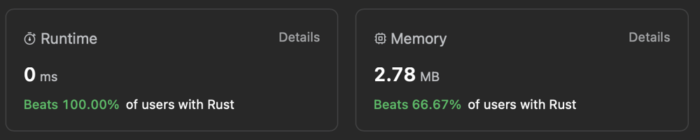

# [Rust] Average one-liner enjoyer

**Author:** discreaminant2809
**Votes:** 3
**Link:** [https://leetcode.com/problems/number-of-laser-beams-in-a-bank/solutions/4497048/](https://leetcode.com/problems/number-of-laser-beams-in-a-bank/solutions/4497048/)

---



# Complexity
- Time complexity:
$$O(m \	imes n)$$

- Space complexity:
$$O(1)$$

# Code
```
impl Solution {
    pub fn number_of_beams(bank: Vec<String>) -> i32 {
        bank.into_iter()
            .filter_map(|line| {
                NonZeroI32::new(line.bytes().filter(|&byte| byte == b'1').count() as i32)
            })
            .fold((0, 0), |(res, prev), line| {
                (res + prev * line.get(), line.get())
            })
            .0
    }
}

use std::num::NonZeroI32;
```