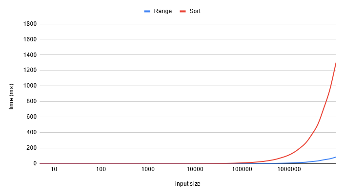
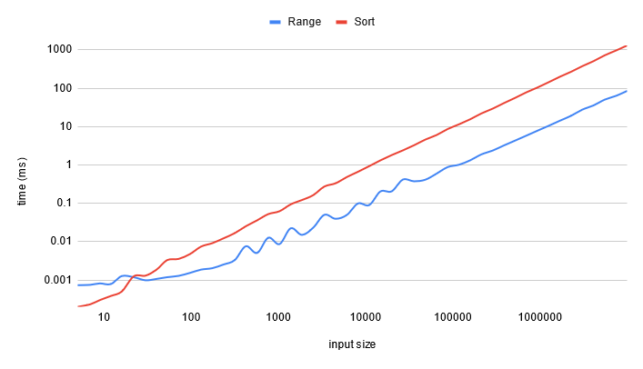

# O(n) original algorithm || 10x faster than using sort || Beats 100% in Rust

**Author:** juncture353
**Votes:** 2
**Link:** [https://leetcode.com/problems/destroying-asteroids/solutions/4867037/](https://leetcode.com/problems/destroying-asteroids/solutions/4867037/)

---

# Intuition

For an asteroid to combine, it has to be smaller than the planet, hence, your new planet mass will at least be 2 * asteroid.
Using this fact, you can create groups of asteroids in a way that if the smallest is combined, all the others will follow. And you can represent these groups by an interval.

# Approach

The start of the interval is the smallest asteroid and the end of it is the smallest reachable weight, which equals to the smallest asteroid + the sum of all the asteroids of the group.
Since a group cover at least a power of two (the smallest range is (x, 2 * x)), there are a maximum of log2(max_reachable_weight) ranges; which we can consider O(1).
And as adding a new asteroids and checking at the end if the planet will collect all the asteroids is O(1), in the end we reach O(n) complexity.

I also naively tried binary_search to find the first larger interval but there were too few intervals to make it worthwhile. 

I did some benchmarks, I rarely reached more than 5 ranges at the same times on random inputs (vec of length (0..10_000_000) containing i32 in (0..2^31 - 1)). It would be interesting to explore the behavior on more input variety. In average, this version was 10 times faster than the version using sort.




Here is the log log graph:

We can see an average 10x performance difference on randomized inputs when the input size is greater than 100 - 1000 elements.

# Complexity
- Time complexity: $$O(n)$$

- Space complexity: $$O(n)$$

# Code
```
impl Solution {
    pub fn asteroids_destroyed(mass: i32, mut asteroids: Vec<i32>) -> bool {
        let mut ranges = Vec::with_capacity(100);
        let mut last_ranges = Vec::with_capacity(100);
        last_ranges.push((0, mass as u64));
        for asteroid in asteroids.into_iter().map(|x| x as u64) {
            // let first_greater = last_ranges.iter().position(|&(_, high)| asteroid <= high);
            let mut first_greater = None;
            for (curr_idx, &(low, high)) in last_ranges.iter().enumerate() {
                if asteroid <= high {
                    first_greater = Some(curr_idx);
                    break;
                }
                ranges.push((low, high));
            }

            if let Some(idx) = first_greater {
                let fold_result = last_ranges[idx..].iter().enumerate().try_fold(
                    (asteroid, 2 * asteroid),
                    |(curr_low, curr_high), (idx, &(low, high))| {
                        if low <= curr_low && curr_low <= high {
                            Ok((low, curr_high - curr_low + high))
                        } else if low <= curr_high && curr_high <= high {
                            Ok((curr_low, high - low + curr_high))
                        } else {
                            Err((idx, (curr_low, curr_high)))
                        }
                    },
                );
                match fold_result {
                    Ok(range) => ranges.push(range),
                    Err((offset, range)) => {
                        ranges.push(range);
                        ranges.extend(&last_ranges[idx + offset..]);
                    }
                }
            } else {
                ranges.push((asteroid, 2 * asteroid));
            }
            last_ranges.clear();
            std::mem::swap(&mut ranges, &mut last_ranges);
        }
        last_ranges.len() == 1
    }
}
        
```

-----------

Same for C++, it is a direct translation. Please, feel free to give advice on the C++ version, I have very little experience.

```

class Solution {
public:
    bool asteroidsDestroyed(int mass, std::vector<int>& asteroids) {
        std::vector<std::pair<unsigned long long, unsigned long long>> ranges;
        std::vector<std::pair<unsigned long long, unsigned long long>> last_ranges;
        last_ranges.push_back(std::make_pair(0, static_cast<unsigned long long>(mass)));
        for (auto asteroid : asteroids) {
            unsigned long long asteroid_ull = static_cast<unsigned long long>(asteroid);
            int i;
            for (i = 0; i < last_ranges.size(); i++) {
                auto range = last_ranges[i];
                if (asteroid_ull <= range.second) {
                    break;
                }
                ranges.push_back(range);
            }
            if (i < last_ranges.size()) {
                std::pair<unsigned long long, unsigned long long> fold_result = std::make_pair(asteroid_ull, 2 * asteroid_ull);
                for (; i < last_ranges.size(); i++) {
                    auto range = last_ranges[i];
                    if (range.first <= fold_result.first && fold_result.first <= range.second) {
                        fold_result = std::make_pair(range.first, fold_result.second - fold_result.first + range.second);
                    } else if (range.first <= fold_result.second && fold_result.second <= range.second) {
                        fold_result = std::make_pair(fold_result.first, range.second - range.first + fold_result.second);
                    } else {
                        break;
                    }
                }
                ranges.push_back(fold_result);

                for (; i < last_ranges.size(); i++) {
                    ranges.push_back(last_ranges[i]);
                }

            } else {
                ranges.push_back(std::make_pair(asteroid_ull, 2 * asteroid_ull));
            }
            last_ranges.clear();
            std::swap(ranges, last_ranges);
        }
        return last_ranges.size() == 1;
    }
};
```