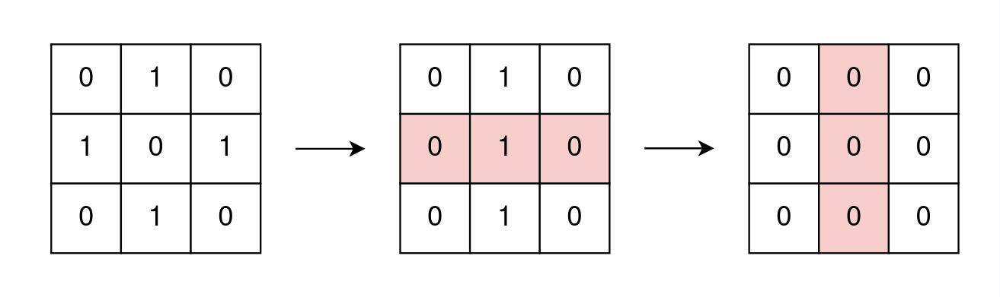
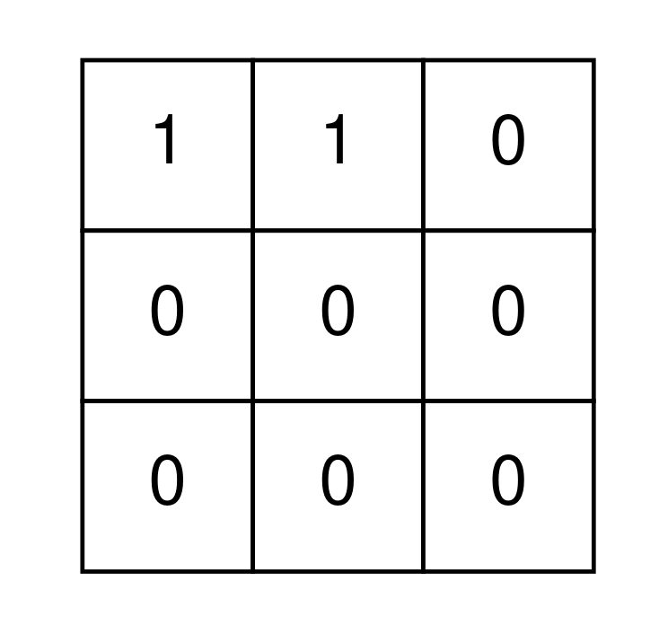
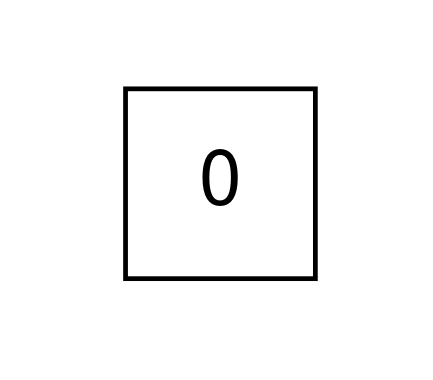

# [2128. Remove All Ones With Row and Column Flips](https://leetcode.com/problems/remove-all-ones-with-row-and-column-flips/)

| Category | Difficulty | Likes | Dislikes |
| :------: | :--------: | :---: | :------: |
| Algorithms | Medium | 481 | 188 |

**Tags:** [`array`](https://leetcode.com/tag/array), [`math`](https://leetcode.com/tag/math), [`bit-manipulation`](https://leetcode.com/tag/bit-manipulation), [`matrix`](https://leetcode.com/tag/matrix)

**Companies:** `google`

## Description

You are given an `m x n` binary matrix `grid`.

In one operation, you can choose **any** row or column and flip each value in that row or column (i.e., changing all `0`'s to `1`'s, and all `1`'s to `0`'s).

Return `true`* if it is possible to remove all *`1`*'s from *`grid` using **any** number of operations or `false` otherwise.

 

**Example 1:**


```

Input: grid = [[0,1,0],[1,0,1],[0,1,0]]
Output: true
Explanation: One possible way to remove all 1&#39;s from grid is to:
- Flip the middle row
- Flip the middle column

```

**Example 2:**


```

Input: grid = [[1,1,0],[0,0,0],[0,0,0]]
Output: false
Explanation: It is impossible to remove all 1&#39;s from grid.

```

**Example 3:**


```

Input: grid = [[0]]
Output: true
Explanation: There are no 1&#39;s in grid.

```

 

**Constraints:**

	- `m == grid.length`

	- `n == grid[i].length`

	- `1 <= m, n <= 300`

	- `grid[i][j]` is either `0` or `1`.

---

**Links:** [Submissions](https://leetcode.com/problems/remove-all-ones-with-row-and-column-flips/) | [Solutions](https://leetcode.com/problems/remove-all-ones-with-row-and-column-flips/)
