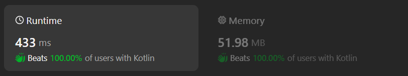

# Kotlin O(n) time solution with 2D array

**Author:** chayangkoon
**Votes:** 0
**Link:** [https://leetcode.com/problems/longest-palindrome-by-concatenating-two-letter-words/solutions/4932106/](https://leetcode.com/problems/longest-palindrome-by-concatenating-two-letter-words/solutions/4932106/)

---



# Complexity
- Time complexity:
O(n)

- Space complexity:
O(alphabet size^2) or O(1)

# Code
```
class Solution {
    fun longestPalindrome(words: Array<String>): Int {
        var frequencyArray = Array(26) { IntArray(26) }

        for(word in words) {
            frequencyArray[word[0] - 'a'][word[1] - 'a']++
        }

        var palindromCount = 0
        var useRepeatedCharsForMiddle = false
        for(word in words) {
            var leftFreq = frequencyArray[word[0] - 'a'][word[1] - 'a']
            val rightFreq = frequencyArray[word[1] - 'a'][word[0] - 'a']

            if(leftFreq > 0 && rightFreq > 0) {
                var freq = min(leftFreq, rightFreq)
                if(word[0] == word[1]) {
                    if(freq % 2 != 0 && !useRepeatedCharsForMiddle) {
                        useRepeatedCharsForMiddle = true
                        freq--
                        palindromCount += 2
                    }
                    palindromCount += (freq / 2) * 4
                } else {
                    palindromCount += freq * 4
                }
                frequencyArray[word[1] - 'a'][word[0] - 'a'] = 0
            }
        }
        return palindromCount

    }
}
```