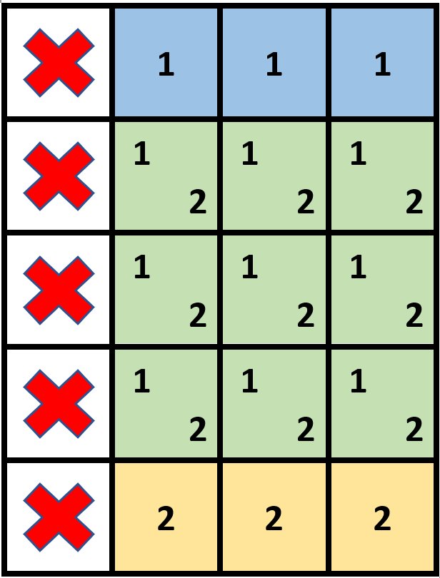
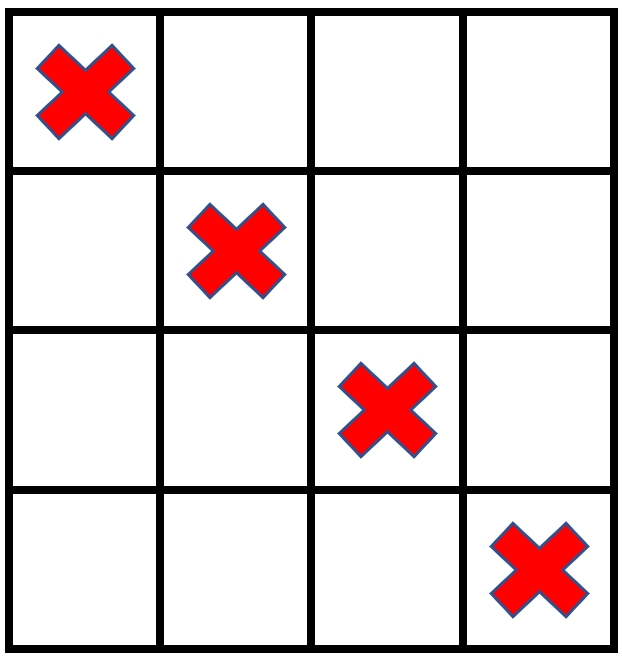

# [2132. Stamping the Grid](https://leetcode.com/problems/stamping-the-grid/)

| Category | Difficulty | Likes | Dislikes |
| :------: | :--------: | :---: | :------: |
| Algorithms | Hard | 414 | 47 |

**Tags:** [`array`](https://leetcode.com/tag/array), [`greedy`](https://leetcode.com/tag/greedy), [`matrix`](https://leetcode.com/tag/matrix), [`prefix-sum`](https://leetcode.com/tag/prefix-sum)

**Companies:** `rubrik`

## Description

You are given an `m x n` binary matrix `grid` where each cell is either `0` (empty) or `1` (occupied).

You are then given stamps of size `stampHeight x stampWidth`. We want to fit the stamps such that they follow the given **restrictions** and **requirements**:

	- Cover all the **empty** cells.

	- Do not cover any of the **occupied** cells.

	- We can put as **many** stamps as we want.

	- Stamps can **overlap** with each other.

	- Stamps are not allowed to be **rotated**.

	- Stamps must stay completely **inside** the grid.

Return `true` *if it is possible to fit the stamps while following the given restrictions and requirements. Otherwise, return* `false`.

 

**Example 1:**


```

Input: grid = [[1,0,0,0],[1,0,0,0],[1,0,0,0],[1,0,0,0],[1,0,0,0]], stampHeight = 4, stampWidth = 3
Output: true
Explanation: We have two overlapping stamps (labeled 1 and 2 in the image) that are able to cover all the empty cells.

```

**Example 2:**


```

Input: grid = [[1,0,0,0],[0,1,0,0],[0,0,1,0],[0,0,0,1]], stampHeight = 2, stampWidth = 2 
Output: false 
Explanation: There is no way to fit the stamps onto all the empty cells without the stamps going outside the grid.

```

 

**Constraints:**

	- `m == grid.length`

	- `n == grid[r].length`

	- `1 <= m, n <= 10^5`

	- `1 <= m * n <= 2 * 10^5`

	- `grid[r][c]` is either `0` or `1`.

	- `1 <= stampHeight, stampWidth <= 10^5`

---

**Links:** [Submissions](https://leetcode.com/problems/stamping-the-grid/) | [Solutions](https://leetcode.com/problems/stamping-the-grid/)
